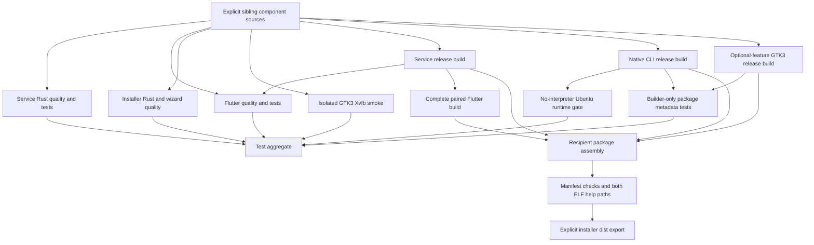

# Text-product development pipeline

**Implemented source.** Make shortcuts → Dagger → component scripts/tools build and validate the Flutter client, Rust service and native Rust installer. Native component commands remain usable independently. Source-bound execution and historical limits are recorded in [validation results](../VALIDATION.md).

| Function | Component responsibility | Output |
|---|---|---|
| `test-service` | Formatting, warning-denied Clippy, locked tests | Successful completion or error |
| `test-client` | Formatting, analyzer, widget/negative tests, compiled Rust↔Dart socket fixture | Successful completion or error |
| `test-installer` | Native/wizard formatting/Clippy/locked tests on Ubuntu 24.04 plus CLI runtime and isolated UI gates | Successful completion or error |
| `test-installer-ui` | GUI-feature formatting/Clippy and isolated Xvfb GTK widget/session smoke on Ubuntu 24.04 UID/GID 1000 | Successful completion or error |
| `test-native-runtime` | Direct release ELF help/version/service-only dry-run without Python/build tools or usable PATH; assert no destination writes | Successful completion or error |
| `test-package` | Builder-only metadata/payload-policy tests with actual CLI/GUI ELFs, CLI dry-run and no-display GUI help/preflight | Successful completion or error |
| `test` | Run component and package suites concurrently | Passing aggregate only if all pass |
| `build-service` | Locked release build | File artifact |
| `build-client` | Linux release build and safely copied compatible service | Paired bundle directory artifact |
| `build-installer-binary` | Default locked CLI release, no GTK/display or Flutter build | Native CLI ELF |
| `build-installer-ui` | Locked optional `gui` feature with GTK3 development libraries | Native GUI ELF |
| `build-installer` | Both installer ELFs, complete client, identical service and metadata; preserve text-only payload exclusions | Full recipient package |

Run from the repository root with the official CLI/module **v0.21.9**, selecting the module explicitly: `dagger --mod dagger call test --service service --client client --installer installer --tooling dagger`, or `make test`. Make supplies `--mod dagger`; a reviewed `DAGGER` executable override is supported. The module's `dagger.json` configures `engineVersion`; root `dagger.toml`/`dagger.lock` are retained compatibility files, not evidence that the official CLI enforces their image pins.

Build functions do not implicitly assert tests passed. Exports are development outputs, not approved releases. A release gate must bind passing evidence to exact source/artifacts before publication. Rust1.98 is configured; declared installer MSRV1.83 has no implied compile evidence. Builders are not digest-pinned/cache-hermetic.

Native intermediates live in `service/target/`, `installer/target/` and `client/build/`. Explicit exports go to component `dist/`; the component-install CLI goes to `installer/build/smith-installer`; `make installer/ui` exports `installer/build/smith-installer-ui` only. Full package export remains `installer/dist/`, with both installer ELFs and payloads. Make artifact-install targets invoke that native ELF's explicit `--artifacts-only` mode after Dagger exports, without registration/start/model effects. The CLI's default recipient mode owns separately consented lifecycle/model provisioning. The GUI offers explicit Install/Upgrade or Uninstall, then model setup/service-backed checks and optional Providers management. Registration/reload, login Enable, Start, model download/preference/inference and provider save/validation retain separate confirmations. Successful verified Install/Upgrade offers an explicit Launch Smith action; nothing launches automatically. The app itself gives external repair guidance rather than launching an installer. See the retained [recipient guide](INSTALLER.md) for the current flow. Dagger/package Python is builder-only and no interpreter entrypoint is shipped.

`make installer/ui-test` exposes the isolated UI gate; its results and scoped review are pending, not inferred from these functions. GUI help/version avoids GTK initialization/display discovery but still requires GTK shared libraries; the CLI's no-Python/no-GTK/no-display gate is unchanged. The native migration's final integrated assurance was cancelled, not a PASS. For separate operator QA from the repository root, build the full package if needed, then run `./installer/dist/smith-installer-ui`.

Voice and former Python installer sources are retired from the active tree and retained through [Git-backed history](../docs/HISTORY.md), outside all explicit inputs. No provider server is started, model downloaded, host-home/manager/provider mounted or installed unit changed by the test/build pipeline. Container/fake tests and the no-interpreter gate do not establish real graphical behavior, full clean-host installation, provider/GPU compatibility, external daemon cancellation or live host cleanup. Installed-host upgrades and publication remain separately approved gates. Configured tagged candidate preparation is described in the [installer pipeline plan](../docs/plans/LOCAL-SMITH-INSTALLER-PIPELINE.md); CI configuration alone is not execution evidence, release approval or permission for artifact disclosure.
