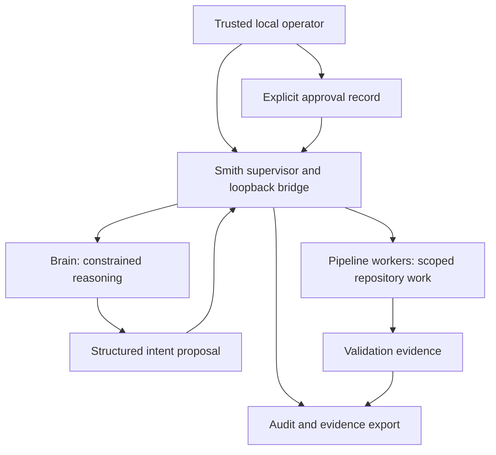

# Smith Architecture

## Status

**Normative target architecture.** The current implementation is the evidence source for what works today; [SMITH Linux Architecture Report](SMITH_LINUX_ARCHITECTURE_REPORT.md) records inspected as-built topology, limitations, and open gaps. A target requirement is not an implementation claim.

## System model

Smith is a Linux workstation control plane, not a general remote agent platform.



The supervisor is the policy-enforcement point. Models propose structured intents; they do not gain authority merely by producing valid-looking text.

## Trust boundaries

| Boundary | Target rule |
|---|---|
| Operator → supervisor | Local single-user trust model. Approval records must identify the action, repository, branch, base revision, target revision, and expiry. |
| Brain → supervisor | The brain is tool-constrained by default. Intent is untrusted data, schema-validated and authorized by the supervisor. |
| Supervisor → worker | Each worker receives only project-specific repository, tools, network, filesystem mounts, and credentials needed for its stage. |
| Worker → host | No Docker socket, broad home-directory mount, or implicit SSH directory access. Paths are allowlisted and canonicalized. |
| Worker → network | Default deny or explicit minimal egress policy. Search, registries, Git remotes, and model endpoints are distinct capabilities. |
| External text → model | Repository content, Jira/GitHub bodies, web search, MCP metadata, and tool output may contain prompt injection. They must never override policy or approvals. |
| Evidence → release decision | Narratives are insufficient. Evidence must include commands/scenarios, revision, result, timestamps, and retained artifacts. |

## Linux workstation topology

- The Rust supervisor and HTTP bridge are local control-plane services.
- The brain may run in a constrained container or as a host process; host execution is not equivalent to a filesystem or network sandbox.
- Coding and pipeline work run in scoped Docker workers.
- Local model inference is designed around host-native AMD-capable Ollama for the reference workstation.
- Search and optional voice services are separate capabilities, not implicit authority granted to the brain.
- All default inbound services must bind to loopback. Any non-loopback publication is an elevated, documented, human-approved exception.

Exact host requirements and resource limits are in [Host Profile](HOST_PROFILE.md).

## Implemented chat-only profile

**Implemented in source:** `src/main.rs` selects `src/commands/offline_chat.rs` for `serve --chat-only --model <exact-installed-tag>`, bypassing legacy supervisor startup. The immutable process profile conflicts with `--echo`; plain `serve` and `chat` retain legacy behavior. The bridge binds only `127.0.0.1` (default port 4783) and exposes health, text chat, and explicit shutdown—not task, file, voice, or service-management routes. Loopback is a single-operator trust boundary, not authentication against other local processes.

Inference goes directly to `http://127.0.0.1:11434`. The client ignores ambient proxies, refuses redirects, requires an exact installed Ollama tag, and rejects remote/cloud model metadata. There is no OpenCode, intent dispatch, task creation, Docker, search, warm-service/sidecar startup, model pull, dependency provisioning, or provider fallback. Model text remains inert selectable text in Halo, without Markdown image/file/network loading. Text requests use the exclusive `/v1/chat-only` endpoint; the legacy router rejects it before reset or dispatch, so listener replacement after health verification cannot route a release-client request into legacy orchestration. Halo validates the successful reply's chat-only profile/schema and never falls back to `/v1/chat`. Health identifies profile/provider/model and reports provider availability separately from listener health.

One shared `default` session is process-local and cleared on restart; no durable history or recovery is promised. Admission allows one active turn without queueing. Source limits are 16 KiB input, 64 KiB assistant text, 64 KiB retained message content, at most 16 retained turn pairs, and a 120-second generation timeout. Old pairs are evicted; failed turns do not append partial history. An explicit reset clears history before inference and reports that clearing even if the new turn fails.

Ubuntu 24.04 x86_64 full Flutter candidates include `smith_backend/smith` beside complete `lib/` and `data/`; a standalone backend candidate remains secondary. Candidates use install-only packaging, not the supervisor installer/unit lifecycle. Existing unit registration still selects legacy `serve`; no chat-only service migration is implemented. See [Chat Release](CHAT_RELEASE.md) for candidate provenance and publication blockers. Source restrictions are not proof of actual network-denied Ollama inference or clean-host installation; final integrated evidence remains pending.

## Desktop boot and ownership

**Implemented in source under [LOCAL-SMITH-FLUTTER-BOOT-P0](plans/LOCAL-SMITH-FLUTTER-BOOT-P0.md):** `client/lib/main.dart` mounts `desktop_boot_shell.dart` and `desktop_backend.dart`. Flutter is the primary desktop interface; CLI remains secondary query/status/configuration with existing commands retained. Headless operation is a separate deferred deployment/lifecycle capability, not CLI.

Check readiness and the four-second readiness pulse perform health reads only. Opening additionally runs automatic backend discovery and read-only structured inventory inspection under [LOCAL-SMITH-DESKTOP-WIZARD-P0](plans/LOCAL-SMITH-DESKTOP-WIZARD-P0.md). `desktop_setup.dart` resolves only `smith_backend/smith` relative to `Platform.resolvedExecutable`'s directory, validates it before execution through `NativeExecutableResolver`, and permits an explicit advanced normalized absolute native Linux x86_64 executable. Invalid discovery never silently chooses another binary; no cwd/PATH/shell fallback or recursive scan exists. Installed-model inventory supplies exact `name:tag` selection. Opening/checking never starts the chat backend, downloads or performs inference. No Ollama host installation/start or manager integration is implemented. Local ownership/mode/type/ELF checks are not artifact authentication. Positive Smith chat-only/non-echo identity, Ollama provider, exact model and affirmative provider/model availability are required; unknown/mismatch blocks send/start. A compatible external listener can attach without sending/resetting conversation and is never stopped; an explicitly configured model is never substituted.

Explicit Start rechecks absence and launches the captured child with `serve --chat-only --port 4783 --model <exact-installed-tag> --desktop-session <32-lowercase-hex-id>` without a shell. Desktop backend mode rejects occupied-port adoption. Health `desktop_session` plus child liveness correlates readiness; it is not authentication against hostile same-UID processes. Startup has a 15-second budget. Stop/normal app close closes the child's stdin and sends TERM, waits up to five seconds, then KILL and up to two seconds for exit confirmation. Cleanup unknown blocks another start and normal exit. Backend parent-pipe EOF/read failure initiates graceful shutdown. No HTTP shutdown, port/PID-based kill, crash-proof instantaneous termination, or provider-work cancellation is promised. Pulses/recovery preserve the mounted Home, draft and transcript, with no automatic resend/reset.

Source inspection and agent-reported tests are not final source-bound integrated or release evidence; the gates in [Chat Release](CHAT_RELEASE.md) remain.

## Desktop setup command boundary

**Implemented in source:** `src/commands/setup.rs` is a separate CLI namespace, not a serving route/tool or legacy installer. `smith setup inspect` emits one schema-v1 JSON inventory result (`ready`, `unavailable`, or `error`) with fixed provider/endpoint, eligible exact local names, provider-reported digest/size and structured error. It gates Ubuntu 24.04 x86_64 and reads only fixed-loopback `/api/tags`; `ready` means inventory observed, not verified inference. Duplicate/ambiguous metadata is rejected and cloud/remote entries are not selectable. Metadata/schema and executable safety checks are not artifact authentication or proven version compatibility.

`smith setup pull --model <exact-name:tag>` uses schema-v1 NDJSON with operation ID and ordered sequence. For a valid request the first `approval_required` binds the exact model and fixed endpoint; one bounded stdin JSON line must contain matching `schema_version:1`, `operation_id`, `model`, and `approved:true` within 60 seconds. Decline/EOF/mismatch/expiry sends no pull POST. This is trusted-local-operator consent correlation, not authentication. Progress exposes sanitized provider stages and reported per-layer completed/total bytes, not a fabricated overall percentage. Terminal success requires provider success and fresh verification of the exact eligible installed tag. Invalid-model/operation-ID preflight can instead emit a terminal-only error. `PullProtocol` accepts a fully validated schema-v1 sequence-zero terminal only with `status:error`, without consent or an approval event; terminal success/cancelled as the first event are rejected. This exception cannot authorize a pull. The wizard preserves validated failure code/message, strips control/bidi characters and redacts slash-prefixed path-like diagnostics, while retaining no-auto-retry and unknown daemon/cache guidance; this is not a general secret-redaction guarantee.

The HTTP client fixes `http://127.0.0.1:11434`, ignores proxies and refuses redirects; connect/inventory probes are two seconds, tags are bounded to 256 KiB and progress/input frames to 16 KiB. Approval is 60 seconds; pull observation is at most 15 minutes with a 30-second idle deadline. The Flutter adapter bounds inspect/resolve/launch waits, output and captured-child cleanup. Wizard automatic detection and advanced-path resolution are also bounded by the inspection timeout (10 seconds by default). It serializes one setup child per adapter; cleanup unknown retains ownership and blocks reuse. This is not cross-process provider scheduling. No automatic retries, shell/Ollama CLI, sudo, legacy install helpers, daemon start, cache deletion/rollback, persistent configuration or cloud fallback occur.

**Implemented wizard guards (`desktop_boot_shell.dart`):** editing/model selection requires no local setup work/child, a configurable non-ready backend, no owned backend child and no active chat turn. Pull additionally requires observed backend `absent`; permission is rechecked before consent is written. Backend-state changes that invalidate pull permission, or active chat, cancel local setup. Start also requires `backend.canStart` and selection still present in inventory. Ready owned/external, starting/stopping, conflict/unknown and cleanup-unknown states cannot pull/start; only captured owned children can be stopped. Read-only detection/inspection does **not** use all those mutation guards and may run while a backend is active. The source does not supply a global lock against another process using Ollama.

**Partial empty-host setup:** missing Ollama gets guided separate provisioning/start instructions only. Explicit model download allows the external daemon to use internet and persistent provider-managed disk; Smith's loopback request does not constrain daemon egress. Transfer/storage size is unknown until reported. Cancellation/EOF drops the local request/observation and cleans only its captured setup child; daemon continuation and partial cache outcome can remain unknown. Actual provider pull/cancel integration and version compatibility remain gates, not source guarantees. The chat-only bridge remains unchanged and isolated, with no provisioning routes/tools.

## User-service architecture

**Target for the separate legacy orchestration supervisor, not the desktop chat lifecycle.** The Smith supervisor is managed by one unprivileged `systemd --user` unit. Binary installation and service lifecycle are separate authority boundaries:

1. `scripts/install.sh` installs and verifies only a stable Smith executable under an explicit canonical root owned by the invoking non-root user, rejecting group/world-writable roots and executables and writing a private provenance marker required by service registration. It does not write a unit, start Smith, start sidecars or Docker, or change lingering.
2. Service **install** writes the deterministic unit around the canonical absolute executable and reloads the user manager; it does not start or enable the unit.
3. Service **start**, **restart**, and **stop** affect only the current runtime. They do not change login policy.
4. Service **autostart on/off** affects only enablement at user-manager login. It must never imply `--now` or current runtime changes.
5. Service **uninstall** is explicit. No manager failure may fall back to a detached unmanaged `smith serve` process.

The unit belongs beneath the effective `XDG_CONFIG_HOME/systemd/user` path (or the platform XDG default), references an executable outside transient source/build paths, and remains a supervisor-only unit. Docker, Ollama, Whisper, Kokoro, and the independently packaged Flutter client are not installed or registered by this unit contract. Its restart policy suppresses automatic retry for the classified permanent host-runtime configuration exit and bounds all other failure bursts without a host-wide start-limit action. The unit is selected by `default.target` but does not order itself after that target.

Service status exposes independent observations rather than a single “up” flag:

| Observation | Meaning |
|---|---|
| Unit installed/loaded | A unit file exists and the user manager recognizes it. |
| Active state/substate | The manager’s current runtime view, such as `active/running` or `inactive/dead`. |
| Result/restarts/main exit | Independent manager evidence for startup failure and restart-loop diagnosis; failed or malformed queries remain unknown. |
| Enabled at login | Persistent `enabled` manager state selects the unit for the user manager’s login/default target; transient enablement, linking, or aliasing is reported separately and does not prove persistent login startup or current runtime. |
| Linger `yes`/`no`/`unknown` | Whether the user manager may exist before login/after logout; Smith observes but never mutates this policy. |
| Bridge identity/health | The configured loopback listener proves it is Smith and is healthy; an unrelated listener is a failure, not “running.” |

`enabled at login` with `Linger=no` means login-scoped startup, not pre-login boot. Pre-login operation requires a separate, deliberate, human-approved host decision to run `loginctl enable-linger`; Smith never performs that mutation.

Before a newly started supervisor advertises bridge readiness, restart reconciliation marks persisted queued/running task and job records as interrupted/recovery-required exactly once while preserving identifiers, prior result/summary/error data, forward-compatible unknown JSON fields, and other record content. Reconciled JSON is replaced atomically from a synced same-directory temporary file; awaiting-signoff and terminal records remain unchanged. After reconciliation, host runtime performs a static OpenCode preflight before warm model/service/sidecar work. The preflight requires a canonical executable; on Ubuntu x86_64 it must be a native x86_64 ELF and pass bounded bare-semantic-version and OpenCode-specific help-signature probes. This is behavioral validation against accidental/impostor configuration, not cryptographic package provenance. Every terminal probe outcome terminates the isolated process group and confirms bounded child/group cleanup. A missing, non-executable, non-native, or behaviorally invalid OpenCode configuration fails before warm effects and uses the unit’s non-retryable configuration exit. Spawn, wait, timeout, nonzero, and other unclassified probe failures remain retryable under the bounded restart fuse. Manager state, bridge health, dependency failure, and recovered work state remain separately visible.

**Implemented and observed status.** The source and sandbox evidence for this target are tracked in [SMITH Linux Architecture Report](SMITH_LINUX_ARCHITECTURE_REPORT.md). The reference-host observation remains in [Host Profile](HOST_PROFILE.md); target wording here is not proof that its service is installed or running.

## Capability model

Every operation must have an explicit capability set:

```text
identity + role + repository + branch + revision + stage
+ filesystem roots + network destinations + credentials
+ tool allowlist + time/resource budget + approval binding
```

Rules:

1. Capability sets are additive only through explicit human-approved configuration.
2. Provider failure or fallback must never add tools, network access, filesystem access, credentials, or publication authority.
3. Worker identity, model/provider identity, task ID, plan ID, and approval ID belong in audit evidence.
4. A role may assess or report a risk but cannot self-authorize an exception.

## State, audit, and recovery

- Treat plan and worker-container artifacts as ephemeral execution state unless exported.
- Retain an audit package for consequential work: intent, plan, revisions, diff identity, validation evidence, assurance verdict, review findings, approval record, and external results.
- Audit records should be append-oriented and digest-linked so omissions or alteration are detectable. An owner-writable package and its unkeyed checksum file detect accidental corruption but are not an adversarial integrity anchor; consequential release evidence must bind the package digest in an independently retained review, approval record, signature, reviewed commit, or append-only store.
- Pipeline/job identity must be collision-resistant and scoped per operation.
- Restart recovery must reconcile tasks, workers, pending approvals, and external Git state. A stale `running` record must not imply a live job.
- Replays, duplicate events, retries, cancellation, and partial cross-repository updates must be idempotent or fail closed.

## Resource and concurrency policy

- One critical pipeline per project/branch at a time until a scheduler with locking, budgets, and recovery exists.
- Bound CPU, memory, GPU, disk, wall-clock, retry, and model-context consumption for workers.
- Do not perform check-then-act port allocation without reservation/ownership.
- Preserve host responsiveness over autonomy throughput.

## Architecture review triggers

An architect review and architecture-document update are required before changing:

- inbound ports, network egress, images, or container security options;
- filesystem roots, symlinks, bind mounts, SSH, credentials, or MCP tools;
- authorization, approvals, Git push/merge/release paths, or provider fallback;
- storage formats, audit data, concurrency, retries, cancellation, or crash recovery;
- local model hardware assumptions, systemd lifecycle, or required host dependencies.

## Current deltas to resolve

The as-built report documents known deltas including broad worker port publication, broad SSH/config mounts, container-local pipeline state, limited recovery/admission control, and incomplete approval enforcement. These are tracked implementation obligations, not acceptable reasons to weaken this architecture.
