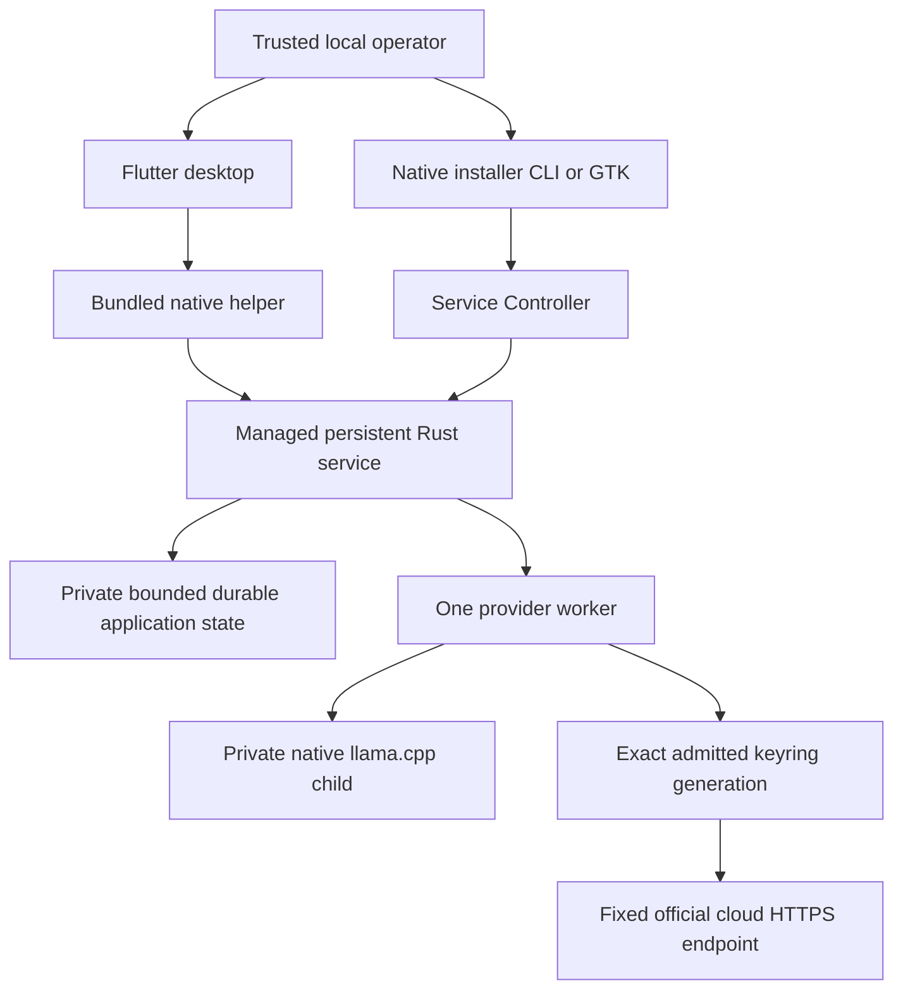

# Smith Architecture

## Status

**Normative target architecture with labelled implemented source contracts.** [Scope](SCOPE.md), [Process](PROCESS.md), [Design](DESIGN.md) and [Host Profile](HOST_PROFILE.md) retain canonical authority; the [as-built report](SMITH_LINUX_ARCHITECTURE_REPORT.md) records evidence and gaps. Source restrictions, fake tests and process survival are not deployed guarantees.

## System model

**Implemented:** root `client/` is Flutter desktop; `service/` is the persistent Rust authority; `installer/` is an independent Rust workspace using `../service`; `dagger/` is builder/package tooling. There is no root Cargo product/workspace. The client uses the executable-relative `smith_backend/smith-service` helper and private Core/app Unix bridges, not a legacy HTTP/orchestration backend. Promoting source does not rename `smith-next.service`, `smith-next`, XDG namespaces, keyring/wire identities or deterministic recognition bytes.

The service owns saved histories, configuration, accepted operations and routing. Desktop close detaches. Restart interrupts unfinished work rather than resuming it. Goals, tools, coding workers and general orchestration are **target/deferred**, not hidden chat capabilities. Retired root/voice/Python stages are available in the [pinned prior architecture](https://github.com/jdharrison/smith/blob/168865b0422b787f08ab33e89d052cd4adbd11f7/docs/ARCHITECTURE.md); [History](HISTORY.md) records the source relocation and retrieval policy. Historical behavior is not a current fallback.

## Trust boundaries

| Boundary | Contract |
|---|---|
| Operator → local control | Single trusted account; exact effect-bound consent, not hostile-same-UID authentication. Human delivery approvals additionally bind repository/branch/base/target/action/expiry. |
| Client/helper → service | Managed unit/executable/MainPID and socket/peer checks; bounded correlated protocols, no silent version/mutation fallback. |
| Model/external text → policy | Inert untrusted data; never tools, approval or permission expansion. This includes repository/ticket/web/MCP/tool text. |
| Service → native runner | Owned child/lease/process cleanup and integrity checks, not a filesystem/network/driver sandbox. |
| Service → cloud/keyring | Exact admitted generation, destination consent, fixed endpoint and finite one-attempt budgets; no ambient credential/endpoint authority. |
| Evidence → decision | Commands, source/artifact identities, timestamps, outcomes and independent review; narrative/checksums alone are not approval or authenticity. |

**Target/deferred workers:** supervisor-enforced schema/capability authorization, project-specific canonical allowlisted roots/tools/egress/credentials; no broad home/SSH mount or Docker socket. All default inbound publication must be loopback/private; non-loopback exposure needs elevated review and explicit approval. Host processes and Docker-internal networks do not constitute an air gap.

## Next-generation service control and login Boot implementation

**Implemented source:** `service/src/control.rs`, `manager.rs`, `filesystem.rs` and transports provide strict Core schema2. Binary/unit/enablement/runtime/bridge are independent facts. Persistent enabled state requires manager `UnitFileState=enabled` and the exact invoking-user-owned `systemd/user/default.target.wants/smith-next.service` symlink targeting the exact owned unit. Runtime-only, linked, alias, masked, foreign, malformed or unknown combinations fail closed.

The deterministic unprivileged unit has `Type=simple`, `Restart=no`, `UMask=0077`, five-second stop budget and `[Install]/WantedBy=default.target`. Registration/reload, Enable and Start remain separate effects. Enable uses fixed `systemctl --user enable smith-next.service`, never `--now`; Start requires exact installed/enabled/safely-stopped identity and never enables. No `loginctl` or lingering mutation, sudo, detached unmanaged fallback or legacy `smith.service` migration.

Prepare → visible confirm → apply uses original single-use60s tokens bound to action, roots, artifacts/unit and observations; no silent renewal/retry. Fresh setup is artifacts → register/reload → Enable → Start → fresh Core/app verification. Decline/failure preserves completed/uncertain effects. Unsafe roots, changed artifacts, overrides/foreign units/listeners and ambiguous states block. Exact-owned stopped pending-reload units permit separately confirmed reload-only repair. Defaults remain validated XDG data `smith-next/bin/smith-service` and state, config `systemd/user/smith-next.service`, and private runtime sockets. Production control/serve rejects UID0.

Managed FragmentPath/MainPID, executable path/bytes, socket identity and Linux `SO_PEERCRED` UID/PID checks remain. Core frames are bounded (4095 bytes); separate app frames are bounded to4MiB so provider work does not block Core inspection. Held daemon lock rejects duplicate foreground instances. Desktop disposal cleans only short-lived owned helpers; cleanup uncertainty blocks reuse, never kills the independently managed service. Helper cleanup is not rollback of accepted manager jobs or guaranteed descendant containment after abrupt death.

Boot serializes read-only Core observations under a15s monotonic budget, then uses separate finite app synchronization bounds. Chat mounts only after exact enabled/bridge-ready facts and synchronized conversations; Boot never installs, enables, starts, provisions, infers or resends automatically. Only exact installed/registered/enabled/safely-stopped state exposes separately prepared/confirmed Start. Presentation clocks do not establish readiness. The target is **after-login** availability; real manager/login/logout/reboot, pre-login/post-logout and lingering remain separate unverified/approved concerns.

## Current next bundled native runner

**Implemented source:** `service/src/runner.rs`, `providers.rs`, `acceleration.rs` and `catalog.rs`. The paired client includes separate SHA-pinned llama.cpp `b11429` `smith_backend/runtime/cpu/` and `vulkan/` trees, never mixed libraries, with `$ORIGIN` runpaths. Host glibc/libstdc++/libgcc/OpenSSL3 remain required; libgomp is bundled. Vulkan additionally needs host `libvulkan.so.1` and compatible ICD/driver/device access, never provisioned by Smith. Service-only publication can report `RUNTIME_MISSING`.

Curated GGUF and exact catalog markers live in private XDG data `smith-next/models` (0700 directories/0600 files). Full model SHA/runtime-manifest verification checks cancellation/deadline between bounded1MiB reads. The verified model FD survives exec and is loaded via `/proc/self/fd/<fd>` with separate SHA alias: pathname replacement cannot substitute a different verified model. Same-UID inode writes remain possible. Runtime path hashing/rechecks are point-in-time, not descriptor-bound dynamic loading or protection from concurrent/hostile same-UID code replacement. Individual syscalls/fsync have no hard cancellation deadline.

One inherited `runner.lock`, random private runner directory/socket, peer UID/PID checks, cleared environment and random API key constrain ownership, not hostile same-user access. The shared parked-lease slot explicitly unlocks its owned file on final destruction, including when the verified-model owner has already gone or the slot mutex is poisoned. Cleaned startup handback to a live model retains the same locked description across fallback; an empty slot cannot unlock the raw active lease. Unknown child cleanup returns before handback and preserves inherited exclusion. This corrects terminal parked-lease release, not all pre-child raw-file error windows or a proven historical CI schedule. The child has its own process group and race-checked parent-death SIGKILL; cleanup uses TERM≤2s/KILL≤1s, idle expiry600s. App-owner teardown fences publication, atomically cancels native waits and joins cleanup; desktop close only detaches. One slot/`--parallel 1`, bounded CPU threads, context4096/output1024 and180s cooperative dispatch budget remain. Request-only trimming uses rendered templates/tokenization with conservative byte-token fallback, never edits durable history. Model-default reasoning is not forced to zero. Only complete nonempty final content succeeds; reasoning-only, token-cap truncation, tool calls and identity mismatch fail with no replay.

Auto verifies/launches Vulkan with fixed `--device Vulkan0 --split-mode none --gpu-layers all --fit off`, plus `--log-verbosity 4 --no-log-prefix --no-log-timestamps --no-log-jsonl`. Acceptance needs exactly one revision-bound newline-terminated `load_tensors: offloaded X/Y layers to GPU`, `X == Y > 0`, within a sticky64KiB startup prefix and fixed at-most1s post-health observation window under the original deadline. Zero/partial/missing/malformed/duplicate/incomplete evidence, cancellation, child exit or capture failure/EOF fail closed. Health is not a stderr flush barrier; the final locked snapshot covers observed startup bytes, not future output. Logging normalization is not upstream config isolation.

Missing Vulkan or classified startup/evidence failure permits exactly one independent CPU launch only after confirmed cleanup, returning the same held model/runner lease under the original deadline. CPU uses `--device none --gpu-layers 0 --fit off` and does not load Vulkan. Unknown cleanup, integrity, cancellation or deadline failures grant no fallback. After Vulkan acceptance, request/preparation/completion failure never replays on CPU. One finite sanitized last-startup fallback cause survives CPU reuse/idle unload behind nonblocking Rust `last_startup_fallback_reason()`; busy/unavailable is explicit. Fresh preparation clears it; teardown loses it. No raw native output/paths/keys/prompts are retained. It is not wire/UI/current-mode evidence.

## GPU-preferred runner direction and remaining work

**Target/deferred:** device discovery/classification, stable selection, memory/desktop headroom, validated partial offload, versioned preferences and compact confirmed execution status. Fixed `Vulkan0` is not suitability or stable identity. Host device-only observations in [Host Profile](HOST_PROFILE.md#non-model-gpu-diagnostic-observation--gpu-startup-fix) do not prove model fit, full offload, inference or speed.

## Current next cloud routing and credential boundary

**Implemented source:** `service/src/app_v3.rs`, `app_v3_worker.rs` and `cloud*.rs` extend the existing domain/sole worker, not a second scheduler. Flutter/provider-aware installer use app schema3, disk4; Core2 and the four-outstanding/one-per-chat/one-executing constraints remain. Exact catalogs/adapter semantics are in the retained [cloud API contract](plans/LOCAL-SMITH-NEXT-CLOUD-API-CONTRACT.md).

**Compatibility:** strict valid disk1/2/3 migrations preserve histories, configuration, full-u64 revisions, results/receipts, replay IDs/tombstones and inert old voice data without invented routing provenance or historical dates. Corrupt/unsafe/unsupported bytes remain preserved. Bounded separate `route_catalog`, `conversation_routing` and `request_routing` expose non-secret metadata. Old v1/v2 operations stay local-only with exact unaffected projections; access that cannot represent retained v3 work/routing fails `UPGRADE_REQUIRED`, never hides it or executes a cloud default. Provider-aware installer uses explicit v3 even for local Model work; production Flutter has no mutation/version fallback. Strict old catalog readers may reject newly compiled IDs despite unchanged schema: use paired updated client/service/installer. Older binaries reject disk4; separately approved rollback needs pre-migration state and compatible paired binaries plus exact keyring-generation relationships. JSON backup does not include keyring items and must never substitute a replacement key.

**Routing/consent:** per-chat selection is volatile; last accepted route is a reattach hint, not permanent lock. Admission freezes provider/model, digest or endpoint/policy, credential generation/provider revision, context/hash, revisions, limits and deadlines. It changes neither local default nor accepted work. First transfer to each provider/generation requires exact request/context confirmation; generation is opaque credential identity, not verified vendor account. Retained chat consent covers later explicit sends including intervening retained local/other-provider history; changing model at that destination does not repeat it, replacing generation does. Each cloud send still prepares afresh:60s admission/600s dispatch expiry fixed at preparation, plus independent ten-minute queue-age enforcement. Save/Validate keep60s effect-start authorization. Declined/expired pre-admission preparation grants no chat/approval; post-admission dispatch expiry does not revoke destination consent. Unavailable historical routes never permit substitution/deletion. Local queue Resume alone cannot approve new cloud export.

**Keyring:** service-only `cloud_keyring.rs` connects to fixed `/run/user/<uid>/bus`, validates socket/peer/service-owner UID and pins the existing unique Secret Service owner, ignoring ambient bus addresses and using `NoAutoStart`. Existing unlocked GNOME Keyring/default collection and encrypted session are required. No plaintext session, activation, collection creation, unlock, Prompt, environment/file key or subscription-login fallback. Bounded keyring work runs on the sole worker≤3s, not under the app mutex/on UI thread. Keys enter through private installer input, remain volatile/best-effort zeroized and never enter durable tasks, fingerprints, logs or context. Same-UID checks/zeroization do not isolate swap/core dumps or hostile same-user processes.

Read-back accepts exactly `text/plain` or `text/plain; charset=utf-8`, independently of encrypted transport and bounded printable-ASCII secret checks. Attributes require all four exact Smith identity fields, optionally only `xdg:schema=org.freedesktop.Secret.Generic` as a fifth. Unknown extras/schema or changed/missing identity fail before secret retrieval and are rechecked afterward. Outgoing search/create identity and strict timestamp checks are unchanged; inactive items are never adopted.

Each confirmed Save creates a fresh namespaced item before activating its opaque JSON reference. These are **not one transaction**: uncertainty/failure may leave an inactive item; observe original identity, never automatic retry/adoption/cleanup. Prior generations remain; no credential removal/purge, and Uninstall does not delete keyring items/revoke vendor keys. Dispatch retrieves/rechecks exactly the admitted generation. A supported route with matching active saved reference is eligible to attempt Send/Validate without prior probing, instance observation or successful validation. `ModelChoice.available` means attempt eligibility, not key access/account acceptance. Locked/missing/conflict/unobserved metadata and failed/interrupted checks remain advisory; successful validation identifies only its exact model/generation, and chat success invents no validation record. Actual read/identity/revision failure prevents HTTP. Cached state/catalog/routing never reads keyring or calls vendors; explicit probes read keyring only. Startup/selection/Save/observation recovery never infer remotely.

**HTTP:** fifteen compiled text identities (7 OpenAI/8 Anthropic), no discovery. Only `https://api.openai.com/v1/responses` and `https://api.anthropic.com/v1/messages`, normal certificate/hostname checks, no production endpoint/trust override, ambient proxies, redirects, automatic/protocol retries, tools, remote chaining or fallback. Single-connection Hyper HTTP/1/Rustls enforces16KiB raw response heads while reading (including informational/status/whitespace bytes),1MiB incremental success/error bodies and64KiB final UTF-8 text. Input/context including proposed user text≤64KiB, input≤16KiB; trim oldest complete pairs in the request only. Cloud output≤8192 total tokens including reasoning, under the original180s operation budget including keyring/DNS/TLS; connect≤10s within it. Local1024 stays unchanged. Complete envelope/exact model/final-text validation rejects reasoning-only, refusal, truncation, unsupported/tool-bearing or malformed output without replay. Raw remote diagnostics/reasoning/IDs/headers never become retained output; fixed Smith categories do. See API contract for exact request/parser rules, context/framing reservation and vendor-retention caveats. Fixed URLs are not an OS firewall; OpenAI `store:false` is not zero retention, and no cost ceiling is promised.

**Delivery:** durably publish `may_have_sent` before the single HTTP attempt and recheck ownership/deadline; failed publication prevents dispatch. `not_sent`/`may_have_sent`/`received` remain distinct. Restart interrupts without replay; unknown remote processing/billing or credential publication is not no effect. Close/observer Stop does not cancel accepted work or guarantee remote cancellation. Synthetic TLS/keyring/compiled Rust↔Dart tests and retained review evidence are not normal-session/vendor/installed acceptance.

## Current next multi-chat storage and scheduling

**Implemented source:** `service/src/app.rs`, `app_v2.rs`, `app_v3.rs` and `app_timestamps.rs` own bounded atomic `app-state.json`. First accepted `submit_new` creates chat+job atomically; unsent New chat/drafts remain local. Legacy v1 migrates into `Current chat` without invented missing prompt text. Context is isolated per conversation; local default/configuration remain global, with per-request routing above.

At most32 active+archived conversations,16 pairs/64KiB each,16KiB input,32 retained operations and1024 expired-ID tombstones. Encoded preflight reserves completion/transition headroom within16MiB state and4MiB frames, including JSON expansion. Only terminal operations expire, retaining opaque IDs; ordinary capacity rejection is not a latched storage fault. Unexpected publication/transition failure fences the service. Four chats can be outstanding, one per conversation/one executing; dispatch rejects queue age>10min. Admission is synced before dispatch; identical IDs/fingerprints return original work, conflicts/expired IDs cannot resurrect it. Restart interrupts queued/running work before readiness with no replay. App-owner fencing prevents old workers publishing after reopened ownership.

Schema-v2 summary/detail and lifecycle operations bind request/conversation/revisions; recognized reply/errors correlate schema/call ID. Exact v1 installer keys `config/history/active/providers/retention` remain, with no foreign conversation/queued-status leakage. Legacy configuration u64 values are lossless: v2 wire number through9007199254740991, canonical decimal string above; v1/disk numeric. Clients echo without conversion; max revision refuses mutation. New revisions/sequences stay safe integers.

Atomic first-message titles sanitize controls/collapse whitespace/cap40 Unicode scalars; renames use the same new-write limit. Stored/input legacy title validation remains256 bytes, including receipts; no rewriting old titles/results. Rename/archive/reactivate/delete are atomic, idempotent and revision-checked. Archive/delete block target queued/running work; UI uncertainty also blocks. Delete removes current-store title/history/payload/results/content-derived fingerprints and timing, retaining only opaque replay protection/content-free bounded receipt; exhausted tombstones refuse without partial effects. It does not stop/clear the runner or securely erase RAM/KV/journals/swap/backups. Late worker publication checks running identity/conversation/history revision and cannot recreate deleted data. Stale lifecycle receipts cannot regress newer metadata.

## Saved message timestamps

**Implemented source:** disk4's required bounded conversation-keyed timing sidecar migrates disk1/2/3 without invented dates. Missing entries mean wholly unknown; present entries exactly align with retained pairs. Admission reserves timing headroom; successful ordinary/routed publication appends/trims timing atomically with history/result; deletion removes it, job eviction does not. Role/content messages, provider payloads and consent hashes are unchanged.

App3 read-only `conversation_timestamps({conversation_id})` returns matching ID/history revision and≤16 `{user_at_ms,assistant_at_ms}` pairs, null or positive UTC epoch-ms≤253402300799999. YOU is service admission; SMITH is wall time after final validation/publication fences for successful history transaction, not exact fsync completion. Invalid clocks remain unknown; clock corrections do not reorder/rewrite. Failed/interrupted turns publish no completed pair. Client uses matching instance/conversation/revision/count only; absent/failed/mismatched metadata leaves undated readable history, never observation-time substitution or replay. Disk4 rollback rules above apply.

## Client-side sequential message queue

**Implemented source:** conversation-owned volatile FIFO shared across panes, including hidden panes/blank promotion, with one coalesced serialized workspace dispatcher. Logical row identity differs from immutable attempt ID. Limits:8 follow-ups/chat,32/desktop plus one current-predecessor allowance/chat;16KiB each. Never-dispatched waiting has no execution timeout/service slot.

Advancement needs exact predecessor success **and saved synchronized history**, fresh target detail and expected history revision. Unknown admission/poll/possibly post-commit `STATE_UNAVAILABLE` retains identity without replay. Failed head blocks. Explicit Retry gets a new attempt only for definitive failure/not-admission; Skip abandons only resolved/never-attempted heads, never cancels running/unknown work. Instance/config/foreign-history changes pause for review; revision fences stale actions. Query-only observation may wake an already-authorized unpaused dispatcher, not resume uncertain/paused chains. This is observed-instance protection, not atomic restart fencing or cross-desktop exclusive ownership. Route/generation/context are never silently rebound; queued cloud transfer uses its separate consent contract.

Shell-owned identity-bound exit hold stops undispatched Send/enqueue/Retry/pump during Close/Quit decision. Native GTK delete/quit destroys only after explicit true Dart reply; absent/failed reply keeps open. Cancel releases that hold without clearing pauses; confirmation holds through disposal. Counts deduplicate hidden/shared chats/blanks. Drafts/queues are not durable; forced termination can lose them. Accepted service work continues; no active cancellation/durable outbox implied.

## Automatic desktop connection observation

**Implemented:** after Boot, one workspace timer reads at30s, then30s after prior reconciliation completes. Serialized app state/necessary detail/original-ID poll only; no automatic inventory, lifecycle/configuration/inference/replay. Preserve finite budgets/expiry markers, drafts/history/accepted IDs across outages, without healthy-check flicker. Instance changes invalidate model facts; connectivity recovery does not prove Send readiness. Explicit workspace Retry uses serialized app sync plus inventory refresh, not competing Core inspection. Sends waiting behind observation capture/reserve immutable text and draft/config/history/instance/conversation identity synchronously, revalidating before dispatch. Disposal fences late work/cancels timers, not service.30s is idle cadence, not outage-detection deadline. Scoped evidence: `client/CONNECTION_POLLING_VALIDATION.md`.

## Split-workspace experiment ownership

**Implemented:** up to4 retained panes have separate selection/blank identities, one workspace/API/arbiter/inventory/heartbeat owner; saved chat IDs share one controller/draft/queue. Blank promotion and archive/delete repair every pane, including hidden; hidden pending work remains observed. One controller-free shared header/Layout/focus owner; only workspace bodies repeat. Each ChatPanel owns editor/focus/reading bookmarks independent of shared data. Layout adds neither worker nor inference slots. Native graphical/IME acceptance remains separate.

## Session-only desktop windows

**Implemented:** production-injected launcher directly spawns current resolved executable, exactly `--session-only-window`, detached/no shell. Embedded/test constructors have no implicit host launch. Pending creation disables only that action; sanitized failure needs explicit retry; spawn is not visible-window/readiness proof. Exact startup flag omits preference-store construction completely: no load/save/lock/adoption even after original closes. New process starts1×1/Chat with normal Boot-selected conversation, not copied workspace; it can launch another. Each has its own Boot/API/observations/drafts/queues/exit guard; durable chats and service limits are shared. No parent-child termination, cross-window unsent sync, monitor/geometry management or service action. Session-only does not make saved chat history ephemeral.

## Client workspace preference storage

**Implemented:** strict v1≤4KiB JSON stores layout preset/active tile/exactly4 saved-chat-ID-or-null and Chat/Settings slots, including hidden. No text/drafts/titles/scroll/editor/operation/readiness/model/service state. Production injection only. Linux x86_64/glibc store: `XDG_STATE_HOME/smith-next/client/workspace.json`, else `HOME/.local/state/smith-next/client/workspace.json`; reject relative roots. Explicit/XDG root must exist; HOME fallback may create `.local/state`.

Descriptor-relative no-follow ownership/mode checks,0700 app dirs/0600 files and lifetime nonblocking `flock` exclude cooperating writers (even separate same-process stores). Serialized/coalesced saves use exclusive same-dir temp, file fsync, atomic rename and prior file/lock identity checks. Not directory-fsync/power-loss, hostile-same-UID or hard filesystem-deadline assurance. Corrupt/unsupported/unsafe/inaccessible files remain untouched; saving disabled/session warning, UI usable. Restore once after Boot sync/before interaction: saved null wins; missing/archived IDs become independent blanks and repaired preferences save; transient detail failure retains selection. No resume/send/lifecycle/configuration effects. Save layout/page/selection/accepted blank promotion only, not draft/status. Normal disposal drains writes; abrupt death may lose latest preference.

## Workspace entrance presentation

**Implemented:** one620ms paint-only opacity/translation clock after Boot/preference hydration; unchanged retained layout/editor/pane/scroll/service identity. Gate workspace pointer/focus/actionable semantics only; Close/Quit outside. Reduced motion/recovery permanently settles it; polling/navigation/layout never restart or authorize API effects. No persisted animation state. Boot motion has its own independent readiness boundary.

## Next-generation artifact installation

**Implemented:** `installer/src/artifact.rs`, `fs.rs`, `manifest.rs`. Make install targets build then invoke native `--artifacts-only --client BUNDLE` and/or `--service BINARY`; only that mode accepts optional `--yes`, bypassing confirmation only, never checks. No manager/provider/artifact execution, unit/state/config write, cache refresh, Enable/Start. Host publication outside builder, no home mount.

Complete verified client releases: XDG data `smith-next/client/releases/<digest>`, exact relative `current` selector, absolute desktop/icon and HOME `.local/bin/smith-next`. Standalone `smith-next/bin/smith-service` refuses differing bytes/implicit upgrade and checks paired helper. Non-root ownership/mode/single-link/private namespaces, bounded trees/files, held-directory no-follow traversal, verified cooperative lock and post-consent/under-lock revalidation remain. Compact sorted schema1 manifest+newline preserves historical release identity. Fresh releases/files no-clobber+sync; selected-client/service-only dependencies reverified before selection/success. Atomic selector exchange retains/checks displaced data; late conflict may leave current changed and returns failure. No hostile-same-UID CAS, global transaction, rollback or automatic failed-stage cleanup.

## Focused native installer and model management

**Implemented:** full package `installer/dist/` has native CLI, optional-feature GTK3 sibling, complete paired Flutter/service payload, manifest/checksums/instructions. Default root is actual canonical installer executable directory, not cwd/argv alias/PATH. CLI is GTK/display/Python-independent; GUI library loading still needs GTK even for display-free help/version/licenses. Native is not static/universal Linux ABI. `dagger/package.py` is builder metadata tooling, never host publisher/fallback. No weights/voice/reference payloads; strict allowlist rejects unknowns.

GUI opens two actions, hidden read-only artifact preview then explicit Checking/action page. Fixed paired-product register/Enable/Start recipe retains **separate** original60s consent for every effect. Full CLI supports bundle/dry-run/exact model/download (`--pull-model` alias)/verify; no blanket yes. Dry-run/initial artifact decline creates no destination files/locks or Controller/provider/runtime roots. Controller is constructed lazily after publication with source **packaged `payload/service/smith-service`**, never installer executable; existing managed identity/correlation stays authoritative.

Consent≤4096 bytes incl newline/60s; EOF/interruption/timeout is no approval. Bounded setup/progress supports nonblocking pipes/sockets/terminals, rejects regular files/other devices; artifact publisher stdio and filesystem/fsync do not gain a total deadline. One owned worker, bounded typed critical-event FIFO/capped reports, original IDs, joined cancellation and sticky close/reopen guard. GTK coalesces numeric byte telemetry only into a bounded latest snapshot; stage/consent/final boundaries discard stale telemetry. Strict CLI forwarding unchanged; no retry/resume/deadline extension/deletion. Missing/full reporting preserves partial/uncertain effects, never rollback. Observer cancellation joins installer-owned effects, not accepted service work or remote requests.

Seven compiled revision/size/SHA Apache-2.0 choices; fresh GUI Qwen3-14B Q4_K_M revision `530227a7d994db8eca5ab5ced2fb692b614357fd`,9001752960 bytes, SHA256 `500a8806e85ee9c83f3ae08420295592451379b4f8cf2d0f41c15dffeb6b81f0`. Saved selection survives. Unsupported selection stays inert/read-only, never inserted into chooser or submitted. No free-form/import. Separate exact-model download/preference/check/removal consent; `configure_checked` atomically checks expected revision, legacy configure unchanged.

Explicit download uses HTTPS443 exact `huggingface.co` or label-boundary `*.hf.co`,≤3 redirects, no ambient proxy/retry, exact size/SHA,30s idle/1800s observation and≤16GiB model stream (artifact limits unchanged). Install lock/free-space check/held-directory staging/synced no-clobber publication/marker-last preserve conflicts/partial stages. Async factories construct requests/body futures inside owned Tokio runtime after deadline/cancel check, not detached work. Disk guard is model size+64MiB, not RAM suitability.

Verify/remove use durable admission/poll/fingerprint/expiry/interruption and exact request/model/SHA/config revision. Verify sends fixed isolated greeting, no prior context/history append;180s service/210s observer are provisional, not CPU14B performance proof. Removal blocks selected or any loaded runner including idle, no hidden unload/Stop; installation lock→runner lease, exact descriptor-relative marker/file validation. Marker unlink+dir sync before model unlink+sync; partial/orphan state preserved, no recursive cleanup/retry/rollback or history/preference edits. Idle stop600s may delay management. Manage models bypasses artifact republication/review expiry only, never managed-service prerequisites, differing-binary guard or its own/Core/model consent.

Optional provider management/save/check uses cloud boundary above; no artifact/lifecycle work on rerun. Successful management says model check/removal complete, not installation verified. Neither installer is persistently installed; retain full package. No OS/GPU/keyring provisioning, debug-completion write, automatic desktop launch or lingering change.

## Installer-owned appearance resources

**Implemented presentation only:** optional GUI `appearance.rs` embeds JetBrains Mono/icons/notices, uses3 sealed CLOEXEC memfds kept alive through partial registration failure, Fontconfig app fonts and caller-thread Pango refresh. No system-font install/disk fallback/font-cache/network/new worker. Check native font/PNG support before effect worker. Display-free `--licenses` prints full notices; CLI imports none of GTK/resources. Native library initialization is not itself sandboxed. Grouped consent remains deferred.

## Explicit native installer maintenance

**Implemented:** service/installer `maintenance.rs` independently inspect safe selected release/relative selector, manifest, standalone==selected helper, exact desktop/shim and byte-exact recognized static/current unit/manager/link facts. Retained voice-era files are valid historical release contents, not active capabilities. Never run old helper. Unknown/foreign/unsafe objects, overrides/drop-ins/transient units, malformed enablement or ambiguous absent selector/binary block. Missing independently proven launcher may be disclosed/skipped. Uninstall is candidate-independent; inspection does not reset app/Core data.

Manager seams default-refuse; fixed bounded Stop verifies captured old digest/path via `/proc/MainPID/exe` and process cgroup. Stopped proof needs PID0, kernel cgroup2 quiescence including descendants/captured group and absent Core/app sockets. No rawPID kill, stale-socket deletion, manager override or detached fallback. Prepared Stop/Unregister single-use60s action/path/identity/fact binding; unknown outcome is not success.

Lock order: publisher install lock→typed Core data-directory `MaintenanceLease`→runner lease after Stop. Candidate `apply_with_lease` validates the same held lease without recursive flock; ordinary apply still locks with no-follow/root-identity checks. Serializes participants, not external manager clients/hostile same-UID changes; no global CAS/transaction.

After explicit artifact review, private backup/effect record preserves old binary/unit/selector/launchers before lifecycle effects; state/models stay in place. Upgrade separately confirms Stop/quiescence, migrates only exact static→current unit/reload, preserves exact enabled current without churn or separately enables exact disabled current. Stage/verify candidate, atomic standalone exchange retaining displacement, guarded paired client publish/select and launcher/pair verification. Any needed registration/reload/Enable/Start has fresh separate original-token approval. Declined Start means artifacts upgraded/service stopped; running success requires fresh candidate Core/app readiness, not model readiness. Failure preserves stages/backups and stops unsafe later phases; no rollback/retry/reprepare/crash replay.

Uninstall Stop/quiesce→disable exact enabled current and verify→exact unregister/reload/verify absent→held-directory no-clobber preservation away from active desktop/shim/current/standalone names, sync/moved-identity checks→verify active absence. ALL data/history/preferences/models/releases/backups/stages/locks/unrelated objects remain. No recursive deletion/purge; moved objects consume disk. Partial failure remains incomplete/uncertain. GUI maintenance is independent of failed/expired install preview but retains its own consent. No CLI/Make force/automatic maintenance or legacy service migration.

## Explicit installer desktop launch

**Implemented:** only explicit click after verified joined-worker Install/Upgrade success. Shared selector validation checks owned no-follow namespaces, exact relative `releases/<digest>`, manifest/content identity and nonempty single-link0755 client, rechecking selector/executable. Captured HOME/XDG roots; resolution read-only, no manager/provider/wrapper/package executable/desktop-file interpreter.

Background owner created before spawn; resolved installed executable/direct exec/no shell/PATH, release cwd, argv0 only, null stdio, `setsid`. Immediate dispatch report and off-UI reaping, not lifetime join. Close pending dispatch waits only for outcome; duplicate/new-management blocked while pending. Installer exit leaves desktop independent. Launch failure does not change install result and needs deliberate retry. Trusted-user point-in-time checks are not atomic hostile-same-UID protection, authenticity, filesystem deadline or readiness evidence.

## Installer candidate build boundary

**Implemented workflow/helper configuration, not hosted execution:** Ubuntu-only CI uses native component/Dagger gates/full paired package. Checksum-pinned official Dagger v0.21.9, explicit `--mod dagger`; retained compatibility lock files are not proof of enforced image locks/hermeticity. Builder engine/cache/dependency network is explicit, not recipient capability. Test workers receive no user home/bus/manager/GPU/model/real-provider capability.

PR/main validates without distributable uploads. Only annotated canonical release-tag candidates matching exact HEAD/event commit/main history and component/lock versions may archive after gates. Full tar modes/content survive bounded fresh private extraction/reverification; source/build metadata/logs remain outside strict recipient package. Pinned actions, read-only contents, credential-free checkout; no tag/GitHub Release/deployment creation.14-day Actions retention is remote disclosure requiring separately approved activation, destination/visibility and redistribution clearance. Checksums are not authenticity or approval; current cutover gates must remove retired root-Cargo commands and use promoted root paths. [Process](PROCESS.md#native-installer-candidate-automation) is the publication boundary.

## Capability model

**Target/deferred orchestration:** each operation needs identity+role+repository+branch+revision+stage, canonical filesystem roots, network destinations, credentials, tool allowlist, resource/time budget and approval binding. Capability expansion requires human-approved configuration. Provider failure/fallback may not add permissions or publication rights. Audit worker/provider/task/plan/approval identity; roles cannot self-authorize exceptions.

## State, audit, and recovery

Retain consequential intent/plan/diff/revisions/commands/results/review/approval/external outcomes; export worker artifacts before ephemeral removal. Append-oriented digest links detect omissions only with independently retained anchors: owner-writable checksums are not adversarial integrity. Future worker/pipeline IDs must be collision-resistant; reconcile workers/pending approvals/external Git, not infer live work from stale records. Duplicate/retry/cancel/partial coordination must be idempotent or fail closed. Current bounded chat interruption is not a durable general scheduler.

## Resource and concurrency policy

One consequential pipeline/project/branch until explicit locking/budgets/recovery scheduler exists; bound worker CPU/RAM/GPU/disk/context/time/retries and reserve host responsiveness. Port ownership requires reservation, not check-then-start. Current chat FIFO/panes/windows do not relax one inference or authorize extra model resources.

## Architecture review triggers

Review and update canonical architecture before changing ports/egress/images/security, roots/symlinks/mounts/SSH/credentials/MCP/tools, approvals/Git/publication/fallback, storage/audit/concurrency/retries/cancel/recovery, local hardware/systemd/dependencies. Add relevant negative/integration tests. Do not describe retired runtime hazards as active behavior; retain their historical findings and use them as constraints on future designs.

## Current deltas to resolve

Installed manager/cgroup/login/reboot/restore, native graphical/accessibility, real-model CPU/GPU/resource and real-account/provider acceptance remain separately approved gates. Clean-source provenance, effective dependency locking, redistribution/icon rights, licenses/SBOM and human publication authority remain release obligations. Root relocation itself needs fresh source/artifact-bound tests and independent full-cutover review; prior passes do not validate moved paths.
