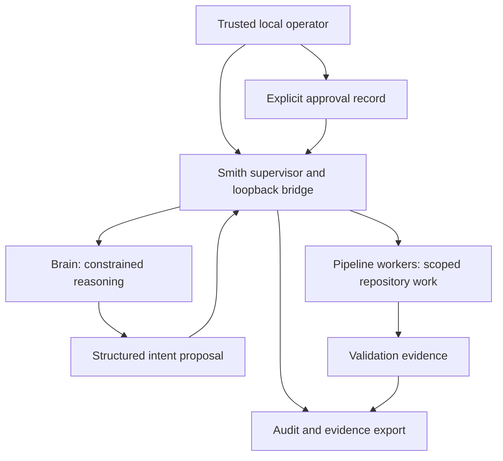

# Smith Architecture

## Status

**Normative target architecture.** The current implementation is the evidence source for what works today; [SMITH Linux Architecture Report](SMITH_LINUX_ARCHITECTURE_REPORT.md) records inspected as-built topology, limitations, and open gaps. A target requirement is not an implementation claim.

## System model

Smith is a Linux workstation control plane, not a general remote agent platform.



The supervisor is the policy-enforcement point. Models propose structured intents; they do not gain authority merely by producing valid-looking text.

## Trust boundaries

| Boundary | Target rule |
|---|---|
| Operator → supervisor | Local single-user trust model. Approval records must identify the action, repository, branch, base revision, target revision, and expiry. |
| Brain → supervisor | The brain is tool-constrained by default. Intent is untrusted data, schema-validated and authorized by the supervisor. |
| Supervisor → worker | Each worker receives only project-specific repository, tools, network, filesystem mounts, and credentials needed for its stage. |
| Worker → host | No Docker socket, broad home-directory mount, or implicit SSH directory access. Paths are allowlisted and canonicalized. |
| Worker → network | Default deny or explicit minimal egress policy. Search, registries, Git remotes, and model endpoints are distinct capabilities. |
| External text → model | Repository content, Jira/GitHub bodies, web search, MCP metadata, and tool output may contain prompt injection. They must never override policy or approvals. |
| Evidence → release decision | Narratives are insufficient. Evidence must include commands/scenarios, revision, result, timestamps, and retained artifacts. |

## Linux workstation topology

- The Rust supervisor and HTTP bridge are local control-plane services.
- The brain may run in a constrained container or as a host process; host execution is not equivalent to a filesystem or network sandbox.
- Coding and pipeline work run in scoped Docker workers.
- Local model inference is designed around host-native AMD-capable Ollama for the reference workstation.
- Search and optional voice services are separate capabilities, not implicit authority granted to the brain.
- All default inbound services must bind to loopback. Any non-loopback publication is an elevated, documented, human-approved exception.

Exact host requirements and resource limits are in [Host Profile](HOST_PROFILE.md).

## Capability model

Every operation must have an explicit capability set:

```text
identity + role + repository + branch + revision + stage
+ filesystem roots + network destinations + credentials
+ tool allowlist + time/resource budget + approval binding
```

Rules:

1. Capability sets are additive only through explicit human-approved configuration.
2. Provider failure or fallback must never add tools, network access, filesystem access, credentials, or publication authority.
3. Worker identity, model/provider identity, task ID, plan ID, and approval ID belong in audit evidence.
4. A role may assess or report a risk but cannot self-authorize an exception.

## State, audit, and recovery

- Treat plan and worker-container artifacts as ephemeral execution state unless exported.
- Retain an audit package for consequential work: intent, plan, revisions, diff identity, validation evidence, assurance verdict, review findings, approval record, and external results.
- Audit records should be append-oriented and digest-linked so omissions or alteration are detectable.
- Pipeline/job identity must be collision-resistant and scoped per operation.
- Restart recovery must reconcile tasks, workers, pending approvals, and external Git state. A stale `running` record must not imply a live job.
- Replays, duplicate events, retries, cancellation, and partial cross-repository updates must be idempotent or fail closed.

## Resource and concurrency policy

- One critical pipeline per project/branch at a time until a scheduler with locking, budgets, and recovery exists.
- Bound CPU, memory, GPU, disk, wall-clock, retry, and model-context consumption for workers.
- Do not perform check-then-act port allocation without reservation/ownership.
- Preserve host responsiveness over autonomy throughput.

## Architecture review triggers

An architect review and architecture-document update are required before changing:

- inbound ports, network egress, images, or container security options;
- filesystem roots, symlinks, bind mounts, SSH, credentials, or MCP tools;
- authorization, approvals, Git push/merge/release paths, or provider fallback;
- storage formats, audit data, concurrency, retries, cancellation, or crash recovery;
- local model hardware assumptions, systemd lifecycle, or required host dependencies.

## Current deltas to resolve

The as-built report documents known deltas including broad worker port publication, broad SSH/config mounts, container-local pipeline state, limited recovery/admission control, and incomplete approval enforcement. These are tracked implementation obligations, not acceptable reasons to weaken this architecture.
