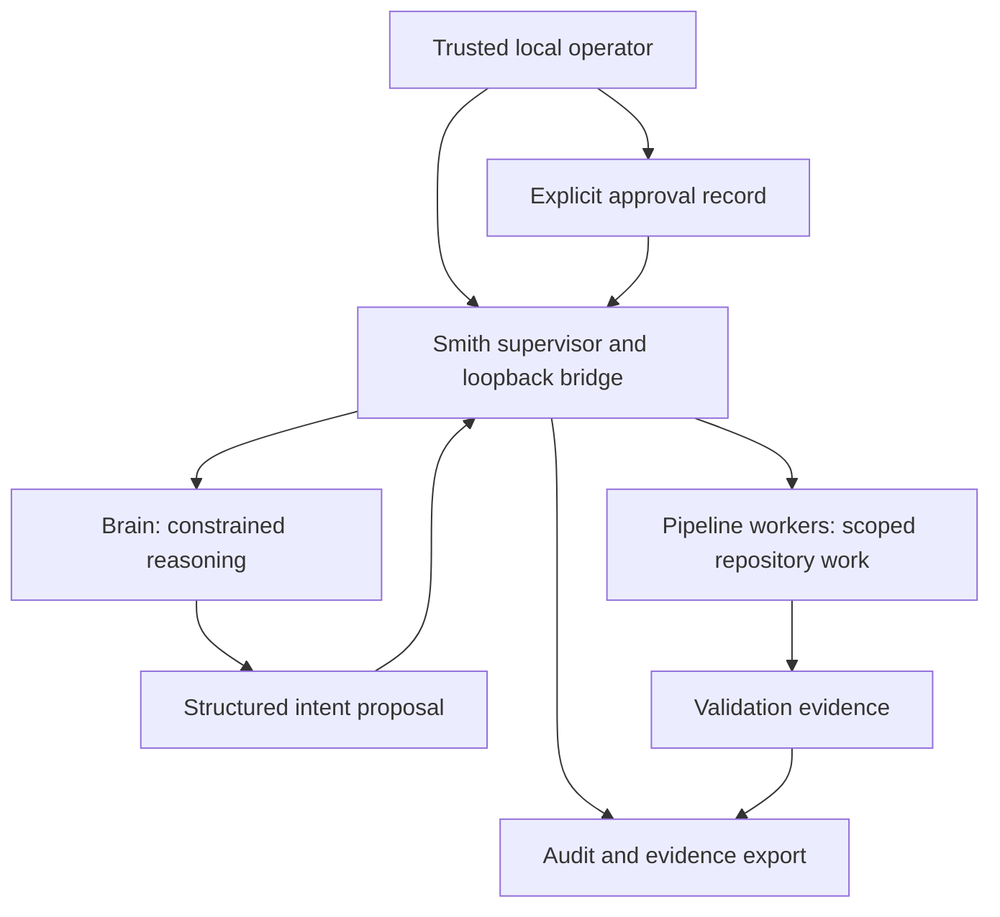

# Smith Architecture

## Status

**Normative target architecture.** The current implementation is the evidence source for what works today; [SMITH Linux Architecture Report](SMITH_LINUX_ARCHITECTURE_REPORT.md) records inspected as-built topology, limitations, and open gaps. A target requirement is not an implementation claim.

## System model

Smith is a Linux workstation control plane, not a general remote agent platform.



The supervisor is the policy-enforcement point. Models propose structured intents; they do not gain authority merely by producing valid-looking text.

## Trust boundaries

| Boundary | Target rule |
|---|---|
| Operator → supervisor | Local single-user trust model. Approval records must identify the action, repository, branch, base revision, target revision, and expiry. |
| Brain → supervisor | The brain is tool-constrained by default. Intent is untrusted data, schema-validated and authorized by the supervisor. |
| Supervisor → worker | Each worker receives only project-specific repository, tools, network, filesystem mounts, and credentials needed for its stage. |
| Worker → host | No Docker socket, broad home-directory mount, or implicit SSH directory access. Paths are allowlisted and canonicalized. |
| Worker → network | Default deny or explicit minimal egress policy. Search, registries, Git remotes, and model endpoints are distinct capabilities. |
| External text → model | Repository content, Jira/GitHub bodies, web search, MCP metadata, and tool output may contain prompt injection. They must never override policy or approvals. |
| Evidence → release decision | Narratives are insufficient. Evidence must include commands/scenarios, revision, result, timestamps, and retained artifacts. |

## Linux workstation topology

- The Rust supervisor and HTTP bridge are local control-plane services.
- The brain may run in a constrained container or as a host process; host execution is not equivalent to a filesystem or network sandbox.
- Coding and pipeline work run in scoped Docker workers.
- Local model inference is designed around host-native AMD-capable Ollama for the reference workstation.
- Search and optional voice services are separate capabilities, not implicit authority granted to the brain.
- All default inbound services must bind to loopback. Any non-loopback publication is an elevated, documented, human-approved exception.

Exact host requirements and resource limits are in [Host Profile](HOST_PROFILE.md).

## Implemented chat-only profile

**Implemented in source:** `src/main.rs` selects `src/commands/offline_chat.rs` for `serve --chat-only --model <exact-installed-tag>`, bypassing legacy supervisor startup. The immutable process profile conflicts with `--echo`; plain `serve` and `chat` retain legacy behavior. The bridge binds only `127.0.0.1` (default port 4783) and exposes health, text chat, and explicit shutdown—not task, file, voice, or service-management routes. Loopback is a single-operator trust boundary, not authentication against other local processes.

Inference goes directly to `http://127.0.0.1:11434`. The client ignores ambient proxies, refuses redirects, requires an exact installed Ollama tag, and rejects remote/cloud model metadata. There is no OpenCode, intent dispatch, task creation, Docker, search, warm-service/sidecar startup, model pull, dependency provisioning, or provider fallback. Model text remains inert selectable text in Halo, without Markdown image/file/network loading. Text requests use the exclusive `/v1/chat-only` endpoint; the legacy router rejects it before reset or dispatch, so listener replacement after health verification cannot route a release-client request into legacy orchestration. Halo validates the successful reply's chat-only profile/schema and never falls back to `/v1/chat`. Health identifies profile/provider/model and reports provider availability separately from listener health.

One shared `default` session is process-local and cleared on restart; no durable history or recovery is promised. Admission allows one active turn without queueing. Source limits are 16 KiB input, 64 KiB assistant text, 64 KiB retained message content, at most 16 retained turn pairs, and a 120-second generation timeout. Old pairs are evicted; failed turns do not append partial history. An explicit reset clears history before inference and reports that clearing even if the new turn fails.

Ubuntu 24.04 x86_64 full Flutter candidates include `smith_backend/smith` beside complete `lib/` and `data/`; a standalone backend candidate remains secondary. Candidates use install-only packaging, not the supervisor installer/unit lifecycle. Existing unit registration still selects legacy `serve`; no chat-only service migration is implemented. See [Chat Release](CHAT_RELEASE.md) for candidate provenance and publication blockers. Source restrictions are not proof of actual network-denied Ollama inference or clean-host installation; final integrated evidence remains pending.

## Next-generation persistent service target

**Approved target, not implemented in `next/`:** the service owns authoritative goals, conversations, configuration and operation state independently of client lifetime. First-use desktop setup starts the service through a defined consented lifecycle; the desktop attaches/synchronizes state. Window close or desktop Quit detaches the client, without stopping the service or already-authorized work. Explicit service Stop is separate; external providers are not implicitly stopped. See [the product reset](plans/LOCAL-SMITH-PRODUCT-RESET.md).

Service supervision must have defined ownership, identity/access checks, duplicate-start/work prevention and startup/shutdown budgets. It must not be implemented by silently orphaning a desktop-owned child or weakening the legacy close/EOF guards. The debug subset below selects a dedicated user unit and Unix transport in source; installed-host behavior is not a deployed guarantee. Durable identifiers/records, atomic writes, migrations, interrupted-operation recovery and retry semantics require review/tests; process survival is not durable state and neither promises uninterrupted crash/reboot execution.

Roles, subagents and triangulation may later build on persistent goal-oriented chat, but model/chat text is not approval for capabilities or external effects. The implemented source below selects login-scoped default-target startup with `Restart=no`; logout/reboot verification, pre-login/post-logout availability and lingering remain separate explicit decisions. The legacy profile retains its existing desktop-owned shutdown behavior until a separately validated migration.

## Next-generation service control and login Boot implementation

**Implemented in source under [LOCAL-SMITH-NEXT-DEBUG-BOOT](plans/LOCAL-SMITH-NEXT-DEBUG-BOOT.md), extended by [LOCAL-SMITH-NEXT-LOGIN-BOOT](plans/LOCAL-SMITH-NEXT-LOGIN-BOOT.md):** `next/client` uses the bundled Rust `smith_backend/smith-service`, not a shell or interpreter. Strict Core schema 2 reports binary, unit, enablement, runtime and bridge independently. Persistent enablement is accepted only for manager `UnitFileState=enabled` plus the exact invoking-user-owned symlink at `systemd/user/default.target.wants/smith-next.service` targeting the exact owned unit; runtime-only, linked, alias, masked, foreign, malformed and unknown combinations fail closed.

The isolated unprivileged `systemd --user` unit has `Type=simple`, `Restart=no`, `UMask=0077`, a five-second stop budget, and deterministic `[Install]\nWantedBy=default.target`. Enable runs fixed `systemctl --user enable smith-next.service`, never `--now`; Start is a separate action permitted only for an exact installed, enabled, safely stopped unit. Neither control nor installer invokes `loginctl` or mutates lingering. Enable and Start use separate expiring single-use prepare/confirm/apply bindings over action, roots, artifact/unit identity and current facts; these bindings correlate trusted-local consent but do not authenticate against hostile same-UID processes.

Fresh installation orchestration is artifacts → register/reload → separately confirmed Enable → separately confirmed Start → fresh Core/app readiness. Decline or failure preserves completed effects and reports incomplete/partial state; there is no rollback, implicit Start from Enable or implicit Enable from Start. Defaults remain validated XDG data `smith-next/bin/smith-service` and state, config `systemd/user/smith-next.service`, and private runtime sockets. Unsafe roots, changed artifacts, overrides, foreign units/listeners and ambiguous states block action. Exact-owned stopped pending-reload units retain separately consented reload-only repair. Production control/serve rejects UID zero.

The adapter retains managed FragmentPath/MainPID, executable bytes/path, socket metadata and Linux SO_PEERCRED UID/PID verification. Core frames remain bounded; the foreground daemon serializes requests and rejects duplicates through its held lock. Desktop disposal cleans only short-lived owned helpers, never the independently managed daemon; cleanup uncertainty blocks reuse and requires fresh inspection.

The application mounts a minimal Boot surface before the existing conversation UI. It serializes Core read-only inspections within a 15-second monotonic observation budget, then uses the application protocol's separate finite helper/operation bounds for conversation synchronization; the 15-second observation clock is not presented as a fabricated synchronization percentage or cancellation guarantee. Boot shows only a restrained `CustomPainter` loop and short live status (`Starting Smith`, `Connecting to Smith`, `Syncing conversation`), and substitutes a static mark when reduced motion is requested. No sidebar/chat controls mount during Boot. Chat mounts only after exact enabled + bridge-ready facts and conversation synchronization. Boot performs no automatic Start, Enable, install, model operation, inference or resend. Only a fresh exact installed + registered + enabled + safely stopped state with unavailable bridge exposes **Start Smith**; Start follows prepare → exact visible confirmation → apply original token → fresh bounded observation. Disabled, static/missing, conflict and unknown states never expose Start.

This implements a **login-scoped target after user login**. With lingering unchanged, it is not a pre-login or post-logout guarantee. Component tests use fake managers/private roots, isolated GTK, and a real compiled Rust↔Dart fixture; real user-manager behavior, actual login/logout/reboot, installed-host upgrade/uninstall, release and deployment remain unverified and require fresh exact approval.

## Current next bundled native runner

**Implemented source:** [native-runner plan](plans/LOCAL-SMITH-NEXT-NATIVE-RUNNER.md), extended by the first [GPU-preferred source slice](plans/LOCAL-SMITH-NEXT-GPU-PREFERRED.md), supersedes earlier Ollama-specific `next/` descriptions below, not legacy behavior. Desktop → persistent Rust service → worker-owned llama.cpp child → explicit curated GGUF. The paired selected release contains independent `smith_backend/runtime/cpu/` and `smith_backend/runtime/vulkan/` subtrees from SHA-pinned llama.cpp `b11429`; libraries are never mixed. Both retain `$ORIGIN` runpaths. CPU retains glibc/libstdc++/libgcc/OpenSSL3 host dependencies with bundled libgomp. Vulkan additionally depends on the prepared host's `libvulkan.so.1` and driver/ICD stack; Smith does not bundle or provision a driver. Service-only publication reports `RUNTIME_MISSING`. This process is not a filesystem/network/GPU-driver sandbox.

Models and exact catalog-bound markers live in XDG data `smith-next/models`,0700 directory/0600 files. Full model SHA and runtime manifest verification check deadline/cancellation between bounded1MiB reads. The verified model descriptor survives exec and is loaded through `/proc/self/fd/<fd>` with separate SHA alias: pathname replacement cannot swap the verified model, but hostile same-UID inode writes are not prevented. Runtime hashing is a point-in-time integrity check only: executable/library paths are rechecked before launch but are not descriptor-bound through dynamic loading, so hostile or concurrent same-UID replacement after verification is outside the guarantee and may fail or execute changed native code. The prepared single-operator trust model does not treat this as same-UID sandboxing. Individual filesystem syscalls/fsync have no real-time cancellation guarantee.

One inherited `runner.lock`, fresh private `runner-<random>/llama.sock`, peer UID/PID checks, cleared environment and random API key constrain ownership. Keys remain weak against same-UID processes. Own process group, race-checked parent-death SIGKILL, TERM≤2s/KILL≤1s cleanup, idle stop600s. Service app-owner teardown fences publication, atomically cancels native waits and joins cleanup; desktop close only detaches. One slot, bounded CPU threads,ctx4096/max_tokens1024 and180s cooperative dispatch budget. Request-only context trimming uses rendered template/tokenization, conservative byte-token fallback; durable history remains unchanged. Model-default reasoning without a forced-zero override; only final content is exposed/persisted, and empty/reasoning-only or token-cap-truncated replies fail. Identity mismatch/tool calls are rejected. No external Ollama/TCP endpoint, tools/cloud or implicit download/retry.

Production Auto first verifies and launches the Vulkan subtree with fixed `--device Vulkan0 --split-mode none --gpu-layers all --fit off`. Startup success additionally requires exactly one revision-bound `load_tensors: offloaded X/Y layers to GPU` line with `X == Y > 0`; zero, partial, missing, malformed or duplicate evidence is not full-GPU success. Missing Vulkan runtime or classified startup/evidence failure may fall back once only after confirmed child cleanup; the held model/runner lease is returned for the independent CPU launch and the original deadline is retained. CPU uses fixed `--device none --gpu-layers 0 --fit off`. After a Vulkan runner is accepted, any request/preparation/completion failure ends that operation without CPU replay. Automatic partial offload, device discovery/classification, stable-device persistence, configurable preferences and app execution-status reporting are not implemented in this slice.

**Implemented source correction under [GPU startup fix](plans/LOCAL-SMITH-NEXT-GPU-STARTUP-FIX.md):** Vulkan also uses fixed `--log-verbosity 4 --no-log-prefix --no-log-timestamps --no-log-jsonl`, because pinned `b11429` library INFO is verbosity 4 and default logging is decorated. CPU arguments remain unchanged. Only complete newline-terminated records in the bounded startup prefix count. A valid candidate remains provisional through a fixed at-most-one-second post-health observation window under the original operation deadline; cancellation, child exit, capture failure/EOF, incomplete records, duplicates and the unchanged 64 KiB raw-prefix cap fail closed. The final locked snapshot covers observed startup bytes, not future stderr; health is not a logging flush barrier. Explicit flags normalize logging, not upstream configuration-file isolation or a driver sandbox.

The provider retains one finite, fixed-message last-startup fallback cause through CPU success/failure, reuse and idle unload. The Rust-only `last_startup_fallback_reason()` accessor uses `try_lock`, returns explicit busy/unavailable rather than blocking behind generation, performs no runtime action and is not a wire/UI/current-mode contract. A fresh preparation clears it; provider teardown loses it. No raw native output, paths, prompts or keys are copied into the retained cause. CPU operation errors remain authoritative; unknown cleanup/integrity/cancellation/deadline failures do not gain fallback authority.

Installer-only explicit HTTPS download: no proxies/retries, at most3 redirects, https443 to exact `huggingface.co` or label-boundary `*.hf.co`, exact size/SHA,30s idle/1800s observation budgets. Existing installation lock, free-space check, held-directory private staging, synced no-clobber model publication and marker-last preserve conflicts/partial stages. Artifact limits unchanged. Optional inference uses the same lease/held API and saves no turn. The focused model wizard below owns GUI provisioning; real-model/clean-host/release evidence remains separate. Streaming models are bounded to16GiB, independently of unchanged artifact publisher limits. The synchronous installer worker constructs async request/body futures through factories inside its owned Tokio runtime; constructing reqwest timeout-bearing requests before entering the reactor is invalid. Deadline/cancellation checks occur before factory invocation and during polling, with no detached transfer or implicit retry.

## GPU-preferred runner direction and remaining work

**Partially implemented in source:** the first slice above provides paired CPU/Vulkan artifacts, explicit full-offload attempt, strict actual-offload evidence and one confirmed-cleanup startup fallback. [The GPU-preferred plan](plans/LOCAL-SMITH-NEXT-GPU-PREFERRED.md) remains authoritative for later device discovery/classification, stable explicit selection, resource budgeting, validated partial offload, versioned preferences and compact execution reporting. The current fixed `Vulkan0` Auto attempt is not a persistent device identity or suitability judgment and must not be advertised as general Vulkan-device selection. The separately approved non-model device/driver observation is recorded in [Host Profile](HOST_PROFILE.md); it does not establish model fit, real GPU/CPU inference, resource behavior under load or performance, which remain unverified.

## Current next cloud routing and credential boundary

**Implemented source under [cloud-provider plan](plans/LOCAL-SMITH-NEXT-CLOUD-PROVIDERS.md):** `next/service/src/app_v3.rs`, `app_v3_worker.rs` and `cloud*.rs` extend the existing service-owned domain/worker, not a second scheduler. Flutter and provider-aware installer exchanges use application schema 3; the original cloud disk schema 3 extends `app_v2.rs` and is now migrated to disk4 by the message-timestamp addition below. Core schema 2, unit/lifecycle ownership, four outstanding chats, one outstanding request per conversation and one executing inference remain. This supersedes earlier `next/` schema-2-only, global-only model routing and installer-only active-selection descriptions; those sections retain their local/historical baseline, not a cloud exclusion.

**Compatibility and persistence:** valid disk1/disk2 configuration, histories, receipts, IDs/tombstones, full-u64 configuration revisions and inert legacy data migrate without invented model provenance. Corrupt/unsupported state is preserved. Existing state/history shapes stay strict; separate `route_catalog`, `conversation_routing` and `request_routing` queries expose bounded non-secret metadata. Old local operations remain local-only with exact unaffected v1/v2 projections. Legacy state/poll or target access that cannot represent retained v3 work/routing fails `UPGRADE_REQUIRED`, never hides it or executes a cloud default. Provider-aware installer paths use explicit v3 handling even for later local Model management; production Flutter has no mutation/version fallback. The current disk4 format (including the timestamp extension below) is not readable by older binaries: rollback requires separately approved pre-migration state plus compatible paired binaries and tested restore. Keyring items are outside the JSON snapshot; restore must not substitute a different credential generation.

**Routing and consent:** per-chat selection is process-local, with last accepted route only a reattach hint. Admission snapshots provider/model, local digest or cloud endpoint/policy, credential generation/provider revision, context/hash, revisions, limits and deadlines. It does not change the installer's local default or another accepted request. First transfer to a provider/generation requires a request/context-bound confirmation; the generation is an opaque credential identity, not verified vendor account identity. Approval is retained per conversation for later explicit sends, including intervening retained local/other-provider turns. Model changes at the same approved destination do not repeat consent; a new generation does. Every cloud send still needs fresh preparation: 60-second admission and 600-second dispatch deadlines fixed at preparation, with the existing queue-age limit independently enforced. Save/validation retain their original 60-second effect-start authorization. Decline or expired pre-admission preparation creates no approval or chat; post-admission dispatch expiry does not revoke already-granted destination consent. Same-chat switching and unavailable historical identities never authorize automatic substitution, branching or history deletion.

**Credential boundary:** the service alone uses the `cloud_keyring.rs` adapter against an existing unlocked Ubuntu GNOME Keyring Secret Service/default collection. It connects only to `/run/user/<uid>/bus`, checks socket/peer/service-owner UID and pins the unique owner; it ignores ambient D-Bus addresses and uses `NoAutoStart`. The encrypted Secret Service session has no plaintext-session fallback. Read-back accepts exactly GNOME's normalized `text/plain` or `text/plain; charset=utf-8`; this MIME metadata does not select encryption or bypass bounded printable-ASCII validation. See the [provider-save MIME correction](plans/LOCAL-SMITH-NEXT-PROVIDER-SAVE-FIX.md). Returned attributes must contain all four exact Smith identity fields and no extras except the optional exact `xdg:schema=org.freedesktop.Secret.Generic` pair; absent schema requires four attributes, present schema five. Unknown schema values/extras and missing/changed identity fields fail before secret retrieval, and the same predicate is checked again after retrieval. This [schema compatibility correction](plans/LOCAL-SMITH-NEXT-PROVIDER-SCHEMA-FIX.md) does not add schema to outgoing search/create identity, relax timestamps or adopt inactive items. There is no activation, unlock, Prompt invocation, collection creation or environment/file credential fallback. Bounded keyring work runs on the sole worker, at most three seconds, not under the app mutex or on a UI thread. Keys enter only through the installer's private exchange, remain volatile/best-effort zeroized, and are excluded from durable tasks, fingerprints, logs and model context. Same-UID checks and zeroization are not a hostile-same-user, swap or core-dump isolation guarantee.

Each confirmed save creates one fresh namespaced item before activating its opaque reference in JSON. Keyring publication and state activation are not one transaction: failure/uncertainty can leave an inactive item and requires observation of the original operation, not retry/adoption/cleanup. Previous generations remain; P0 offers no removal/purge and Uninstall leaves keyring items and vendor credentials untouched. Each dispatched request retrieves its exact admitted generation, never a replacement. Under the [saved-key attempt contract](plans/LOCAL-SMITH-NEXT-SAVED-KEY-ATTEMPTS.md), an active saved credential reference with an exact matching generation and supported model makes a cloud route eligible for a new explicit attempt. Current-instance observation and prior successful validation are not prerequisites; cached unobserved/locked/missing/conflict/unavailable observations and failed/interrupted validation remain advisory. `ModelChoice.available` means attempt eligibility, not guaranteed credential access or provider acceptance. `ProviderView.credential_state` and its errors remain factual current-instance observations, and `validated_model` still identifies only the exact model/generation from a successful explicit check. A normal chat success does not invent a validation record. Actual dispatch freshly retrieves the exact admitted credential and rechecks its identity/revision before any HTTP; inaccessible credentials fail closed at that point. Cached catalog/state/routing reads do not access keyring or APIs; explicit probes read keyring only. Startup, selection, credential save and observation-only recovery never perform vendor inference.

**Cloud adapter limits:** `cloud.rs` compiles fifteen exact text-model identities (seven OpenAI, eight Anthropic) from the [API contract](plans/LOCAL-SMITH-NEXT-CLOUD-API-CONTRACT.md), expanded by the [static-catalog follow-up](plans/LOCAL-SMITH-NEXT-CLOUD-CATALOG-EXPANSION.md). Rust and Dart exact catalogs are synchronized; the existing eight-per-provider bound and optional first-per-provider validation defaults remain. Cloud eligibility uses the active saved generation, independently of cached observation or past model-test success; local readiness is unchanged. Added choices are not individually verified until explicitly tested, and account/model failure remains a one-attempt error. Picker text filtering is presentation-only over the cached catalog, not discovery or API authority. Strict older clients/installers can reject new model IDs despite unchanged schema; rebuild/use the paired artifacts rather than claiming mixed-version compatibility. `cloud_http.rs` sends only to `https://api.openai.com/v1/responses` or `https://api.anthropic.com/v1/messages`, with certificate/hostname checks, no ambient proxies, redirects, automatic/protocol retries, tools, remote conversation chaining or provider/model fallback. There is no production endpoint/trust override; test-only injection is separate. The service requests at most **8192 total generation tokens including reasoning**, under the original **180-second** operation budget including credential access; connection time is at most ten seconds within that budget. Its single-connection Hyper HTTP/1 and Rustls transport enforces a 16-KiB raw response-head limit while reading, including whitespace/status lines/informational heads, rather than checking normalized headers after buffering. It incrementally caps response bodies at 1 MiB and final text at 64 KiB. Request context including the proposed user message is bounded to 64 KiB and trimmed by oldest complete pairs without rewriting durable history; current input remains at most 16 KiB. Only validated complete final text is published; reasoning-only, truncated, tool-bearing or wrong-model replies fail without replay. The native runner retains its 1024-token cap and existing local Vulkan-startup/CPU exception. Fixed URLs are not an OS egress sandbox; OpenAI `store:false` is not a vendor zero-retention guarantee.

**Delivery and evidence boundary:** `may_have_sent` is durably published before the single HTTP attempt, with ownership/deadline checks after publication; publication failure prevents dispatch. Request/result state distinguishes `not_sent`, `may_have_sent` and `received`. Restart interrupts unfinished work without replay; possible remote dispatch or credential publication remains explicitly uncertain, not proof of no processing/billing. Close detaches; stopping observation does not cancel an accepted service request or guarantee remote cancellation. Required synthetic/compatibility/integration gates are in [Process](PROCESS.md#next-cloud-provider-validation-and-compatibility); final combined results and fresh assurance are parent-owned in `next/VALIDATION.md`, not asserted here. No real keyring/API, installed-state migration or deployment evidence is supplied by this source description.

## Next-generation text-only application and installer

**Implemented source:** [text reset](plans/LOCAL-SMITH-NEXT-TEXT-RESET.md) retains the private managed Rust service and durable bounded worker. The multi-chat implementation below supersedes app protocol/storage schema 1 with schema 2 while retaining the exact v1 installer projection; Core lifecycle remains strict schema 2 under the login-boot implementation above. The native runner above supersedes its external Ollama adapter. The original desktop operations state/models/configure/submit/poll are extended by the conversation operations below; installer operations retain configure_checked/verify_model/remove_model. New speech execution fails explicitly. Inventory observes only the bundled runtime and curated local store, never retired provider ports. Minimal legacy voice fields/results remain bounded compatibility data; valid v1 history/preferences/IDs/tombstones survive and old running jobs interrupt without replay. Retained duplicates resolve original results; conflicting/expired IDs retain protection. Archived source is outside all explicit inputs.

After the login Boot synchronization gate, the desktop mounts the conversation workspace, not a provisioning wizard. Runtime identity and availability gate sending; the legacy setup_complete boolean does not. Retry inspects/synchronizes/polls, never provisions or resends. Authoritative history and request-keyed verified terminal answers are separate so outage recovery neither duplicates turns nor loses a known reply. Under [minimal chat](plans/LOCAL-SMITH-NEXT-MINIMAL-CHAT.md), the app has no installer handoff/dialog or model configuration controls. Installation and saved model selection belong to the separate installer. Missing prerequisites disable Send and show concise external-repair guidance; explicit Retry reobserves state/inventory without provisioning, configuration or replay.

**Implemented native installer source:** [the native migration](plans/LOCAL-SMITH-NEXT-NATIVE-INSTALLER.md) replaces the recipient Python runtime with the independent Rust crate/workspace and lockfile at `next/installer`. Dagger's full package exports native Linux x86_64 CLI `smith-installer` and GTK3 sibling `smith-installer-ui` with the complete paired Flutter/service payload, manifest, checksums and instructions under `next/installer/dist/`. The GUI uses the optional `gui` feature; the default CLI retains no GTK/display dependency. Recipients need compatible Ubuntu 24.04 native runtime libraries, not Python or builder toolchains; native does not mean statically linked or portable to arbitrary Linux distributions. Python Dagger and `next/dagger/package.py` are builder-only orchestration/metadata tooling, not host publication or lifecycle implementations. The retired Python sources/tests remain checksummed under excluded `reference/python-installer-v1/`, with no maintained fallback. Client/service source and wire/unit contracts are unchanged by this migration.

Full recipient mode accepts `--bundle`, `--dry-run`, `--model EXACT`, `--pull-model` and `--verify-inference`; omitted `--bundle` resolves beside the actual canonical running executable, not cwd, argv alias or PATH. Artifact publication, unit registration/reload, login Enable, Start, exact-model download, saved preference and optional direct minimal inference each require separate consent. There is no recipient `--yes`. Dry-run and initial artifact decline do not create destination files/locks or construct runtime roots, a manager/backend or provider; artifact-only mode below also never contacts managers/providers.

Orchestration directly reuses `smith_service::Controller` from `next/service`, with `source` set to the packaged `payload/service/smith-service`, never the installer executable. Runtime roots/backend are constructed only after artifact consent/publication. Existing inspect/prepare/confirm/apply and `Controller::app` retain the managed executable/unit/MainPID, socket/peer and instance/request-correlation checks; this is not an installer-owned service or wrapper-helper subprocess. The original Core preparation token retains its 60-second expiry, without automatic reprepare/retry. Consent input is bounded to 4096 bytes including newline and 60 seconds; EOF, interruption and timeout do not approve. Cooperative cancellation retains Core manager cleanup and individual manager/socket budgets, not a total 45-second filesystem deadline. Bounded setup/progress console output accepts pipes, sockets and terminals, rejecting regular files/other devices whose writes cannot be bounded with `O_NONBLOCK`; the artifact publisher's separate stdio reporting is not covered by that deadline contract. Filesystem writes/fsync and external daemon cancellation are not deadline guarantees. Incomplete reporting or later failure preserves accepted/uncertain effects, never implies rollback.

Models remain outside the default payload. The bundled CPU runner and curated model store replace the prior external Ollama dependency. A reviewed explicit payload-path contract excludes weights/voice/reference artifacts; checksum metadata is not authenticity. Neither installer provisions OS/GPU/Docker dependencies, writes the debug completion flag, launches the desktop automatically, performs implicit upgrades or changes lingering policy. Current full-recipient orchestration separately confirms exact login Enable and Start as described above.

The frozen wire keeps inert voice fields for old data only; no audio capture/playback, WAV/base64 execution or voice dependency/pipeline remains. The reference is a source snapshot, not a supported alternate product. Actual text installation/inference/graphical lifecycle and a new installed-candidate upgrade remain separately approved gates; the previously approved voice deployment was not altered by source trimming.

## Current next multi-chat storage and scheduling

**Implemented source under [multi-chat plan](plans/LOCAL-SMITH-NEXT-MULTI-CHAT.md):** `next/service/src/app_v2.rs` owns schema-v2 conversations and durable FIFO admission. Valid v1 state migrates atomically into one `Current chat`, preserving configuration/history/results/replay IDs and inert speech metadata; unfinished jobs interrupt without replay. Missing legacy submitted text is not invented. Unsupported/corrupt state is preserved. New chat is client-local until `submit_new` atomically allocates a service ID and records an accepted request. Context is conversation-isolated; model/configuration remain global.

At most 32 active+archived conversations retain 16 pairs/64 KiB each; input is bounded to16 KiB, retained operations to32 and expiry IDs to1024. Encoded-state preflight reserves completion/transition headroom within16 MiB and4 MiB frames, including JSON expansion. Only terminal operations can expire, with their IDs retained; normal capacity rejection does not latch a storage fault. Unexpected transition/publication failures fence the service. Four chat requests may be outstanding, at most one per conversation and one executing globally; excess queue age is checked before dispatch at ten minutes. The existing180s provider budget, sole worker/runner, `runner.lock`, `--parallel 1`, CPU/Vulkan selection and no completion replay are unchanged. Close detaches; service restart interrupts all queued/running work before readiness. This is concurrent admission, not parallel inference or automatic crash resumption.

Desktop app v2 returns a bounded summary index and separate conversation details, with request/conversation/revision-bound submissions and lifecycle mutations. Exact v1 installer DTOs remain unchanged, including state keys `config/history/active/providers/retention`; no queued status or another conversation's job leaks into v1. Valid legacy configuration revisions retain the full u64 range: v2 emits a JSON number through9007199254740991 and a canonical decimal string above that; v1/disk remain numeric. Clients echo the representation without conversion or loss; maximum revision refuses further configuration mutation. Other newly generated revisions/sequences remain safe integers. All recognized app reply/error paths correlate version and call ID. Production desktop never falls back to v1.

Initial v2 titles are derived in the atomic first-submit transaction from the unchanged full prompt, with whitespace collapsed, forbidden characters removed and a 40-Unicode-scalar cap. New renames enforce the same cap. Stored/incoming title validation retains the historical 256-byte limit, including lifecycle receipt snapshots; no existing title or replay result is rewritten. The client caps ordinary display through a shared formatter without changing authoritative metadata. Rename/archive/restore/delete are atomic, idempotent and revision-checked. Archive/delete refuse target queued/running work; client uncertainty additionally blocks them. Delete removes current-store title/history/payload/result and content-derived fingerprint records, preserving only opaque replay protection and a bounded content-free delete receipt. It does not stop the runner or promise erasure from RAM/KV caches, journals, swap or backups. Tombstone exhaustion refuses deletion without partial effects. Late worker publication requires the same running request, conversation and history revision and cannot recreate a deleted record.

One client workspace owns the serialized helper arbiter and current-instance inventory, with per-chat process-local drafts, scroll, uncertainty and provisional answers. Boot synchronizes index/selected detail/operation identities without waiting for generation; readiness is not persisted across service instances. Poll errors after acceptance retain identity; historical lifecycle receipts cannot roll back newer metadata. Full wire/state/recovery details and tests are in the plan and `next/VALIDATION.md`. No live state was migrated by these source/fixture checks. Live rollout requires a separately approved pre-migration state snapshot and paired client/service; old binaries cannot consume v2, so binary-only downgrade is invalid.

## Saved message timestamps

**Implemented source under [message-timestamp plan](plans/LOCAL-SMITH-NEXT-MESSAGE-TIMESTAMPS.md):** disk4 adds a required, bounded conversation-keyed timing sidecar to the existing atomic application record. Strict disk1/2/3 migration preserves history, routing, receipts and configuration, with no invented historical dates. Missing sidecar entries mean wholly unknown times; present entries align exactly with the retained history pairs. Admission reserves completion metadata space; successful ordinary and routed local/cloud publication appends and trims timing in the same transaction as history/result. Logical deletion removes the associated timing, and job eviction does not erase retained history timing.

The strict role/content `Message` type, provider payloads and consent-bound context hashes are unchanged. Schema-3 read-only `conversation_timestamps({conversation_id})` returns `{conversation_id, history_revision, turns:[{user_at_ms, assistant_at_ms}]}`, at most 16 pairs. Each time is null or a positive UTC epoch-millisecond integer through 253402300799999. YOU is service admission; SMITH is the wall-clock sample after final-output validation/publication fences for the successful history transaction, not exact fsync completion. Invalid clocks remain unknown, and clock corrections never reorder the transcript or rewrite timestamps. Failures/interruption publish no completed pair.

The desktop only attaches metadata to the matching service instance, conversation, saved history revision and pair count. Optional missing/failed/mismatched metadata leaves history readable without dates; no observation-time replacement, request replay or new provider capability is introduced. Application schema3 and Core schema2 remain unchanged. Older binaries reject disk4: separately approved rollout/rollback requires the pre-migration state snapshot plus compatible paired binaries and preserved keyring-generation references, not binary-only downgrade. No installed migration is authorized or claimed by source validation.

## Client-side sequential message queue

**Implemented source under [message-queue plan](plans/LOCAL-SMITH-NEXT-MESSAGE-QUEUE.md):** each conversation controller owns one volatile FIFO shared across panes, including hidden views and first-message promotion. The workspace owns a coalesced serialized dispatcher. Logical message identity is separate from each immutable service attempt. Follow-ups are bounded to eight per conversation/32 desktop-wide plus one current-predecessor allowance per conversation, at 16 KiB UTF-8 each. Never-dispatched waiting has no execution timeout and occupies no service admission slot. The existing four-outstanding/one-per-chat/one-worker limits remain authoritative.

Advancement requires the correlated predecessor's successful terminal result and its saved history; a fresh target detail is read before dispatch and the exact expected history revision is submitted. Unknown admission/poll outcomes retain the original identity without replay, including potentially post-commit STATE_UNAVAILABLE. Failure blocks the logical head. Explicit Retry creates a new attempt only for a definitively failed/not-admitted head; Skip explicitly abandons a resolved or never-attempted head, never cancels active work. Configuration/instance/foreign-history changes pause and require explicit review. Action revisions fence stale UI callbacks. Normal observation remains query-only; it can wake the separate dispatcher for an already-authorized unpaused local queue, never resume a paused or uncertain chain. This is observed-instance protection, not atomic restart fencing or exclusive ownership across desktops.

One shell-owned, identity-bound exit hold blocks every undispatched Send/enqueue/Retry/pump while normal Close/Quit is decided. A GTK delete-event/quit gate destroys the desktop only after an explicit true Dart reply; missing/failed replies keep it open. Cancellation releases only that hold; confirmation retains it through disposal. Counts deduplicate hidden/shared conversations and independent blanks. Queues/drafts are not persisted; forced termination remains unprotected and accepted service work is not stopped. No service/wire/storage change is introduced by this queue slice. Cloud routing, generation-bound transfer consent and remote-delivery uncertainty require the separate cloud-provider integration contract; generic queue Resume is not permission for new cloud egress.

## Automatic desktop connection observation

**Implemented source under the operator-requested polling follow-up:** after Boot reaches ready, `WorkspaceController` owns one idempotent timer, with the first read after 30 seconds and the next 30 seconds after the preceding observation completes. Automatic reconciliation uses only app `state`, necessary `conversation_get` and existing-request `poll` through the owned native API. It never admits model inventory, lifecycle, configuration, inference or replay work. Whole reconciliation workflows are serialized; automatic checks preserve finite request/mutation/global budgets and expired markers. Healthy checks do not invalidate connectivity; outages preserve local drafts/history and original pending identities, and later successful checks recover connectivity. Instance changes invalidate cached model facts, so automatic reconnection does not guarantee Send eligibility. Missing inventory still requires explicit observation/recovery.

Post-Boot workspace Retry uses the same serialized app synchronization plus explicit inventory refresh, not a competing Core inspection. Status verifies app transport/state, not continuing login enablement; Boot retains its finite Core readiness/explicit Start boundary. A Send queued behind observation captures immutable text, draft/config/history/instance/conversation identities and reserves the conversation synchronously, then revalidates before dispatch. It never substitutes newly edited text. Disposal cancels timers and fences queued/late work without stopping the service. Thirty seconds is an idle polling interval, not an outage-detection deadline. See `next/client/CONNECTION_POLLING_VALIDATION.md` for scoped review and outstanding combined gates; no installed-host validation is implied.

## Split-workspace experiment ownership

**Implemented local source under [split-workspace plan](plans/LOCAL-SMITH-NEXT-SPLIT-WORKSPACE.md):** up to four retained `WorkspacePane` handles separate selection and unsent New chat identity from the single `WorkspaceController`. Saved conversation IDs still map to one shared conversation controller. Blank promotion correlates across pane-owned unsent controllers; archive/delete/index removal repairs every affected pane. Snapshots deduplicate visible selections, while pending work in hidden panes remains observed. Pane creation/visibility does not create another API client, heartbeat, Boot coordinator or inference worker.

Under [shared header](plans/LOCAL-SMITH-NEXT-SHARED-HEADER.md), the Flutter grid duplicates only `SmithWorkspace` bodies. A single controller-free `SmithAppHeader` sits above both canvas scroll views; the existing split owner retains the sole Layout menu and focus scope. Global menu interaction does not activate a different pane unless the current pane becomes hidden. The header extraction changes no preference schema or service ownership. Each `ChatPanel` owns editor/focus resources and per-conversation reading bookmarks independent of shared draft/history state. All pane actions retain the existing serialized reconciliation and synchronous send reservation. The backend protocol, durable state, four-outstanding limit, one-per-chat admission and one actual inference are unchanged. The [workspace restoration extension](plans/LOCAL-SMITH-NEXT-WORKSPACE-RESTORE.md) now persists presentation preferences only; drafts, reading bookmarks and provisional recovery remain process-local. No service authority is introduced. Source review and focused tests do not substitute for installed graphical acceptance; see the plan's validation limitations.

## Session-only desktop windows

**Implemented client source under [New window](plans/LOCAL-SMITH-NEXT-NEW-WINDOW.md):** the shared header's New window action requests one independent desktop process using the current resolved executable, exactly `--session-only-window`, detached execution and no shell. Launcher injection occurs only in production `main`; embedded/test constructors do not implicitly launch host processes. Pending creation disables only that action; failure is sanitized and requires deliberate retry. Successful process creation is not evidence of a visible window or service readiness.

The exact startup flag omits workspace preference-store construction entirely: additional windows do not load, save, lock or adopt workspace preferences, even after the originating window closes. Ordinary startup persistence is unchanged. Additional windows start default 1×1/Chat with ordinary Boot-selected conversation, not a copied workspace. Every production window can open another session-only window. Each process owns its normal Boot/API/observation, drafts, local queues and exit guard; saved conversations and existing service admission/resource limits remain shared. No service/protocol/native runner change, automatic lifecycle/inference/replay action, parent-child termination ownership or cross-window draft/queue synchronization is introduced. Session-only means presentation, not ephemeral service chat history. Source/fake tests and builds do not establish native graphical or multi-monitor acceptance.

## Workspace entrance presentation

**Implemented client source under [workspace entrance](plans/LOCAL-SMITH-NEXT-WORKSPACE-ENTRANCE.md):** one finite UI-only animation scope mounts inside the existing conversation screen after Boot and preference hydration. Header, workspace and chat regions consume the same 620ms clock through retained paint-only opacity/translation wrappers; their real layout, scroll/editor resources, pane identities and service ownership remain unchanged. No animation state is persisted. The scope gates only workspace pointer/focus/actionable semantics during entrance; reduced motion or recovery settles it permanently, and Close/Quit remains outside the scope. Polling, navigation and layout updates cannot restart the timeline or authorize API effects. The prior loader has its own unchanged readiness/timing boundary. Source/widget checks are not installed graphical acceptance.

## Client workspace preference storage

**Implemented source under [workspace restoration](plans/LOCAL-SMITH-NEXT-WORKSPACE-RESTORE.md):** a strict version-1, at-most-4-KiB JSON record stores the four-preset layout, active tile and exactly four saved-chat-ID-or-null / Chat-or-Settings slots, including hidden slots. It contains no chat text, drafts, titles, scroll/editor state, operation identities, readiness or service/model configuration. Production storage is injected only by `main()`; test/embedded constructors have no implicit host store.

The Linux x86_64/glibc client-local adapter uses `XDG_STATE_HOME/smith-next/client/workspace.json`, or `HOME/.local/state/smith-next/client/workspace.json` when XDG state home is absent/empty. Relative roots are rejected. Explicit/XDG state roots must already exist; the HOME fallback may create `.local/state`. Directory-relative no-follow opens validate ownership and modes; owned application directories are 0700 and files 0600. A lifetime nonblocking `flock` prevents competing cooperating desktop writers, including separate stores in one process. Saves are serialized/coalesced, use an exclusive same-directory temporary file, file fsync and atomic rename, and verify the previous file/lock identity. This is not a directory-fsync/power-loss guarantee, protection against a malicious same-UID actor, or a hard filesystem deadline.

Corrupt, unsupported, unsafe or inaccessible storage is preserved and saving is disabled for that session. The UI warns and remains usable. Restoration runs once after authoritative Boot synchronization and before workspace interaction; saved null overrides default selection, missing/archived IDs fall back to independent blanks, and those repairs are saved. Transient detail failures retain selected identity. Restoration never submits, replays, starts services or changes configuration. Layout/page/selection changes and accepted blank promotion save preferences; ordinary draft/status changes do not. Pending writes drain before store close during normal widget disposal, but abrupt process termination may lose the latest preference. Existing service persistence/recovery remains independent.

## Installer-owned appearance resources

**Implemented presentation-only option A under [installer redesign](plans/LOCAL-SMITH-NEXT-INSTALLER-REDESIGN.md):** `next/installer/src/appearance.rs` is imported only by the optional GUI binary. JetBrains Mono faces and rasterized derivatives of the selected supplied icons are embedded, independent of candidate/client files. Three sealed, close-on-exec anonymous Linux memory files remain process-owned while Fontconfig application-font entries refer to them; partial registration failures also retain descriptors to prevent stale descriptor-path reuse. Pango's caller-thread map is refreshed, without a system font install, disk fallback, font-cache command, network fetch or new worker. Required native font/PNG support is checked before constructing the effect worker. This is resource loading, not a sandbox guarantee about all native GTK/Fontconfig initialization.

Full appearance notices are embedded and printed by GUI `--licenses` through the same display-free documentation dispatch as help/version; loading the GUI ELF still needs native libraries. The default CLI does not import these resources or acquire GTK dependencies. Existing exact per-effect consent, worker ownership, filesystem/lifecycle/model and protocol contracts remain unchanged. Grouped consent is explicitly deferred.

## Focused native installer and model management

**Implemented source under [model-wizard plan](plans/LOCAL-SMITH-NEXT-MODEL-WIZARD.md), with the focused shell simplified by [minimal-installer plan](plans/LOCAL-SMITH-NEXT-MINIMAL-INSTALLER.md):** the optional GTK3 shell over the native owned worker initially exposes exactly two large actions: **INSTALL / UPGRADE** and **UNINSTALL**. Its bounded artifact preview starts read-only in the background; selecting an action enters a dedicated **Checking Smith** state before one focused action/page. App/menu/icon/command/service remain one fixed paired product. Normal installation uses fixed registration, Enable and Start defaults, while each retains fresh separate Core consent/original 60s token. Read-only artifact review is consumed by the existing held-FD publisher; no safeguards or artifact-size limits are weakened. Model operations run only after an explicit action, not opening.

Fresh model selection is prefilled with Qwen3-14B Q4_K_M, revision530227a7d994db8eca5ab5ced2fb692b614357fd, size9001752960, SHA256500a8806e85ee9c83f3ae08420295592451379b4f8cf2d0f41c15dffeb6b81f0. Existing saved selection survives reruns. Separate displayed exact-model confirmations bind download, revision-checked preference, service-backed inference and destructive removal. `configure_checked` atomically rejects stale expected_revision; legacy configure is unchanged.

**Implemented source under [download-progress plan](plans/LOCAL-SMITH-NEXT-DOWNLOAD-PROGRESS.md):** installer progress has a typed actual-byte numeric path whose default text forwarding keeps CLI and non-GUI sinks strict. GTK alone coalesces numeric telemetry into one bounded latest snapshot; critical stage, consent and final/report events retain strict bounded FIFO/fail-closed delivery. Boundaries invalidate stale snapshots so numeric download telemetry cannot cross a later stage, confirmation, model-list or finished event. This changes observation only: cancellation, observer disconnect and the original deadline remain enforced, with no retry, resume, deadline increase or deletion. Fake/source validation does not prove a real transfer.

`verify_model` and `remove_model` share durable admission/poll/fingerprint/expiry/restart-interruption protection with existing app work. Args bind request ID/model/SHA/expected config revision. Verification uses a fixed isolated greeting through the service provider, no prior conversation and no appended history; it preserves model-default reasoning and accepts only valid nonempty complete final content. Observer210s/service180s budgets remain provisional, not evidence of CPU14B suitability. Desktop parses new active kinds observationally but exposes no provisioning controls.

Model removal is service-mediated on the same worker; selected models, stale config and any loaded runner (including idle) block. No implicit unload/Stop. Installation lock then runner lease protects descriptor-relative exact catalog marker/file verification; production loading acquires runner lease before model verification. Marker unlink+directory sync precedes file unlink+sync; failure preserves orphan/partial data, never recursively cleans, retries or rolls back. Removal does not edit conversation history or preferences. Normal runner idle expiry is600s; management may remain blocked until then.

Manage models is not a landing action; it remains reachable from setup/review and appropriate result screens. It is independent of artifact review success/expiry and bypasses artifact republication, not managed-service identity/prerequisite checks. Only its artifact-review receive path ignores artifact-consent expiry; Install and Core/model approvals remain strictly expiring. Artifact review failure cannot authorize publication or bypass a differing installed service. Explicit upgrade/uninstall is now supplied by the independent maintenance path below; ordinary Install remains non-overwriting. Each explicit session retains bounded typed channels/reporting and original-ID consent. Successful management reports Model check complete or Model removal complete, not installation verification. Cancellation joins installer-owned effects, never cancels/resends accepted service work; stopping observation may leave it running. Process cancellation is sticky: close/reopen before another session. No detached effect-capable worker or false filesystem deadline. Neither installer is persistently installed; retain the complete package. Source tests/compiled fixtures are not installed-host, real-model or release evidence.

## Explicit native installer maintenance

**Implemented source:** [maintenance plan](plans/LOCAL-SMITH-NEXT-INSTALLER-MAINTENANCE.md), extended by [login-boot](plans/LOCAL-SMITH-NEXT-LOGIN-BOOT.md), adds `next/service/src/maintenance.rs` and `next/installer/src/maintenance.rs`. Existing ownership is inspected independently of candidate bytes: safe manifest-verified selected release and relative selector, installed standalone==selected helper, exact generated desktop/shim, and only the byte-exact legacy static or current installable deterministic user unit with exact manager/link facts. No old helper is executed. Retained voice-era files remain valid historical release contents. Unknown/mismatched/foreign/unsafe objects, drop-ins, transient units and malformed/foreign enablement block. Missing independently proven launchers can be disclosed/skipped; ambiguous missing selector/binary blocks. Uninstall requires no candidate payload. Lifecycle ownership does not parse/reset app/Core data.

The service Manager gains default-refusing maintenance seams and production fixed bounded Stop plus strict UnitFileState/ControlGroup inspection. Running ownership checks `/proc/MainPID/exe` against captured old digest/path and process cgroup; stopped proof requires PID0, kernel cgroup2 quiescence (including descendants/captured group) and absent Core/app sockets. No rawPID kill, stale-socket deletion, manager-path override or detached fallback. Prepared Stop/Unregister objects are single-use, action/path/identity/fact-bound and expire monotonically after60s; unknown outcome is not success.

Maintenance holds the publisher installation lock → typed Core data-directory `MaintenanceLease` → shared runner lease after Stop. Candidate `Controller::apply_with_lease` validates the same held lease without recursively acquiring flock; ordinary apply still locks the same data directory with added no-follow/root-identity checks and unchanged token/applicability guards. Participating operations serialize, not external manager clients or hostile same-UID mutation. No global atomic transaction/CAS claim.

After explicit artifact review acceptance, a fresh private backup/effect record preserves old binary/unit/selector/launcher identity and content before lifecycle effects; state/models remain untouched in place. Upgrade separately confirms Stop when running, then requires quiescence. It migrates only the exact legacy static unit to the exact current installable unit and reloads, preserves an exact current enabled state without churn, and separately confirms Enable for an exact current disabled state. It then stages/verifies the candidate, atomically exchanges the standalone (retaining displacement), publishes/selects the paired client through the guarded publisher and verifies pairing/launchers. Registration/reload if absent, Enable when disabled and Start need fresh separate original-token confirmations. Declined Start reports artifacts upgraded/service stopped; running success needs fresh candidate Core/app identity/readiness and does not imply model readiness. Failed effects preserve stages/backups and block later unsafe phases, without rollback/retry/reprepare/crash replay.

Uninstall separately confirms Stop, disables an exact enabled current unit and verifies enablement removal before exact unit unregistration/reload. Only after registration is verified absent are desktop entry, user command, current selector and standalone binary moved away from active names by held-directory no-clobber preservation, synced and moved-identity checked. ALL states/history/preferences/models/releases/backups/stages/lockfiles/unrelated objects remain; no recursive deletion or purge. Removed objects also remain under preserved names and consume disk. Final active absence is checked. Partial failures are reported as uncertain/incomplete, not rolled back.

GUI Upgrade/Uninstall are independent of failed/expired artifact review but retain their own original-ID/deadline consent; construction/effects happen only after an explicit action. The normal UI shows no Logs/Details control: bounded diagnostics remain internal, while exact confirmation effects and all blocking failures, uncertainty, preservation state and safe next action remain directly visible. Successful low-level steps stay hidden. Model choice is compiled-curated-catalog only; an unsupported saved selection is preserved as inert read-only status, is never inserted into the chooser and cannot consume or submit a model request. No free-form name, path or import capability is added. One owned worker, bounded events/progress, joined cancellation and sticky reopen guards remain. CLI/Make do not gain force/yes or automatic maintenance. Source/fake/GTK evidence is distinct from real SystemManager/kernel/installed-host integration and release approval. This presentation simplification changes no safety, lifecycle or approval authority.

## Explicit installer desktop launch

**Implemented source under [installer launch](plans/LOCAL-SMITH-NEXT-INSTALLER-LAUNCH.md):** the GTK completion action validates an installed desktop only on an explicit click after verified, joined-worker Install/Upgrade success. `artifact.rs` shares current-selector verification between publication and launch: owned no-follow namespaces, exact relative `releases/<digest>` target, manifest/content identity and a nonempty single-link regular 0755 `smith_client`, followed by executable/selector rechecks. Roots use the installer's captured HOME/XDG_DATA_HOME resolution. Resolution is read-only; it never invokes a service manager, provider, wrapper, desktop-file interpreter or package executable.

`launch.rs` creates a background owner before spawning, resolves the concrete release executable, uses its release directory as cwd, no arguments beyond argv[0], null stdio, `setsid` and direct `execv` without shell/PATH fallback. It reports spawn outcome immediately and retains/reaps the child off the GTK thread; the UI never joins on desktop lifetime. Closing the installer after dispatch leaves the desktop independent; Linux reparents it if the installer exits first. Pending Close defers only until dispatch outcome; duplicate dispatch/new management is blocked while pending. Errors do not modify installation outcome. This point-in-time trusted-user validation is not atomic protection against hostile same-UID replacement, checksum authenticity, a filesystem deadline or evidence of desktop readiness. CLI/artifact-only behavior and service lifecycle remain unchanged; automatic launch remains excluded.

## Archived next-generation voice/chat application slice

**Historical implemented source, now excluded under `reference/voice-chat-v1/`, not deployed-host speech evidence:** [voice/chat plan](plans/LOCAL-SMITH-NEXT-VOICE-CHAT.md) adds a separately framed private `app.sock` in the same managed Rust service. The stdin-only `smith-service app` helper retains exact managed executable/unit/MainPID and peer UID/PID/inode verification; prompts/audio never enter argv. Core schema-1 controls and 4095-byte frames remain unchanged. App frames are bounded to 4 MiB, with finite buffered exchange budgets and a separate listener so provider work cannot block Core inspections.

A single provider worker admits one operation without queueing. Request IDs plus input fingerprints deduplicate identical work and reject conflicting reuse. Admission is atomically synced before dispatch; preferences, bounded successful turn pairs and operation metadata live in a separate private versioned `app-state.json`. Restart marks unfinished jobs interrupted without replay. Up to 16 turn pairs/64 KiB are retained; this is bounded durable context, not unlimited archival history. Audio is transient and expires across restart. Retention keeps 32 jobs and up to 1024 durable expired-ID tombstones; metadata exhaustion fails explicitly with CAPACITY, never resurrects an expired ID. Corrupt/unsafe/unsupported nested state is preserved. Worker ownership ends behind a publication fence and a bounded 250-ms join wait; delayed external inference may finish, but an old worker cannot overwrite a reopened store or begin follow-on synthesis. Filesystem sync is not an interruptible deadline guarantee.

Production adapters use fixed numeric loopback Ollama11434, STT4890 and TTS4891, no proxies/redirects/retries/cloud fallback/provisioning. Exact eligible installed local model selection and tool-free text generation are enforced. Transcribe/generate/synthesize are asynchronous and pollable; output speech failure preserves generated text without repeating inference. Audio crosses boundaries as validated bounded WAV bytes, never host paths. Desktop captures/plays using fixed PulseAudio utilities with private transient files and captured-child cleanup; containers do not receive microphone/device/audio-server/home mounts.

Voice Compose packaging supplies separate internal networks, loopback publications, read-only narrow operator-selected model mounts, nonroot/read-only rootfs, dropped capabilities/no-new-privileges, and resource limits. No Docker socket, broad shares or automatic model downloads. CPU Whisper and Kokoro load only explicit local artifacts. Built-image/fake tests establish packaging and contracts, not actual network denial, model compatibility or speech quality. Real provider/audio/container smoke and installed-service upgrade remain separate approval gates; the installer still rejects differing installed binaries.

## Next-generation artifact installation

**Implemented in source:** the [artifact-install contract](plans/LOCAL-SMITH-NEXT-ARTIFACT-INSTALL.md) is now implemented by `next/installer/src/artifact.rs`, `fs.rs` and `manifest.rs`, with native fixtures/tests under the same independent crate. `make installer/binary` exports `next/installer/build/smith-installer`; Make install targets invoke its explicit `--artifacts-only --client BUNDLE` and/or `--service BINARY` mode after Dagger builds. Only this mode accepts optional `--yes`, bypassing artifact confirmation but no safety checks; mixed recipient/model arguments are rejected. Host publication stays outside the builder without host-home mounts. It publishes complete manifest-verified client releases under XDG data `smith-next/client/releases/<digest>`, a managed relative `current` selector, an absolute desktop entry/icon and HOME `.local/bin/smith-next`. Standalone binary publication uses the existing `smith-next/bin/smith-service` path, with no overwrite/implicit upgrade and paired-helper compatibility checks. Artifact-only mode never runs artifacts, service managers or cache refresh commands, writes units/state/config, or starts/enables services.

Non-root ownership/mode/single-link/path checks, private namespaces, bounded trees/files and descriptor-relative no-follow traversal through held directory FDs constrain publication. Source/destination facts are revalidated after consent and under a bounded cooperative lock held by a verified FD. Canonical compact sorted schema-1 release-manifest bytes plus newline remain identical to the Python publisher, so changing language alone does not change release identity. Service/unknown-file and fresh-release publication are no-clobber and synced; dependencies, including service-only installations and any selected client helper, are reverified before selection and success. Existing selectors update by atomic exchange with displaced objects retained and checked. A late conflict can leave current changed and returns failure with preserved displaced data; there is no filesystem CAS against arbitrary same-UID writers or automatic rollback. Releases, selectors and failed stages remain for separately scoped cleanup. Multiple publications are not globally transactional; normal-host menu/service integration for the native candidate remains a separately approved gate.

## Desktop boot and ownership

**Implemented in source under [LOCAL-SMITH-FLUTTER-BOOT-P0](plans/LOCAL-SMITH-FLUTTER-BOOT-P0.md):** `client/lib/main.dart` mounts `desktop_boot_shell.dart` and `desktop_backend.dart`. Flutter is the primary desktop interface; CLI remains secondary query/status/configuration with existing commands retained. Headless operation is a separate deferred deployment/lifecycle capability, not CLI.

Check readiness and the four-second readiness pulse perform health reads only. Opening additionally runs automatic backend discovery and read-only structured inventory inspection under [LOCAL-SMITH-DESKTOP-WIZARD-P0](plans/LOCAL-SMITH-DESKTOP-WIZARD-P0.md). `desktop_setup.dart` resolves only `smith_backend/smith` relative to `Platform.resolvedExecutable`'s directory, validates it before execution through `NativeExecutableResolver`, and permits an explicit advanced normalized absolute native Linux x86_64 executable. Invalid discovery never silently chooses another binary; no cwd/PATH/shell fallback or recursive scan exists. Installed-model inventory supplies exact `name:tag` selection. Opening/checking never starts the chat backend, downloads or performs inference. No Ollama host installation/start or manager integration is implemented. Local ownership/mode/type/ELF checks are not artifact authentication. Positive Smith chat-only/non-echo identity, Ollama provider, exact model and affirmative provider/model availability are required; unknown/mismatch blocks send/start. A compatible external listener can attach without sending/resetting conversation and is never stopped; an explicitly configured model is never substituted.

Explicit Start rechecks absence and launches the captured child with `serve --chat-only --port 4783 --model <exact-installed-tag> --desktop-session <32-lowercase-hex-id>` without a shell. Desktop backend mode rejects occupied-port adoption. Health `desktop_session` plus child liveness correlates readiness; it is not authentication against hostile same-UID processes. Startup has a 15-second budget. Stop/normal app close closes the child's stdin and sends TERM, waits up to five seconds, then KILL and up to two seconds for exit confirmation. Cleanup unknown blocks another start and normal exit. Backend parent-pipe EOF/read failure initiates graceful shutdown. No HTTP shutdown, port/PID-based kill, crash-proof instantaneous termination, or provider-work cancellation is promised. Pulses/recovery preserve the mounted Home, draft and transcript, with no automatic resend/reset.

Source inspection and agent-reported tests are not final source-bound integrated or release evidence; the gates in [Chat Release](CHAT_RELEASE.md) remain.

## Desktop setup command boundary

**Implemented in source:** `src/commands/setup.rs` is a separate CLI namespace, not a serving route/tool or legacy installer. `smith setup inspect` emits one schema-v1 JSON inventory result (`ready`, `unavailable`, or `error`) with fixed provider/endpoint, eligible exact local names, provider-reported digest/size and structured error. It gates Ubuntu 24.04 x86_64 and reads only fixed-loopback `/api/tags`; `ready` means inventory observed, not verified inference. Duplicate/ambiguous metadata is rejected and cloud/remote entries are not selectable. Metadata/schema and executable safety checks are not artifact authentication or proven version compatibility.

`smith setup pull --model <exact-name:tag>` uses schema-v1 NDJSON with operation ID and ordered sequence. For a valid request the first `approval_required` binds the exact model and fixed endpoint; one bounded stdin JSON line must contain matching `schema_version:1`, `operation_id`, `model`, and `approved:true` within 60 seconds. Decline/EOF/mismatch/expiry sends no pull POST. This is trusted-local-operator consent correlation, not authentication. Progress exposes sanitized provider stages and reported per-layer completed/total bytes, not a fabricated overall percentage. Terminal success requires provider success and fresh verification of the exact eligible installed tag. Invalid-model/operation-ID preflight can instead emit a terminal-only error. `PullProtocol` accepts a fully validated schema-v1 sequence-zero terminal only with `status:error`, without consent or an approval event; terminal success/cancelled as the first event are rejected. This exception cannot authorize a pull. The wizard preserves validated failure code/message, strips control/bidi characters and redacts slash-prefixed path-like diagnostics, while retaining no-auto-retry and unknown daemon/cache guidance; this is not a general secret-redaction guarantee.

The HTTP client fixes `http://127.0.0.1:11434`, ignores proxies and refuses redirects; connect/inventory probes are two seconds, tags are bounded to 256 KiB and progress/input frames to 16 KiB. Approval is 60 seconds; pull observation is at most 15 minutes with a 30-second idle deadline. The Flutter adapter bounds inspect/resolve/launch waits, output and captured-child cleanup. Wizard automatic detection and advanced-path resolution are also bounded by the inspection timeout (10 seconds by default). It serializes one setup child per adapter; cleanup unknown retains ownership and blocks reuse. This is not cross-process provider scheduling. No automatic retries, shell/Ollama CLI, sudo, legacy install helpers, daemon start, cache deletion/rollback, persistent configuration or cloud fallback occur.

**Implemented wizard guards (`desktop_boot_shell.dart`):** editing/model selection requires no local setup work/child, a configurable non-ready backend, no owned backend child and no active chat turn. Pull additionally requires observed backend `absent`; permission is rechecked before consent is written. Backend-state changes that invalidate pull permission, or active chat, cancel local setup. Start also requires `backend.canStart` and selection still present in inventory. Ready owned/external, starting/stopping, conflict/unknown and cleanup-unknown states cannot pull/start; only captured owned children can be stopped. Read-only detection/inspection does **not** use all those mutation guards and may run while a backend is active. The source does not supply a global lock against another process using Ollama.

**Partial empty-host setup:** missing Ollama gets guided separate provisioning/start instructions only. Explicit model download allows the external daemon to use internet and persistent provider-managed disk; Smith's loopback request does not constrain daemon egress. Transfer/storage size is unknown until reported. Cancellation/EOF drops the local request/observation and cleans only its captured setup child; daemon continuation and partial cache outcome can remain unknown. Actual provider pull/cancel integration and version compatibility remain gates, not source guarantees. The chat-only bridge remains unchanged and isolated, with no provisioning routes/tools.

## User-service architecture

**Target for the separate legacy orchestration supervisor, not the desktop chat lifecycle.** The Smith supervisor is managed by one unprivileged `systemd --user` unit. Binary installation and service lifecycle are separate authority boundaries:

1. `scripts/install.sh` installs and verifies only a stable Smith executable under an explicit canonical root owned by the invoking non-root user, rejecting group/world-writable roots and executables and writing a private provenance marker required by service registration. It does not write a unit, start Smith, start sidecars or Docker, or change lingering.
2. Service **install** writes the deterministic unit around the canonical absolute executable and reloads the user manager; it does not start or enable the unit.
3. Service **start**, **restart**, and **stop** affect only the current runtime. They do not change login policy.
4. Service **autostart on/off** affects only enablement at user-manager login. It must never imply `--now` or current runtime changes.
5. Service **uninstall** is explicit. No manager failure may fall back to a detached unmanaged `smith serve` process.

The unit belongs beneath the effective `XDG_CONFIG_HOME/systemd/user` path (or the platform XDG default), references an executable outside transient source/build paths, and remains a supervisor-only unit. Docker, Ollama, Whisper, Kokoro, and the independently packaged Flutter client are not installed or registered by this unit contract. Its restart policy suppresses automatic retry for the classified permanent host-runtime configuration exit and bounds all other failure bursts without a host-wide start-limit action. The unit is selected by `default.target` but does not order itself after that target.

Service status exposes independent observations rather than a single “up” flag:

| Observation | Meaning |
|---|---|
| Unit installed/loaded | A unit file exists and the user manager recognizes it. |
| Active state/substate | The manager’s current runtime view, such as `active/running` or `inactive/dead`. |
| Result/restarts/main exit | Independent manager evidence for startup failure and restart-loop diagnosis; failed or malformed queries remain unknown. |
| Enabled at login | Persistent `enabled` manager state selects the unit for the user manager’s login/default target; transient enablement, linking, or aliasing is reported separately and does not prove persistent login startup or current runtime. |
| Linger `yes`/`no`/`unknown` | Whether the user manager may exist before login/after logout; Smith observes but never mutates this policy. |
| Bridge identity/health | The configured loopback listener proves it is Smith and is healthy; an unrelated listener is a failure, not “running.” |

`enabled at login` with `Linger=no` means login-scoped startup, not pre-login boot. Pre-login operation requires a separate, deliberate, human-approved host decision to run `loginctl enable-linger`; Smith never performs that mutation.

Before a newly started supervisor advertises bridge readiness, restart reconciliation marks persisted queued/running task and job records as interrupted/recovery-required exactly once while preserving identifiers, prior result/summary/error data, forward-compatible unknown JSON fields, and other record content. Reconciled JSON is replaced atomically from a synced same-directory temporary file; awaiting-signoff and terminal records remain unchanged. After reconciliation, host runtime performs a static OpenCode preflight before warm model/service/sidecar work. The preflight requires a canonical executable; on Ubuntu x86_64 it must be a native x86_64 ELF and pass bounded bare-semantic-version and OpenCode-specific help-signature probes. This is behavioral validation against accidental/impostor configuration, not cryptographic package provenance. Every terminal probe outcome terminates the isolated process group and confirms bounded child/group cleanup. A missing, non-executable, non-native, or behaviorally invalid OpenCode configuration fails before warm effects and uses the unit’s non-retryable configuration exit. Spawn, wait, timeout, nonzero, and other unclassified probe failures remain retryable under the bounded restart fuse. Manager state, bridge health, dependency failure, and recovered work state remain separately visible.

**Implemented and observed status.** The source and sandbox evidence for this target are tracked in [SMITH Linux Architecture Report](SMITH_LINUX_ARCHITECTURE_REPORT.md). The reference-host observation remains in [Host Profile](HOST_PROFILE.md); target wording here is not proof that its service is installed or running.

## Capability model

Every operation must have an explicit capability set:

```text
identity + role + repository + branch + revision + stage
+ filesystem roots + network destinations + credentials
+ tool allowlist + time/resource budget + approval binding
```

Rules:

1. Capability sets are additive only through explicit human-approved configuration.
2. Provider failure or fallback must never add tools, network access, filesystem access, credentials, or publication authority.
3. Worker identity, model/provider identity, task ID, plan ID, and approval ID belong in audit evidence.
4. A role may assess or report a risk but cannot self-authorize an exception.

## State, audit, and recovery

- Treat plan and worker-container artifacts as ephemeral execution state unless exported.
- Retain an audit package for consequential work: intent, plan, revisions, diff identity, validation evidence, assurance verdict, review findings, approval record, and external results.
- Audit records should be append-oriented and digest-linked so omissions or alteration are detectable. An owner-writable package and its unkeyed checksum file detect accidental corruption but are not an adversarial integrity anchor; consequential release evidence must bind the package digest in an independently retained review, approval record, signature, reviewed commit, or append-only store.
- Pipeline/job identity must be collision-resistant and scoped per operation.
- Restart recovery must reconcile tasks, workers, pending approvals, and external Git state. A stale `running` record must not imply a live job.
- Replays, duplicate events, retries, cancellation, and partial cross-repository updates must be idempotent or fail closed.

## Resource and concurrency policy

- One critical pipeline per project/branch at a time until a scheduler with locking, budgets, and recovery exists.
- Bound CPU, memory, GPU, disk, wall-clock, retry, and model-context consumption for workers.
- Do not perform check-then-act port allocation without reservation/ownership.
- Preserve host responsiveness over autonomy throughput.

## Architecture review triggers

An architect review and architecture-document update are required before changing:

- inbound ports, network egress, images, or container security options;
- filesystem roots, symlinks, bind mounts, SSH, credentials, or MCP tools;
- authorization, approvals, Git push/merge/release paths, or provider fallback;
- storage formats, audit data, concurrency, retries, cancellation, or crash recovery;
- local model hardware assumptions, systemd lifecycle, or required host dependencies.

## Current deltas to resolve

The as-built report documents known deltas including broad worker port publication, broad SSH/config mounts, container-local pipeline state, limited recovery/admission control, and incomplete approval enforcement. These are tracked implementation obligations, not acceptable reasons to weaken this architecture.
