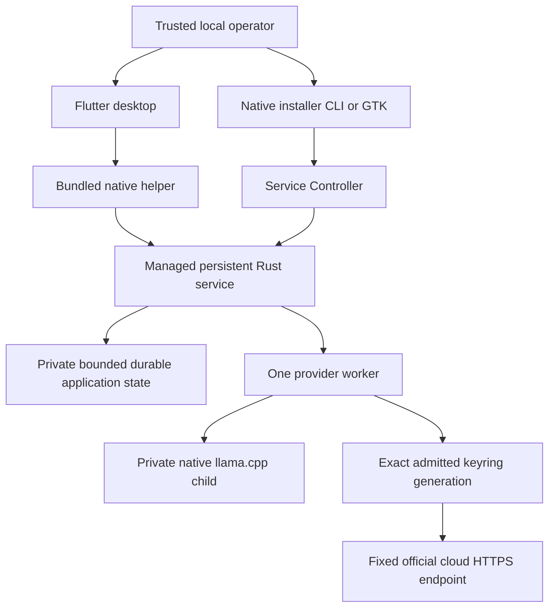

# Smith Architecture

## Status

**Normative target architecture with labelled implemented source contracts.** [Scope](SCOPE.md), [Process](PROCESS.md), [Design](DESIGN.md) and [Host Profile](HOST_PROFILE.md) retain canonical authority; the [as-built report](SMITH_LINUX_ARCHITECTURE_REPORT.md) records evidence and gaps. Source restrictions, fake tests and process survival are not deployed guarantees.

## System model

**Implemented:** root `client/` is Flutter desktop; `service/` is the persistent Rust authority; `installer/` is an independent Rust workspace using `../service`; `dagger/` is builder/package tooling. There is no root Cargo product/workspace. The client uses the executable-relative `smith_backend/smith-service` helper and private Core/app Unix bridges, not a legacy HTTP/orchestration backend. Promoting source does not rename `smith-next.service`, `smith-next`, XDG namespaces, keyring/wire identities or deterministic recognition bytes.

The service owns saved histories, configuration, accepted operations and routing. Desktop close detaches. Restart interrupts unfinished work rather than resuming it. Goals, tools, coding workers and general orchestration are **target/deferred**, not hidden chat capabilities. Retired root/voice/Python stages are available in the [pinned prior architecture](https://github.com/jdharrison/smith/blob/168865b0422b787f08ab33e89d052cd4adbd11f7/docs/ARCHITECTURE.md); [History](HISTORY.md) records the source relocation and retrieval policy. Historical behavior is not a current fallback.

## Trust boundaries

| Boundary | Contract |
|---|---|
| Operator → local control | Single trusted account; exact effect-bound consent, not hostile-same-UID authentication. Human delivery approvals additionally bind repository/branch/base/target/action/expiry. |
| Client/helper → service | Managed unit/executable/MainPID and socket/peer checks; bounded correlated protocols, no silent version/mutation fallback. |
| Model/external text → policy | Inert untrusted data; never tools, approval or permission expansion. This includes repository/ticket/web/MCP/tool text. |
| Service → native runner | Owned child/lease/process cleanup and integrity checks, not a filesystem/network/driver sandbox. |
| Service → cloud/keyring | Exact admitted generation, destination consent, fixed endpoint and finite one-attempt budgets; no ambient credential/endpoint authority. |
| Evidence → decision | Commands, source/artifact identities, timestamps, outcomes and independent review; narrative/checksums alone are not approval or authenticity. |

**Target/deferred workers:** supervisor-enforced schema/capability authorization, project-specific canonical allowlisted roots/tools/egress/credentials; no broad home/SSH mount or Docker socket. All default inbound publication must be loopback/private; non-loopback exposure needs elevated review and explicit approval. Host processes and Docker-internal networks do not constitute an air gap.

## Next-generation service control and login Boot implementation

**Implemented source:** `service/src/control.rs`, `manager.rs`, `filesystem.rs` and transports provide strict Core schema2. Binary/unit/enablement/runtime/bridge are independent facts. Persistent enabled state requires manager `UnitFileState=enabled` and the exact invoking-user-owned `systemd/user/default.target.wants/smith-next.service` symlink targeting the exact owned unit. Runtime-only, linked, alias, masked, foreign, malformed or unknown combinations fail closed.

The deterministic unprivileged unit has `Type=simple`, `Restart=no`, `UMask=0077`, five-second stop budget and `[Install]/WantedBy=default.target`. Registration/reload, Enable and Start remain separate effects. Enable uses fixed `systemctl --user enable smith-next.service`, never `--now`; Start requires exact installed/enabled/safely-stopped identity and never enables. No `loginctl` or lingering mutation, sudo, detached unmanaged fallback or legacy `smith.service` migration.

Prepare → visible confirm → apply uses original single-use60s tokens bound to action, roots, artifacts/unit and observations; no silent renewal/retry. Fresh setup is artifacts → register/reload → Enable → Start → fresh Core/app verification. Decline/failure preserves completed/uncertain effects. Unsafe roots, changed artifacts, overrides/foreign units/listeners and ambiguous states block. Exact-owned stopped pending-reload units permit separately confirmed reload-only repair. Defaults remain validated XDG data `smith-next/bin/smith-service` and state, config `systemd/user/smith-next.service`, and private runtime sockets. Production control/serve rejects UID0.

Managed FragmentPath/MainPID, executable path/bytes, socket identity and Linux `SO_PEERCRED` UID/PID checks remain. Core frames are bounded (4095 bytes); separate app frames are bounded to4MiB so provider work does not block Core inspection. Held daemon lock rejects duplicate foreground instances. Desktop disposal cleans only short-lived owned helpers; cleanup uncertainty blocks reuse, never kills the independently managed service. Helper cleanup is not rollback of accepted manager jobs or guaranteed descendant containment after abrupt death.

Boot serializes read-only Core observations under a15s monotonic budget, then uses separate finite app synchronization bounds. Chat mounts only after exact enabled/bridge-ready facts and synchronized conversations; Boot never installs, enables, starts, provisions, infers or resends automatically. Only exact installed/registered/enabled/safely-stopped state exposes separately prepared/confirmed Start. Presentation clocks do not establish readiness. The target is **after-login** availability; real manager/login/logout/reboot, pre-login/post-logout and lingering remain separate unverified/approved concerns.

## Current next bundled native runner

**Implemented source:** `service/src/runner.rs`, `providers.rs`, `acceleration.rs` and `catalog.rs`. The paired client includes separate SHA-pinned llama.cpp `b11429` `smith_backend/runtime/cpu/` and `vulkan/` trees, never mixed libraries, with `$ORIGIN` runpaths. Host glibc/libstdc++/libgcc/OpenSSL3 remain required; libgomp is bundled. Vulkan additionally needs host `libvulkan.so.1` and compatible ICD/driver/device access, never provisioned by Smith. Service-only publication can report `RUNTIME_MISSING`.

Curated GGUF and exact catalog markers live in private XDG data `smith-next/models` (0700 directories/0600 files). Full model SHA/runtime-manifest verification checks cancellation/deadline between bounded1MiB reads. The verified model FD survives exec and is loaded via `/proc/self/fd/<fd>` with separate SHA alias: pathname replacement cannot substitute a different verified model. Same-UID inode writes remain possible. Runtime path hashing/rechecks are point-in-time, not descriptor-bound dynamic loading or protection from concurrent/hostile same-UID code replacement. Individual syscalls/fsync have no hard cancellation deadline.

One inherited `runner.lock`, random private runner directory/socket, peer UID/PID checks, cleared environment and random API key constrain ownership, not hostile same-user access. The shared parked-lease slot explicitly unlocks its owned file on final destruction, including when the verified-model owner has already gone or the slot mutex is poisoned. Cleaned startup handback to a live model retains the same locked description across fallback; an empty slot cannot unlock the raw active lease. Unknown child cleanup returns before handback and preserves inherited exclusion. This corrects terminal parked-lease release, not all pre-child raw-file error windows or a proven historical CI schedule. The child has its own process group and race-checked parent-death SIGKILL; cleanup uses TERM≤2s/KILL≤1s, idle expiry600s. App-owner teardown fences publication, atomically cancels native waits and joins cleanup; desktop close only detaches. One slot/`--parallel 1`, bounded CPU threads, context4096/output1024 and180s cooperative dispatch budget remain. Request-only trimming uses rendered templates/tokenization with conservative byte-token fallback, never edits durable history. Model-default reasoning is not forced to zero. Only complete nonempty final content succeeds; reasoning-only, token-cap truncation, tool calls and identity mismatch fail with no replay.

Auto verifies/launches Vulkan with fixed `--device Vulkan0 --split-mode none --gpu-layers all --fit off`, plus `--log-verbosity 4 --no-log-prefix --no-log-timestamps --no-log-jsonl`. Acceptance needs exactly one revision-bound newline-terminated `load_tensors: offloaded X/Y layers to GPU`, `X == Y > 0`, within a sticky64KiB startup prefix and fixed at-most1s post-health observation window under the original deadline. Zero/partial/missing/malformed/duplicate/incomplete evidence, cancellation, child exit or capture failure/EOF fail closed. Health is not a stderr flush barrier; the final locked snapshot covers observed startup bytes, not future output. Logging normalization is not upstream config isolation.

Missing Vulkan or classified startup/evidence failure permits exactly one independent CPU launch only after confirmed cleanup, returning the same held model/runner lease under the original deadline. CPU uses `--device none --gpu-layers 0 --fit off` and does not load Vulkan. Unknown cleanup, integrity, cancellation or deadline failures grant no fallback. After Vulkan acceptance, request/preparation/completion failure never replays on CPU. One finite sanitized last-startup fallback cause survives CPU reuse/idle unload behind nonblocking Rust `last_startup_fallback_reason()`; busy/unavailable is explicit. Fresh preparation clears it; teardown loses it. No raw native output/paths/keys/prompts are retained. It is not wire/UI/current-mode evidence.

**Dev tool compatibility—implemented source, installed validation pending:** strict unique-JSON HTTP200 `/props` must contain an object with exact-true `supports_tools` and `supports_tool_calls`. An explicit `supports_tool_responses` value must be true; absence is permitted only for the complete, already manifest-verified b11429/d81235049 CPU/Vulkan backend inventory and a positive bounded no-generation template probe under the same owned runner lease/deadline. Self-reported version text grants no exception. The probe requires the controlled read definition, structured arguments, assistant content and distinct multiline tool-result evidence in order, with native JSON/tool-response framing; missing/reordered/duplicate evidence, JSON echo or unrecognized framing fails closed. Literal call IDs need not render. Success is cached only on that owned runner and cleared on any failure/stop. Actual-request validation, exact rendering/tokenization/context checks, generation/response guards, read permissions and no replay remain unchanged. Inventory/profile changes—including libraries, modes or licenses—require reviewed repinning before the missing-field exception applies; catalog presence alone is not tool compatibility.

**Isolated QA diagnostics—implemented source, pre-effect review pending:** the explicit `inspection-diagnostics` build feature is off by default. It emits at most256 fixed phase/allowlisted-code events plus one limit marker to stderr, covering broker/frozen-request checks, provider preparation, props/semantic proof, actual rendering/tokenization/context, completion and response/read-evidence validation. Unknown codes become `OTHER`; no error messages, paths, identities, prompts or response bodies enter this stream. Sink write errors are ignored; existing results, guards, deadlines, cleanup and no-replay rules remain unchanged. The isolated harness privately captures and strictly parses the stream; no persistent application schema or UI fields are added, and diagnostics/source fixtures are not native generation or installed acceptance.

## GPU-preferred runner direction and remaining work

**Target/deferred:** device discovery/classification, stable selection, memory/desktop headroom, validated partial offload, versioned preferences and compact confirmed execution status. Fixed `Vulkan0` is not suitability or stable identity. Host device-only observations in [Host Profile](HOST_PROFILE.md#non-model-gpu-diagnostic-observation--gpu-startup-fix) do not prove model fit, full offload, inference or speed.

## Current next cloud routing and credential boundary

**Implemented source:** `service/src/app_v3.rs`, `app_v3_worker.rs` and `cloud*.rs` extend the existing domain/sole worker, not a second scheduler. Flutter/provider-aware installer retain app schema3; disk10 is implemented Agents storage (not installed acceptance), superseding disk9 as current source storage; Core2 and the four-outstanding/one-per-chat/one-executing constraints remain. Exact catalogs/adapter semantics are in the retained [cloud API contract](plans/LOCAL-SMITH-NEXT-CLOUD-API-CONTRACT.md).

**Compatibility:** strict valid disk1–5 migrations preserve histories, configuration, full-u64 revisions, results/receipts, replay IDs/tombstones and inert old voice data without invented routing provenance or historical dates. Disk1–4 initializes an empty project registry; disk5 retains its registry through the structured conversion below. Corrupt/unsafe/unsupported bytes remain preserved. Bounded separate `route_catalog`, `conversation_routing` and `request_routing` expose non-secret metadata. Old v1/v2 operations stay local-only with exact unaffected projections; access that cannot represent retained v3 work/routing fails `UPGRADE_REQUIRED`, never hides it or executes a cloud default. Provider-aware installer uses explicit v3 even for local Model work; production Flutter has no mutation/version fallback. Strict old catalog readers may reject newly compiled IDs despite unchanged schema: use paired updated client/service/installer. Older binaries cannot consume the new disk10 state; separately approved rollback needs pre-migration state and compatible paired binaries plus exact keyring-generation relationships. JSON backup does not include keyring items and must never substitute a replacement key.

**Routing/consent:** per-chat selection is volatile; last accepted route is a reattach hint, not permanent lock. Admission freezes provider/model, digest or endpoint/policy, credential generation/provider revision, context/hash, revisions, limits and deadlines. It changes neither local default nor accepted work. First transfer to each provider/generation requires exact request/context confirmation; generation is opaque credential identity, not verified vendor account. Retained chat consent covers later explicit sends including intervening retained local/other-provider history; changing model at that destination does not repeat it, replacing generation does. Each cloud send still prepares afresh:60s admission/600s dispatch expiry fixed at preparation, plus independent ten-minute queue-age enforcement. Save/Validate keep60s effect-start authorization. Declined/expired pre-admission preparation grants no chat/approval; post-admission dispatch expiry does not revoke destination consent. Unavailable historical routes never permit substitution/deletion. Local queue Resume alone cannot approve new cloud export.

**Keyring:** service-only `cloud_keyring.rs` connects to fixed `/run/user/<uid>/bus`, validates socket/peer/service-owner UID and pins the existing unique Secret Service owner, ignoring ambient bus addresses and using `NoAutoStart`. Existing unlocked GNOME Keyring/default collection and encrypted session are required. No plaintext session, activation, collection creation, unlock, Prompt, environment/file key or subscription-login fallback. Bounded keyring work runs on the sole worker≤3s, not under the app mutex/on UI thread. Keys enter through private installer input, remain volatile/best-effort zeroized and never enter durable tasks, fingerprints, logs or context. Same-UID checks/zeroization do not isolate swap/core dumps or hostile same-user processes.

Read-back accepts exactly `text/plain` or `text/plain; charset=utf-8`, independently of encrypted transport and bounded printable-ASCII secret checks. Attributes require all four exact Smith identity fields, optionally only `xdg:schema=org.freedesktop.Secret.Generic` as a fifth. Unknown extras/schema or changed/missing identity fail before secret retrieval and are rechecked afterward. Outgoing search/create identity and strict timestamp checks are unchanged; inactive items are never adopted.

Each confirmed Save creates a fresh namespaced item before activating its opaque JSON reference. These are **not one transaction**: uncertainty/failure may leave an inactive item; observe original identity, never automatic retry/adoption/cleanup. Prior generations remain; no credential removal/purge, and Uninstall does not delete keyring items/revoke vendor keys. Dispatch retrieves/rechecks exactly the admitted generation. A supported route with matching active saved reference is eligible to attempt Send/Validate without prior probing, instance observation or successful validation. `ModelChoice.available` means attempt eligibility, not key access/account acceptance. Locked/missing/conflict/unobserved metadata and failed/interrupted checks remain advisory; successful validation identifies only its exact model/generation, and chat success invents no validation record. Actual read/identity/revision failure prevents HTTP. Cached state/catalog/routing never reads keyring or calls vendors; explicit probes read keyring only. Startup/selection/Save/observation recovery never infer remotely.

**HTTP:** fifteen compiled text identities (7 OpenAI/8 Anthropic), no discovery. Only `https://api.openai.com/v1/responses` and `https://api.anthropic.com/v1/messages`, normal certificate/hostname checks, no production endpoint/trust override, ambient proxies, redirects, automatic/protocol retries, tools, remote chaining or fallback. Single-connection Hyper HTTP/1/Rustls enforces16KiB raw response heads while reading (including informational/status/whitespace bytes),1MiB incremental success/error bodies and64KiB final UTF-8 text. Input/context including proposed user text≤64KiB, input≤16KiB; trim oldest complete pairs in the request only. Cloud output≤8192 total tokens including reasoning, under the original180s operation budget including keyring/DNS/TLS; connect≤10s within it. Local1024 stays unchanged. Complete envelope/exact model/final-text validation rejects reasoning-only, refusal, truncation, unsupported/tool-bearing or malformed output without replay. Raw remote diagnostics/reasoning/IDs/headers never become retained output; fixed Smith categories do. See API contract for exact request/parser rules, context/framing reservation and vendor-retention caveats. Fixed URLs are not an OS firewall; OpenAI `store:false` is not zero retention, and no cost ceiling is promised.

**Delivery:** durably publish `may_have_sent` before the single HTTP attempt and recheck ownership/deadline; failed publication prevents dispatch. `not_sent`/`may_have_sent`/`received` remain distinct. Restart interrupts without replay; unknown remote processing/billing or credential publication is not no effect. Close/observer Stop does not cancel accepted work or guarantee remote cancellation. Synthetic TLS/keyring/compiled Rust↔Dart tests and retained review evidence are not normal-session/vendor/installed acceptance.

## Current next multi-chat storage and scheduling

**Implemented source:** `service/src/app.rs`, `app_v2.rs`, `app_v3.rs` and `app_timestamps.rs` own bounded atomic `app-state.json`. First accepted `submit_new` creates chat+job atomically; unsent New chat/drafts remain local. Legacy v1 migrates into `Current chat` without invented missing prompt text. Context is isolated per conversation; local default/configuration remain global, with per-request routing above.

At most32 active+archived conversations,16 pairs/64KiB each,16KiB input,32 retained operations and1024 expired-ID tombstones. Encoded preflight reserves completion/transition headroom within16MiB state and4MiB frames, including JSON expansion. Only terminal operations expire, retaining opaque IDs; ordinary capacity rejection is not a latched storage fault. Unexpected publication/transition failure fences the service. Four chats can be outstanding, one per conversation/one executing; dispatch rejects queue age>10min. Admission is synced before dispatch; identical IDs/fingerprints return original work, conflicts/expired IDs cannot resurrect it. Restart interrupts queued/running work before readiness with no replay. App-owner fencing prevents old workers publishing after reopened ownership.

Schema-v2 summary/detail and lifecycle operations bind request/conversation/revisions; recognized reply/errors correlate schema/call ID. Exact v1 installer keys `config/history/active/providers/retention` remain, with no foreign conversation/queued-status leakage. Legacy configuration u64 values are lossless: v2 wire number through9007199254740991, canonical decimal string above; v1/disk numeric. Clients echo without conversion; max revision refuses mutation. New revisions/sequences stay safe integers.

Atomic first-message titles sanitize controls/collapse whitespace/cap40 Unicode scalars; renames use the same new-write limit. Stored/input legacy title validation remains256 bytes, including receipts; no rewriting old titles/results. Rename/archive/reactivate/delete are atomic, idempotent and revision-checked. Archive/delete block target queued/running work; UI uncertainty also blocks. Delete removes current-store title/history/payload/results/content-derived fingerprints and timing, retaining only opaque replay protection/content-free bounded receipt; exhausted tombstones refuse without partial effects. It does not stop/clear the runner or securely erase RAM/KV/journals/swap/backups. Late worker publication checks running identity/conversation/history revision and cannot recreate deleted data. Stale lifecycle receipts cannot regress newer metadata.

## Projects metadata registry

**Implemented service/domain/editor source, validation and assurance pending:** `service/src/app_projects.rs`, `app_v2.rs` and `app_v3.rs` own the inert Projects registry in atomic application disk9. App3/Core2 remain unchanged. Current App3-only operations are `projects_list_v3`, `project_create_v3`, `project_update_v3`, `project_delete_v3` and unchanged `project_receipt({request_id})`. List returns `{revision,projects}`; create/update bind request/instance/expected-revision, all metadata and the opaque target for update; delete binds the same origin and target without metadata. Receipts remain `{request_id,project_id,revision,deleted}`. Unversioned and v2 Projects list/create/update/delete always return `UPGRADE_REQUIRED` before legacy replay/admission, even for empty registries, empty-array updates, deletes and historical IDs. Clients never fall back. This prevents old whole-record writers erasing unseen key/context/read-only metadata. Existing chat projections, provider behavior and resource limits remain unchanged; Projects creates no inference job, conversation, context transfer or Dev runtime/bootstrap.

Project records are exactly `{project_id,name,key,description,prompt,repositories,agent}`: stable32-lowercase-hex internal identity, retained hidden trimmed nonempty control-free≤40-scalar `name`, visible editable human `key`, context fields, ordered0–16 repositories and fixed hidden `agent:"opencode"`; at most32 projects and safe-integer registry revisions. Key matches `[a-z0-9]+(?:-[a-z0-9]+)*`,1–40 ASCII bytes, and is unique across the registry under the mutation mutex. Changing it never changes `project_id` or the hidden Name; update rejects a changed compatibility Name. Ordinary new forms supply Name=key; copies retain their source Name. Description is optional/empty, exact single-line≤60 Unicode scalars without controls or U+2028/U+2029. Prompt is optional/empty exact text≤1000 scalars; LF/tab allowed, other controls rejected. Reject invalid Unicode; do not trim, normalize, truncate, interpolate or automatically inject project context. Project text remains separate from global instructions and agent/provider/model/role configuration.

Every repository is exactly `{name,url,read_only,branch:{base,work,types:{feature,fix,release,hotfix}}}`. All keys/objects and a boolean `read_only` are required; only repository Name, Base/Work and the four type leaves are independently nullable. Null branch/types objects, missing/unknown keys, positional arrays, string-list input and empty non-null optional strings are invalid. New/migrated repositories default read-only true. This flag is inert classification, not access-control enforcement; all hidden branch/type values remain stored and syntactically validated. Non-null Names reuse the≤40-scalar name predicate. Non-null Names and URLs are independently unique within a project by exact case-sensitive equality, without remote-identity normalization; multiple null Names and repeated branch/type values are valid. Cleared optional fields serialize null.

URLs retain the unchanged credential-free locator grammar and2048-UTF-8-byte bound. Locators support only `https://host[:port]/path`, `ssh://git@host[:port]/path` and `git@host:path`: ASCII DNS-style labels≤63 bytes/253 total, decimal ports1–65535, nonempty slash-separated ASCII alphanumeric/`._~-` path segments excluding `.`/`..`/empty segments. No local paths, arbitrary userinfo/passwords, percent escapes, query/fragment, whitespace/controls or shell syntax; exact case-sensitive duplicate comparison. This is syntax validation only, not existence, authorization or future egress approval.

Base describes the main/stable line and accepts only an exact safe branch. Work accepts an exact safe branch or `<safe-branch-prefix>/*`; it may equal Base, including `main`/`main`. Exact branches are a conservative pure subset:1–255 ASCII bytes, nonempty slash-separated components starting alphanumeric and otherwise only alphanumeric/`._-`; no `..`, dot-ended or case-insensitive `.lock`-ended components; reject exact `HEAD` and `refs/` prefix. Patterns are≤255 ASCII bytes total, use the same safe prefix and exactly one final `*` after `/`. This is not every Git-valid ref and invokes no Git subprocess. Four independent type leaves store null/unselected or an exact selected pattern; the approved UI initializes standard `feature/*`, `fix/*`, `release/*`, `hotfix/*` only on explicit selection, clears the corresponding leaf on deselection and preserves custom patterns on load/read-only toggles. No automatic defaults are inferred for unset branches/types. These values authorize no matching/expansion, branch generation/selection, PR direction, workflow execution or publication.

**Fresh-profile initialization — implemented source:** `app.rs` invokes `projects::bootstrap` only when the safe state read returns `None`; shared empty defaults remain empty for tests/legacy construction. Bootstrap creates one ordinary project with key `smith`, hidden Name `Smith`, empty description/prompt, fixed OpenCode metadata and one read-only repository: null Name, URL `https://github.com/jdharrison/smith`, Base/Work `main`/`main`, four null type leaves. It uses ordinary generated opaque IDs/project revision suffix, application/registry revision1, one content-free internal receipt with the existing `v3:projects:bootstrap` metadata fingerprint, and no expired IDs. This consumes normal ledger capacity without reserved identity or validator exemption. Full disk9 validation/capacity/encoded-state preflight precedes `filesystem::publish(..., 0o600, false)` without replacement and before readiness. If a destination appears after the absent read, preserve it and fail; do not adopt/retry/delete uncertain published state. Existing startup ownership remains authoritative; no new lock, root or filesystem machinery is added.

Existing current/legacy/empty/full state follows its load/migration/recovery path without bootstrap insertion. Ordinary edits/key changes/repository removal/deletion retain state and receipt semantics across reopen; empty registries never trigger seeding. A migrated existing Smith project gets its ordinary deterministic legacy key, not a special rename/backfill to `smith`. Bootstrap receipts follow ordinary eviction/scrubbing, not permanent-marker rules. Complete state-file removal creates a genuinely absent profile again. The [fresh-only eligibility](plans/LOCAL-SMITH-DEFAULT-PROJECT.md) is retained within the [approved Projects UX contract](plans/LOCAL-SMITH-PROJECTS-UX.md); it adds no repository/network/Git/provider/keyring/tool/agent effect or automatic project-context transfer.

**Projects migration/compatibility:** disk9 introduced this Projects-only outer schema advance, retaining the Agents contract introduced in disk8; disk10 is now implemented Agents source storage, not installed acceptance (see below). Strict frozen disk1–8 decoders retain duplicate-key/object-shape/legacy validation, capacity preflight and atomic publication; corrupt/unsupported/unsafe/unpublishable bytes remain preserved. Disk1–4 initializes an empty Projects registry with prior unrelated-state semantics. Disk5 string URLs remain exact, with null Name and all six null branch/type leaves. Disk6–8 structured repositories retain exact Names/URLs/branch/type values and order; their frozen Work validator still rejects patterns invalid under those old schemas. Every valid old project gains key `project-<opaque project_id>`, empty description/prompt, and each repository gains read-only true. Preserve project IDs, hidden Names, project/repository order, registry revision, retained fingerprints (including already-null), receipts and expired IDs; conversion is not a Projects mutation. The explicit disk8 path preserves global instructions, accepted snapshots/hashes/grants/receipts, Agents definitions/revisions/ledger and all unrelated durable state subject to existing restart handling. Disk7 retains its separate global-instructions-preserving path and prior Agents initialization; disk1–6 retains prior migration/config-revision/instruction-reset semantics. Never repair corrupt current state by seeding. Older binaries reject disk9; installed rollout/restore requires separately approved pre-migration state, compatible paired artifacts and applicable keyring-generation relationships, not binary-only downgrade.

Mutations bind the observed service instance and independent registry revision, under the existing application ownership/mutex/capacity/publication fence. Chat completions do not stale registry revisions. Project-family replay identities are separate from chat receipts, but old/new Projects operations share one namespace:32 retained content-free receipts plus1024 non-evictable expired-ID tombstones. New fingerprints bind the new operation name and all nested arguments; new calls cannot reuse old IDs. Old receipts remain queryable without replay. Exact retained v3 replay precedes fresh instance/revision admission and changes nothing; conflicting arguments reject. Delete removes only the project and scrubs its old metadata-derived fingerprints, retaining opaque historical receipts/IDs. Scrubbed mutation reuse is expired; receipt lookup can report the historical result, never current project existence. Tombstone/capacity exhaustion refuses atomically.

Flutter `projects.dart`/`projects_controller.dart` implement strict nested shapes/bounds, immutable request capture and v3-only calls through the existing serialized AppApi. The existing reply lexical preflight rejects duplicate decoded member names (including escaped-equivalent/nested-array objects) and object/array depth above64 before whole-reply `jsonDecode`; the4MiB frame limit and `PROTOCOL` failure remain. One desktop-wide registry controller owns saved metadata; project records/context never enter presentation preferences. **Editor implemented in `client/lib/ui/projects_view.dart`; validation and assurance pending:** key/description/prompt/read-only and every repository field must participate in dirty detection, immutable capture, all-field current-origin review and successful reconciliation; later typing must survive older acknowledgements. When a confirmed create binds its authoritative saved target while preserving newer visible input, reconciliation must also adopt that target's hidden `name`, without replacing the newer input or silently rebinding the old origin. This hidden-Name fix remains parent-owned pending source/evidence closeout in the [plan](plans/LOCAL-SMITH-PROJECTS-UX.md#current-sourceevidence-disposition). Editors, overflow actions and delete confirmations bind original instance/revision, including same-revision restart; no silent rebind. After acknowledgement obtain the authoritative list. Lost/malformed/post-publication outcomes retain the original request and block writes; Resolve queries only its `project_receipt` and `projects_list_v3`, including across restart. Unknown/expired receipts retain uncertainty/write blocking while allowing read-only Refresh/list observation; matching values or membership do not prove the original outcome. Confirmed deletion plus authoritative target absence clears the exact selection, even after restart. First Projects open reads metadata only; Boot/navigation, CRUD and editing selection authorize no repository/network/tool/keyring/model/container/harness or context-export effect. [Approved plan](plans/LOCAL-SMITH-PROJECTS-UX.md); current compiled/component/root/package checks and fresh assurance remain parent-owned/pending. Earlier [Projects](evidence/projects/README.md), [structured-repository](evidence/project-repositories/README.md) and [layout](evidence/projects-layout/README.md) evidence stays bound to its original candidate, not this disk9 slice.

## Agents definitions registry

**Implemented source, parent-verified; acceptance pending:** the [approved custom Agents plan](plans/LOCAL-SMITH-AGENTS-CUSTOM.md) requires 2–32 inert records of unchanged shape `{agent_id,name,description,prompt}`. Permanent built-ins `developer`, `assurance` occupy the first two positions; their current saved names/descriptions are service-enforced immutable, with editable prompts. Valid existing built-in metadata/receipts, including descriptions≤256 Unicode scalars, remains readable and supports prompt-only saves without truncation/reset; fresh default descriptions are≤40. Customs append in creation order with service-generated collision-checked immutable32-lowercase-hex IDs. Custom name is required, trimmed, control-free, ≤40 Unicode scalars; description is trimmed, optional/empty, single-line≤40 scalars, rejecting controls and Unicode line/paragraph separators. Every prompt preserves exact text≤4096 UTF-8 bytes, LF/tab allowed, other controls and invalid Unicode rejected. No template or shell interpretation occurs; compiled starter texts are not runtime repository reads.

**Implemented source storage/migration:** atomic disk10, with App3/Core2 unchanged. Frozen strict disk9 and prior Agents decoders must retain their original shape/duplicate-key/bounds validation; do not apply new custom bounds to valid legacy built-in metadata. Preserve all global/Projects/Agents ledgers, revisions, accepted snapshots, receipts, hashes, grants, settings/pack identity and unrelated durable state, subject to existing restart handling. Disk9→10 is not a registry mutation or reseed. Fresh state/supported legacy initialization retains the two built-ins at independent registry revision1 without a synthetic public receipt. Saved metadata survives changed defaults. Historical disk7→8 preserves global instructions and must not enter the disk1–6 instruction-reset path; that older path retains prior interruption/config-revision/reset semantics. Projects conversion and fresh-only starter rules remain unchanged. Existing ownership, capacity, validation and atomic publication fences apply; corrupt/unsafe/unsupported/unpublishable bytes remain preserved, never repaired by seeding. Older binaries cannot consume disk10; installed rollout/restore requires separately approved pre-migration state and compatible paired artifacts, including applicable keyring-generation relationships, not binary-only downgrade.

**Implemented source App3 operations:** `agents_list_v2({}) -> {revision,agents}`; `agent_create_v1({request_id,instance_id,expected_revision,name,description,prompt})` accepts no client agent ID; `agent_update_v2({request_id,instance_id,expected_revision,agent_id,name,description,prompt})` includes the immutable target. Both return unchanged `{request_id,agent_id,revision}`; unchanged `agent_receipt({request_id})` returns the retained content-free receipt. Old `agents_list_v1`/`agent_update_v1` fail `UPGRADE_REQUIRED` before legacy replay/admission, with no client fallback. Strict parsing and immutable operation fingerprints bind all arguments; built-in updates must preserve current saved name/description. Old/new mutations share one receipt namespace,32 retained receipts and1024 non-reusable expired IDs. Exact replay returns its original result; conflicts, expiry, origin mismatch, exhausted capacity or revision overflow refuse without partial effects. Fresh accepted writes increment only the independent safe-integer Agents revision once. Create publishes generated ID+record+receipt atomically; neither create nor update bumps global config revision, alters accepted chat context or wakes workers.

**Implemented source client recovery:** one registry controller per desktop, per-view volatile drafts/selection/scroll. Shared `create(name,description,prompt,{required expectedInstanceId,required expectedRevision,String? requestId})` and update with the same optional request ID return `Future<void>` and expose `AgentReceipt? lastReceipt`. UI captures its own request ID before dispatch and correlates `lastReceipt.requestId`; bind a create target only through that original request's receipt agent ID plus authoritative list, never field matching. Immutable request capture and original instance/revision fences apply to both writes. Unknown outcomes block writes/New; Resolve queries only the original receipt and current list, never resends. Unknown/expired receipts or acknowledged-but-missing/mismatched create targets retain uncertainty/duplicate blocking. Dirty editors require explicit all-field review/rebind after revision or instance drift, including same-revision restart; newer typing survives older acknowledgement. Contextual Retry loading is read-only unavailable/stale-observation recovery, not normal Refresh. No prompt/draft/selection enters preferences. [Operator behavior](DESIGN_DETAILS.md#agents-profile-editor).

Agents creation/editing adds no delete/duplicate/model/harness/run/enabled/test/history/custom-icon operation, worker, filesystem root, execution permission or automatic Dev start. No repository/Git/shell/tool/provider/keyring/network/container effects, Chat injection or cloud-consent expansion follow. Dev ledger reopen recognizes custom canonical IDs only for compatibility; runtime/capability/approval boundaries remain unchanged. Profiles confer neither review independence nor approval. Future execution needs separate capability/snapshot/export-consent approval. [Approved slice](plans/LOCAL-SMITH-AGENTS-CUSTOM.md); final gates and fresh assurance remain pending, with no installed acceptance or rollout authorization.

## Saved message timestamps

**Implemented source:** disk4's required bounded conversation-keyed timing sidecar migrates disk1/2/3 without invented dates. Missing entries mean wholly unknown; present entries exactly align with retained pairs. Admission reserves timing headroom; successful ordinary/routed publication appends/trims timing atomically with history/result; deletion removes it, job eviction does not. Role/content messages, provider payloads and consent hashes are unchanged.

App3 read-only `conversation_timestamps({conversation_id})` returns matching ID/history revision and≤16 `{user_at_ms,assistant_at_ms}` pairs, null or positive UTC epoch-ms≤253402300799999. YOU is service admission; SMITH is wall time after final validation/publication fences for successful history transaction, not exact fsync completion. Invalid clocks remain unknown; clock corrections do not reorder/rewrite. Failed/interrupted turns publish no completed pair. Client uses matching instance/conversation/revision/count only; absent/failed/mismatched metadata leaves undated readable history, never observation-time substitution or replay. Disk4 rollback rules above apply.

## Client-side sequential message queue

**Implemented source:** conversation-owned volatile FIFO shared across panes, including hidden panes/blank promotion, with one coalesced serialized workspace dispatcher. Logical row identity differs from immutable attempt ID. Limits:8 follow-ups/chat,32/desktop plus one current-predecessor allowance/chat;16KiB each. Never-dispatched waiting has no execution timeout/service slot.

Advancement needs exact predecessor success **and saved synchronized history**, fresh target detail and expected history revision. Unknown admission/poll/possibly post-commit `STATE_UNAVAILABLE` retains identity without replay. Failed head blocks. Explicit Retry gets a new attempt only for definitive failure/not-admission; Skip abandons only resolved/never-attempted heads, never cancels running/unknown work. Instance/config/foreign-history changes pause for review; revision fences stale actions. Query-only observation may wake an already-authorized unpaused dispatcher, not resume uncertain/paused chains. This is observed-instance protection, not atomic restart fencing or cross-desktop exclusive ownership. Route/generation/context are never silently rebound; queued cloud transfer uses its separate consent contract.

Shell-owned identity-bound exit hold stops undispatched Send/enqueue/Retry/pump during Close/Quit decision. Native GTK delete/quit destroys only after explicit true Dart reply; absent/failed reply keeps open. Cancel releases that hold without clearing pauses; confirmation holds through disposal. Counts deduplicate hidden/shared chats/blanks. Drafts/queues are not durable; forced termination can lose them. Accepted service work continues; no active cancellation/durable outbox implied.

## Automatic desktop connection observation

**Implemented:** after Boot, one workspace timer reads at30s, then30s after prior reconciliation completes. Serialized app state/necessary detail/original-ID poll only; no automatic inventory, lifecycle/configuration/inference/replay. Preserve finite budgets/expiry markers, drafts/history/accepted IDs across outages, without healthy-check flicker. Instance changes invalidate model facts; connectivity recovery does not prove Send readiness. Explicit workspace Retry uses serialized app sync plus inventory refresh, not competing Core inspection. Sends waiting behind observation capture/reserve immutable text and draft/config/history/instance/conversation identity synchronously, revalidating before dispatch. Disposal fences late work/cancels timers, not service.30s is idle cadence, not outage-detection deadline. Scoped evidence: `client/CONNECTION_POLLING_VALIDATION.md`.

## Split-workspace experiment ownership

**Implemented:** up to4 retained panes have separate selection/blank identities, one workspace/API/arbiter/inventory/heartbeat owner; saved chat IDs share one controller/draft/queue. Blank promotion and archive/delete repair every pane, including hidden; hidden pending work remains observed. One controller-free shared header/Layout/focus owner; only workspace bodies repeat. Each ChatPanel owns editor/focus/reading bookmarks independent of shared data. Layout adds neither worker nor inference slots. Native graphical/IME acceptance remains separate.

## Session-only desktop windows

**Implemented:** production-injected launcher directly spawns current resolved executable, exactly `--session-only-window`, detached/no shell. Embedded/test constructors have no implicit host launch. Pending creation disables only that action; sanitized failure needs explicit retry; spawn is not visible-window/readiness proof. Exact startup flag omits preference-store construction completely: no load/save/lock/adoption even after original closes. New process starts1×1/Chat with normal Boot-selected conversation, not copied workspace; it can launch another. Each has its own Boot/API/observations/drafts/queues/exit guard; durable chats and service limits are shared. No parent-child termination, cross-window unsent sync, monitor/geometry management or service action. Session-only does not make saved chat history ephemeral.

## Client workspace preference storage

**Implemented:** strict≤4KiB JSON writes v4 and reads exact version-specific destinations: v1 Chat/Settings, v2 adds Projects, v3 adds Agents, v4 adds the inert Dev root. It stores layout preset/active tile/exactly4 saved-chat-ID-or-null and destination slots, including hidden. Old valid v1/v2/v3 records remain readable and are not rewritten solely for normalization; the next actual presentation save writes v4. Dev is now a stored presentation destination, not service state. Its separate disclosure remains per-pane session-only and adds no stored field. Dev is invalid in v1–v3; unknown v5 and extra fields are rejected. Older clients may reject v4 and preserve it through their existing session-only fallback; downgrade readability is not promised. No project/agent records, project/agent selection, prompts or editor text are stored. No text/drafts/titles/scroll/editor/operation/readiness/model/service state. Production injection only. Linux x86_64/glibc store: `XDG_STATE_HOME/smith-next/client/workspace.json`, else `HOME/.local/state/smith-next/client/workspace.json`; reject relative roots. Explicit/XDG root must exist; HOME fallback may create `.local/state`.

Descriptor-relative no-follow ownership/mode checks,0700 app dirs/0600 files and lifetime nonblocking `flock` exclude cooperating writers (even separate same-process stores). Serialized/coalesced saves use exclusive same-dir temp, file fsync, atomic rename and prior file/lock identity checks. Not directory-fsync/power-loss, hostile-same-UID or hard filesystem-deadline assurance. Corrupt/unsupported/unsafe/inaccessible files remain untouched; saving disabled/session warning, UI usable. Restore once after Boot sync/before interaction: saved null wins; missing/archived IDs become independent blanks and repaired preferences save; transient detail failure retains selection. No resume/send/lifecycle/configuration effects. Save layout/page/selection/accepted blank promotion only, not draft/status. Normal disposal drains writes; abrupt death may lose latest preference.

## Workspace entrance presentation

**Implemented:** one620ms paint-only opacity/translation clock after Boot/preference hydration; unchanged retained layout/editor/pane/scroll/service identity. Gate workspace pointer/focus/actionable semantics only; Close/Quit outside. Reduced motion/recovery permanently settles it; polling/navigation/layout never restart or authorize API effects. No persisted animation state. Boot motion has its own independent readiness boundary.

## Next-generation artifact installation

**Implemented:** `installer/src/artifact.rs`, `fs.rs`, `manifest.rs`. Make install targets build then invoke native `--artifacts-only --client BUNDLE` and/or `--service BINARY`; only that mode accepts optional `--yes`, bypassing confirmation only, never checks. No manager/provider/artifact execution, unit/state/config write, cache refresh, Enable/Start. Host publication outside builder, no home mount.

Complete verified client releases: XDG data `smith-next/client/releases/<digest>`, exact relative `current` selector, absolute desktop/icon and HOME `.local/bin/smith-next`. Standalone `smith-next/bin/smith-service` refuses differing bytes/implicit upgrade and checks paired helper. Non-root ownership/mode/single-link/private namespaces, bounded trees/files, held-directory no-follow traversal, verified cooperative lock and post-consent/under-lock revalidation remain. Compact sorted schema1 manifest+newline preserves historical release identity. Fresh releases/files no-clobber+sync; selected-client/service-only dependencies reverified before selection/success. Atomic selector exchange retains/checks displaced data; late conflict may leave current changed and returns failure. No hostile-same-UID CAS, global transaction, rollback or automatic failed-stage cleanup.

**Implemented builder-only location gate:** `dagger/package.py` checks the complete existing export path through held no-follow directory descriptors before package assembly writes or verification reads. Match native restricted paths, current/root ancestor ownership and no group/world write, with the root-owned sticky exception only for ancestors; the final output directory must be current-owned. Make installer package/UI/binary and service/client exports explicitly prepare only an absent final generated directory as0700, preserve existing safe modes, scope export umask077 and recheck after Dagger. `installer/run` checks again immediately before GTK launch. Missing intermediate/source directories, symlinks or unsafe existing directories fail without chmod/recursive creation. This is early detection, not a pathname CAS or protection from later external drift; native installation checks remain authoritative. Independent parallel builds may continue after another target fails, but dependent publisher/GUI recipes do not run. [Approved prevention slice](plans/LOCAL-SMITH-INSTALLER-LOCATION.md).

## Focused native installer and model management

**Implemented:** full package `installer/dist/` has native CLI, optional-feature GTK3 sibling, complete paired Flutter/service payload, manifest/checksums/instructions. Default root is actual canonical installer executable directory, not cwd/argv alias/PATH. CLI is GTK/display/Python-independent; GUI library loading still needs GTK even for display-free help/version/licenses. Native is not static/universal Linux ABI. `dagger/package.py` is builder metadata tooling, never host publisher/fallback. No weights/voice/reference payloads; strict allowlist rejects unknowns.

GUI opens two actions, hidden read-only artifact preview then explicit Checking/action page. Fixed paired-product register/Enable/Start recipe retains **separate** original60s consent for every effect. Full CLI supports bundle/dry-run/exact model/download (`--pull-model` alias)/verify; no blanket yes. Dry-run/initial artifact decline creates no destination files/locks or Controller/provider/runtime roots. Controller is constructed lazily after publication with source **packaged `payload/service/smith-service`**, never installer executable; existing managed identity/correlation stays authoritative.

Consent≤4096 bytes incl newline/60s; EOF/interruption/timeout is no approval. Bounded setup/progress supports nonblocking pipes/sockets/terminals, rejects regular files/other devices; artifact publisher stdio and filesystem/fsync do not gain a total deadline. One owned worker, bounded typed critical-event FIFO/capped reports, original IDs, joined cancellation and sticky close/reopen guard. GTK coalesces numeric byte telemetry only into a bounded latest snapshot; stage/consent/final boundaries discard stale telemetry. Strict CLI forwarding unchanged; no retry/resume/deadline extension/deletion. Missing/full reporting preserves partial/uncertain effects, never rollback. Observer cancellation joins installer-owned effects, not accepted service work or remote requests.

Seven compiled revision/size/SHA Apache-2.0 choices; fresh GUI Qwen3-14B Q4_K_M revision `530227a7d994db8eca5ab5ced2fb692b614357fd`,9001752960 bytes, SHA256 `500a8806e85ee9c83f3ae08420295592451379b4f8cf2d0f41c15dffeb6b81f0`. Saved selection survives. Unsupported selection stays inert/read-only, never inserted into chooser or submitted. No free-form/import. Separate exact-model download/preference/check/removal consent; `configure_checked` atomically checks expected revision, legacy configure unchanged.

Explicit download uses HTTPS443 exact `huggingface.co` or label-boundary `*.hf.co`,≤3 redirects, no ambient proxy/retry, exact size/SHA,30s idle/1800s observation and≤16GiB model stream (artifact limits unchanged). Install lock/free-space check/held-directory staging/synced no-clobber publication/marker-last preserve conflicts/partial stages. Async factories construct requests/body futures inside owned Tokio runtime after deadline/cancel check, not detached work. Disk guard is model size+64MiB, not RAM suitability.

Verify/remove use durable admission/poll/fingerprint/expiry/interruption and exact request/model/SHA/config revision. Verify sends fixed isolated greeting, no prior context/history append;180s service/210s observer are provisional, not CPU14B performance proof. Removal blocks selected or any loaded runner including idle, no hidden unload/Stop; installation lock→runner lease, exact descriptor-relative marker/file validation. Marker unlink+dir sync before model unlink+sync; partial/orphan state preserved, no recursive cleanup/retry/rollback or history/preference edits. Idle stop600s may delay management. Manage models bypasses artifact republication/review expiry only, never managed-service prerequisites, differing-binary guard or its own/Core/model consent.

Optional provider management/save/check uses cloud boundary above; no artifact/lifecycle work on rerun. Successful management says model check/removal complete, not installation verified. Neither installer is persistently installed; retain full package. No OS/GPU/keyring provisioning, debug-completion write, automatic desktop launch or lingering change.

## Installer-owned appearance resources

**Implemented presentation only:** optional GUI `appearance.rs` embeds JetBrains Mono/icons/notices, uses3 sealed CLOEXEC memfds kept alive through partial registration failure, Fontconfig app fonts and caller-thread Pango refresh. No system-font install/disk fallback/font-cache/network/new worker. Check native font/PNG support before effect worker. Display-free `--licenses` prints full notices; CLI imports none of GTK/resources. Native library initialization is not itself sandboxed. Grouped consent remains deferred.

## Explicit native installer maintenance

**Implemented:** service/installer `maintenance.rs` independently inspect safe selected release/relative selector, manifest, standalone==selected helper, exact desktop/shim and byte-exact recognized static/current unit/manager/link facts. Retained voice-era files are valid historical release contents, not active capabilities. Never run old helper. Unknown/foreign/unsafe objects, overrides/drop-ins/transient units, malformed enablement or ambiguous absent selector/binary block. Missing independently proven launcher may be disclosed/skipped. Uninstall is candidate-independent; inspection does not reset app/Core data.

Manager seams default-refuse; fixed bounded Stop verifies captured old digest/path via `/proc/MainPID/exe` and process cgroup. Stopped proof needs PID0, kernel cgroup2 quiescence including descendants/captured group and absent Core/app sockets. No rawPID kill, stale-socket deletion, manager override or detached fallback. Prepared Stop/Unregister single-use60s action/path/identity/fact binding; unknown outcome is not success.

Lock order: publisher install lock→typed Core data-directory `MaintenanceLease`→runner lease after Stop. Candidate `apply_with_lease` validates the same held lease without recursive flock; ordinary apply still locks with no-follow/root-identity checks. Serializes participants, not external manager clients/hostile same-UID changes; no global CAS/transaction.

After explicit artifact review, private backup/effect record preserves old binary/unit/selector/launchers before lifecycle effects; state/models stay in place. Upgrade separately confirms Stop/quiescence, migrates only exact static→current unit/reload, preserves exact enabled current without churn or separately enables exact disabled current. Stage/verify candidate, atomic standalone exchange retaining displacement, guarded paired client publish/select and launcher/pair verification. Any needed registration/reload/Enable/Start has fresh separate original-token approval. Declined Start means artifacts upgraded/service stopped; running success requires fresh candidate Core/app readiness, not model readiness. Failure preserves stages/backups and stops unsafe later phases; no rollback/retry/reprepare/crash replay.

Uninstall Stop/quiesce→disable exact enabled current and verify→exact unregister/reload/verify absent→held-directory no-clobber preservation away from active desktop/shim/current/standalone names, sync/moved-identity checks→verify active absence. ALL data/history/preferences/models/releases/backups/stages/locks/unrelated objects remain. No recursive deletion/purge; moved objects consume disk. Partial failure remains incomplete/uncertain. GUI maintenance is independent of failed/expired install preview but retains its own consent. No CLI/Make force/automatic maintenance or legacy service migration.

## Explicit installer desktop launch

**Implemented:** only explicit click after verified joined-worker Install/Upgrade success. Shared selector validation checks owned no-follow namespaces, exact relative `releases/<digest>`, manifest/content identity and nonempty single-link0755 client, rechecking selector/executable. Captured HOME/XDG roots; resolution read-only, no manager/provider/wrapper/package executable/desktop-file interpreter.

Background owner created before spawn; resolved installed executable/direct exec/no shell/PATH, release cwd, argv0 only, null stdio, `setsid`. Immediate dispatch report and off-UI reaping, not lifetime join. Close pending dispatch waits only for outcome; duplicate/new-management blocked while pending. Installer exit leaves desktop independent. Launch failure does not change install result and needs deliberate retry. Trusted-user point-in-time checks are not atomic hostile-same-UID protection, authenticity, filesystem deadline or readiness evidence.

## Installer candidate build boundary

**Implemented workflow/helper configuration, not hosted execution:** Ubuntu-only CI uses native component/Dagger gates/full paired package. Checksum-pinned official Dagger v0.21.9, explicit `--mod dagger`; retained compatibility lock files are not proof of enforced image locks/hermeticity. Builder engine/cache/dependency network is explicit, not recipient capability. Test workers receive no user home/bus/manager/GPU/model/real-provider capability.

PR/main validates without distributable uploads. Only annotated canonical release-tag candidates matching exact HEAD/event commit/main history and component/lock versions may archive after gates. Full tar modes/content survive bounded fresh private extraction/reverification; source/build metadata/logs remain outside strict recipient package. Pinned actions, read-only contents, credential-free checkout; no tag/GitHub Release/deployment creation.14-day Actions retention is remote disclosure requiring separately approved activation, destination/visibility and redistribution clearance. Checksums are not authenticity or approval; current cutover gates must remove retired root-Cargo commands and use promoted root paths. [Process](PROCESS.md#native-installer-candidate-automation) is the publication boundary.

## Capability model

**Target/deferred orchestration:** each operation needs identity+role+repository+branch+revision+stage, canonical filesystem roots, network destinations, credentials, tool allowlist, resource/time budget and approval binding. Capability expansion requires human-approved configuration. Provider failure/fallback may not add permissions or publication rights. Audit worker/provider/task/plan/approval identity; roles cannot self-authorize exceptions.

## State, audit, and recovery

Retain consequential intent/plan/diff/revisions/commands/results/review/approval/external outcomes; export worker artifacts before ephemeral removal. Append-oriented digest links detect omissions only with independently retained anchors: owner-writable checksums are not adversarial integrity. Future worker/pipeline IDs must be collision-resistant; reconcile workers/pending approvals/external Git, not infer live work from stale records. Duplicate/retry/cancel/partial coordination must be idempotent or fail closed. Current bounded chat interruption is not a durable general scheduler.

## Resource and concurrency policy

One consequential pipeline/project/branch until explicit locking/budgets/recovery scheduler exists; bound worker CPU/RAM/GPU/disk/context/time/retries and reserve host responsiveness. Port ownership requires reservation, not check-then-start. Current chat FIFO/panes/windows do not relax one inference or authorize extra model resources.

## Architecture review triggers

Review and update canonical architecture before changing ports/egress/images/security, roots/symlinks/mounts/SSH/credentials/MCP/tools, approvals/Git/publication/fallback, storage/audit/concurrency/retries/cancel/recovery, local hardware/systemd/dependencies. Add relevant negative/integration tests. Do not describe retired runtime hazards as active behavior; retain their historical findings and use them as constraints on future designs.

## Dev initialization review slice

**Implemented preview source:** `app_dev_jobs.rs` owns one active Dev attempt independently of desktop lifetime, behind additive App3 `dev_jobs_state`, `dev_job_start`, `dev_job_get`. Start binds request/service instance, saved project/agent identities and registry revisions; saved global/project/agent text plus exact task are composed once. A private0600 `dev-jobs.json` beside app state retains at most32 records under4MiB, without eviction; app disk9/Core2 stay unchanged. Read-only queries neither launch nor probe Docker. Dev corruption disables Dev only and is preserved. Publication failure fences further work. See [wire/evidence plan](plans/LOCAL-SMITH-JOB-RUNNER.md).

`dev_runtime.rs` uses `/usr/bin/docker` with an explicitly addressed same-user runtime-root `docker.sock`, verifies rootless facts, freezes an inspected local image ID and never pulls/builds/starts a daemon. Container creation uses a random immutable ownership label and exact job/container identity; no host roots, home/SSH/keyring/config/Docker-socket mounts, published ports, devices, capabilities or network. Non-root1000/read-only root, bounded tmpfs,2CPU/2GiB/no extra swap/128PIDs/restart=no and bounded local-driver logs (`max-size=1m`, `max-file=1`, explicit `compress=false`) are configured source restrictions, not live enforcement evidence. Stop is exact-owned and verified; stopped containers are retained, never automatically removed/pruned.

**Implemented diagnostic-only follow-up:** failures carry a payload-free internal diagnostic enum; only fixed allowlisted text reaches the existing summary `message`. Existing checks distinguish absent CLI/socket metadata from inaccessible or rejected prerequisites; failed daemon/image inspection means verification failed, not a stopped daemon or missing image. Unsupported worker/event errors retain the generic no-replay message. No raw errors, paths, stderr, prompts or inspected metadata enter summaries. Delivery/cleanup flags, uncertainty precedence, commands, security predicates and wire/ledger structure are unchanged. Reads do not add preflight probes or rewrite historical generic failures. See the [bounded diagnostics record](plans/LOCAL-SMITH-DEV-DIAGNOSTICS.md).

The native internal `dev-worker` entry uses a narrow correlated stdio protocol and owned OpenCode1.19.3 loopback HTTP inside the container. Health/version/session readiness precedes the durable dispatch barrier and one prompt write. It POSTs `noReply:true` once and verifies the exact user-message read-back. A `recorded` result additionally requires stopped-runtime verification; it does not mean inference or task success. Startup60s/receipt10s/total90s bounds do not preempt uninterruptible OS work or persistence. Lost acknowledgements permit read-back/query only. Restart-loaded unfinished attempts become cleanup-unknown without daemon access or rewrite; delayed create/start cannot be ruled out by an absent/stopped snapshot, so new execution stays blocked pending separately authorized operator reconciliation. No recovery UI is supplied.

The [optional image recipe](../service/dev-worker/README.md) pins/checksums the upstream OpenCode archive; Ubuntu is version-tagged, not digest-pinned. Real executable compatibility, incidental upstream side effects/zero provider calls, Docker resource/cancellation/crash behavior and installed acceptance have not been exercised. Source compilation/pure fixtures do not establish them. No model adapter, credentials, repository permission or extra inference slot is added.

### Local-only one-shot successor — source implementation, live acceptance pending

The [local runner](plans/LOCAL-SMITH-LOCAL-OPENCODE-RUNNER.md) implements fixed OpenCode plus Smith-local models, public checkout and bounded read-only inspection without Agent/cloud dependencies. A separate tool-aware completion contract, correlated broker, shared long-lived app-worker/native inference ownership and hard budgets preserve Chat's tool-free validator and single-inference limit. Local stdio frames use one persistent bounded buffered reader per input owner (including Initialize-to-demux handoff); delimiter scanning avoids per-byte poll/read overhead without changing wire framing, strict size/JSON checks, cancellation/deadlines or overread-frame preservation. The [buffered-reader correction](plans/LOCAL-SMITH-DEV-BUFFERED-FRAMES.md) has isolated read-scaling evidence, not live performance acceptance. The worker receives no host sockets, weights, credentials, arbitrary endpoints or unrestricted networking. Installed models are not implicitly tool-compatible, and source fixtures do not establish executable Git/OpenCode/model acceptance.

**Implemented three-container queue source; not installed acceptance:** explicit Dev starts use `dev_job_start_v4`, `dev_job_get_v4` and `dev_jobs_state_v4` under App3/Core2; the previous local v2 operations refuse with `UPGRADE_REQUIRED`. The service persists FIFO admission in private ledger schema4, retaining strict schemas1–3 reads. At most three container slots execute; uncertain cleanup retains a slot, while an unknown task outcome with verified cleanup does not reserve capacity or block unrelated model setup. Excess jobs queue, expire after ten minutes without dispatch, and never replay after restart. Native inference remains serialized on the existing app-worker owner through a bounded completion mailbox, alternating with ordinary work. Queued/active jobs freeze context/model identities and prevent conflicting configuration/model removal. Every unfinished job reserves bounded result storage. Restart fails never-dispatched queued work and conservatively retains cleanup uncertainty for claimed jobs. The v4 state includes authoritative `scheduler {limit,occupied,queued,accepting}`; the desktop permits reviewed admission while other jobs execute. Delete/deletion v3 stays unchanged; cleanup-verified `unknown` is still not deletable. Paired service/client rollout and schema4-compatible restore require separate approval; no live migration follows from source changes.

**Implemented rootful endpoint follow-up:** `DockerLocalRuntime` selects an immutable rootful mode targeting exactly `unix:///run/docker.sock`; legacy `DockerRuntime::new` retains the private same-user rootless endpoint and verifier. CLI/private runtime-root checks and isolated environment/config remain common. Rootful mode requires native root-owned safe `/` and `/run`, a native root-owned0660 socket without special/world bits, and the supported AppArmor/seccomp/cgroupns security set described in [Host Profile](HOST_PROFILE_DETAILS.md#local-only-successor--implemented-source-preparation-pending). Every lifecycle/owned-cleanup command uses the same adapter and endpoint. No ambient context, environment override, remote endpoint or failure fallback is added; daemon/security/image failures grant no setup/retry authority.

Both receipt and local-runner creation share the same bounded logging argument builder. Compression is explicitly disabled because Docker's local driver rejects compression with only one retained file. The [source-only logging fix](plans/LOCAL-SMITH-DEV-LOGGING-FIX.md) preserves size/count, existing retained records and conservative cleanup uncertainty; a source fix never automatically retries or reconciles a failed container.

The operator explicitly accepts that access to rootful Docker gives the non-root host Smith service root-equivalent host authority. This does not broaden worker mounts, capabilities, user, networking, tools or provider access, nor waive other gates. Docker and existing service-account access are external prerequisites; no installer provisioning, permission changes, daemon startup or Dagger integration follows. Historical uncertain jobs remain observation-only; unresolved cleanup retains capacity as described above. Never reinterpret their old daemon ownership through the new endpoint. Future reconciliation needs separately approved daemon provenance. [Authority, analyses, tests and limits](plans/LOCAL-SMITH-DEV-ROOTFUL-DOCKER.md).

**Implemented local-runner source follow-up, not live acceptance:** branch-name and checkout-reference normalization is shared between host advertisement selection and worker clone/evidence handling, so bare and fully qualified `refs/heads/` Base values select the same exact branch; absent Base still selects `HEAD`, with no missing-ref fallback. Final local-runner model replies require a nonempty authorized read result recorded by the broker and consumed in the validated transcript before acceptance; reserved/failed reads and unconsumed results do not qualify. This is a minimum read-evidence gate, not semantic answer/citation verification. See the [bounded readiness closeout](plans/LOCAL-SMITH-LOCAL-OPENCODE-RUNNER.md#readiness-findings-closeout--2026-10-18); real interoperability and functional acceptance remain unverified.

**Implemented full-clone source, not installed/live acceptance:** native Git performs an ordinary full-history clone with normal remote branches and tags, without depth, single-branch or no-tags restrictions. The existing credential-free public-HTTPS relay and network-isolated worker remain. The broker validates the v0 advertisement, pins Base/HEAD and exposes supported capabilities only. Acquisition is advertisement → pack → complete: bounded advertised SHA1 wants must include the checkout pin, followed by flush/done; shallow/deepen/filter/have extensions are rejected. A bounded NAK/sideband response must contain a possibly fragmented `PACK` signature and terminal flush/EOF; progress remains inert and bounded64KiB. Native Git verifies pack integrity and the detached checkout must match the pin. One advertisement and one POST replace shallow discovery, within the unchanged64MiB aggregate pack budget,32-request ceiling and original deadlines. The explicit10-repository execution ceiling remains unchanged; Projects can retain16 metadata entries. Full history means reachable history acquired by normal clone, not hidden/unreachable objects, submodules or LFS. Oversized repositories fail without shallow fallback. Isolated executable Git2.43 fixtures verify history, branches, tags and pinning through the actual broker, not production DNS/TLS, container/stdio, OpenCode or the model. [Full-clone scope and evidence](plans/LOCAL-SMITH-DEV-FULL-CLONE.md).

**Implemented client list/detail observation source:** the [Dev jobs-list slice](plans/LOCAL-SMITH-DEV-JOBS-LIST.md) retains an immutable ordered summary list and per-request detail caches/flights on the existing shared desktop controller. Per-view modals own browsing selection and drafts; they never become the operational job, resolve admission or change backend concurrency. Authoritative all-row state governs admission/polling, including combined legacy capacity; known/acknowledged identity disappearance remains a sticky fence. Original-request recovery requires correlated GET then consistent-instance state/membership before retiring pending identity. Client-only `DevJobCorrelationFailure` preserves proven wrong-request GET evidence through native validation without changing the wire `PROTOCOL` code. Stale compatibility snapshots cannot independently strand admission after an authoritative clean terminal state. Detail responses are fenced by request/project/instance/generation and controller lifetime. Shared60×2s automatic observation remains bounded; browsing/forced reads do not reset/rearm it. No service schema, stop/reconciliation, preferences storage, provider or installed state change follows.

**Implemented operator-reconciled read support, not live maintenance:** local Dev ledger schemas2–4 admit terminal `reconciled` only with verified cleanup, no outstanding cleanup requirement, retained `may_have_sent=true`, failed stage `running`, valid image/session and complete frozen checkout evidence. Original error, dispatch/session/checkout identity and optional reply remain; this is an operator quiescence disposition, not success or proof that nothing ran. Schema1 retains its strict old semantics; schema2 also accepts valid old statuses. Reads do not migrate/rewrite. Successful scheduler-aware Start/Delete now atomically promotes the local ledger to4; reads preserve historical versions. App3/Core2 remain unchanged; the scheduler-aware v4 operations above supersede local v2 projections; old strict service/client readers reject the new schema/status. Later rollout/restore must use compatible paired artifacts and a preserved pre-transition snapshot, not binary-only downgrade. No API, maintenance writer or automatic transition is added. A later separately approved exact-job maintenance must prove ownership and all execution quiescent (not just a stopped-container snapshot) and durably retain original status/record plus ledger digest before mutation. Missing proof remains blocking. Only this record's uncertainty fence can be released; capacity, original-ID replay protection, other uncertain work and publication/global admission fences remain. [Source scope and checks](plans/LOCAL-SMITH-DEV-BUFFERED-FRAMES.md#approved-source-support-operator-reconciled-terminal-state).

**Implemented logical history deletion and count-cap removal, not installed acceptance:** local-ledger schema3 adds an omitted-false `deleted` marker while retaining the complete record/fingerprint. Strict schemas1/2 preserve their old shapes and32-record validation; schema3 has no record-count cap. The old combined legacy/local32-job admission check is removed; the4MiB ledger,768KiB result reservation, per-job bounds and4MiB App frame budget remain. Schema3 retained single-job execution; the current schema4 scheduler above supersedes that limit with three container slots while keeping native inference serialized. `used` counts retained records (including hidden/legacy), not available slots. Logical deletion neither frees ledger space nor erases evidence/containers. Explicit byte-capacity exhaustion still refuses atomically, without eviction or permission expansion.

App3 adds `dev_job_delete_v3({request_id,instance_id})` and query-only `dev_job_deletion_v3({request_id})`, returning successful `{job,deleted}` evidence bound by the response instance and immutable target identity. Delete is idempotent and allowed only for cleanup-verified completed/failed/reconciled targets; active/unknown/unverified targets remain protected. Original-ID GET/Start returns `JOB_DELETED`, never redispatch. Reads do not probe runtimes or migrate disk. The client filters proven deletions and invalidates stale observations, but a missing known ID or bare error is not deletion proof: exact same-instance deletion-status evidence is required. Lost acknowledgement retains the original target and blocks further writes until proven deletion plus fresh consistent state; definite prewrite refusals recover only after fresh original-instance target observation. Concurrent independent proofs must not manufacture a disappearance contradiction. Other uncertainty/storage/publication/capacity-bytes fences remain. Old readers cannot consume schema3; later paired rollout/restore must preserve compatible artifacts and state. [Scope and evidence](plans/LOCAL-SMITH-DEV-BUFFERED-FRAMES.md#approved-source-extension-delete-history-and-remove-count-cap).

### Unwired artifact-pipeline source

**Implemented library/module source, not an enabled Dev capability:** `artifact_pipeline.rs` defines bounded Setup/Execute/Submit gates; `artifact_dagger.rs` binds module requests/results; `artifact_dagger_process.rs` supplies a fixed host CLI launcher with private verified snapshots, pre-spawn consumed/pending records, bounded captures and owned local-child supervision. Explicit caller-selected private state/workspace roots and independent engine-quiescence verification are required. A CLI exit, response hash or local process-group shutdown is not engine cleanup proof; the default verifier returns Unknown and unresolved launches remain fenced across runner recreation. This launcher-local history is separate from existing app/Dev ledgers; no service admission, API, migration or desktop route invokes it.

The fixed `pipeline/` Dagger source uses pinned OpenCode with no Smith model override or credential inheritance. Its Setup graph validates observed no-model prerequisites against the baked coding fixture. Execute remains unconditionally policy-denied; Submit cannot accept without semantic review. Source/fake-SDK/fake-executable checks are not live CLI/SDK, image, cache, provider/egress, resource or cleanup acceptance. Runtime packaging, approved engine/network authority and actual interoperability must be verified before enablement. [Exact source contracts and scoped evidence](plans/LOCAL-SMITH-ARTIFACT-PIPELINE-MVP.md) remain in the active plan.

### Retained read/write job foundation — source only

A separate retained-session ledger and App3 `dev_sessions_state_v1`, `dev_session_get_v1`, `dev_session_receipt_v1`, `dev_session_start_v1`, `dev_session_prompt_v1`, `dev_session_finish_v1` and `dev_session_delete_v1` operations preserve existing inspection semantics. Service-owned admission freezes global/project context and repository capabilities; read jobs force source read-only, and write jobs cannot override a saved repository restriction. Retained idle/failed/uncertain environments share inspection's three slots; excess sessions queue FIFO. Known failed attempts allow explicit follow-ups, while ambiguous dispatch and restarted sessions never replay. Finish retains history; Delete hides only after verified disposal. Durable receipts remain queryable, including tombstones, and cleanup has reserved history/storage capacity.

The host transport owns a long-lived supervisor per session with bounded JSONL, isolated environment and verified launcher/module snapshots. The Python supervisor holds a Dagger connection/OpenCode service; a fixed proxy checks its boot/workspace incarnation before mutations. Neither a Dagger graph/cache result nor supervisor exit proves retained state or cleanup. Actual cleanup needs independent owned-engine proof. Mixed-capability write trees are currently refused before connection. Normal service construction and Python creation remain unavailable/policy-blocked: prepared source wiring, build/test tools, artifact gates, provider/resource enforcement and live interoperability are outstanding. The injected native fixtures establish source/protocol behavior only. See the [active continuation scope](plans/LOCAL-SMITH-ARTIFACT-PIPELINE-MVP.md#retained-readwrite-jobs--approved-local-source-continuation).

## Current deltas to resolve

Installed manager/cgroup/login/reboot/restore, native graphical/accessibility, real-model CPU/GPU/resource and real-account/provider acceptance remain separately approved gates. Clean-source provenance, effective dependency locking, redistribution/icon rights, licenses/SBOM and human publication authority remain release obligations. Root relocation itself needs fresh source/artifact-bound tests and independent full-cutover review; prior passes do not validate moved paths.
