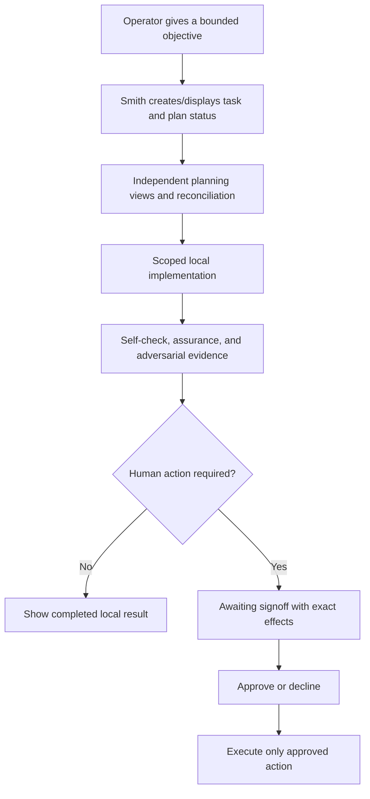

# Smith Operator Design

## Status

**Normative target design.** This document defines the human experience of an Ubuntu-workstation operator controlling Smith. It does not claim every behavior is implemented today.

## Design principles

1. **Agency is visible.** Smith states what it is doing, where, with which authority, and what remains pending.
2. **Evidence before confidence.** Completion views distinguish passed checks, failed checks, skipped checks, and unknowns.
3. **Approval is intentional.** A human sees exact effects before any remote or destructive action and can decline without ambiguity.
4. **Failure is recoverable.** Errors explain scope, affected task/revision, preservation state, and safe next action.
5. **Local-first is legible.** The operator can tell whether a task used host, container, local model, networked search, or external credentials.
6. **No deceptive autonomy.** The interface never represents queued/running model work, inferred approval, or unverified results as completed.

## Operator workflow

## Task states

Use one visible vocabulary across CLI, bridge, and future client surfaces:

| Stage | Operator meaning |
|---|---|
| `new` | Objective accepted but not yet investigated. |
| `discovery` | Facts, constraints, and risks are being collected. |
| `preproduction` | Independent analyses and implementation plan are being reconciled. |
| `production` | Scoped implementation or deterministic validation is running. |
| `review/signoff` | Evidence exists; human decision or remediation is required. |
| `completion` | The approved outcome finished and evidence is retained. |
| `failed` | Work stopped; cause, preserved state, and recovery path are visible. |

A task must not advance to completion merely because an agent produced text, an asynchronous request was acknowledged, or a worker process exited.

## Approval experience

Every signoff view must show:

- ticket, project/repository, branch, base revision, target revision, and changed files/diff summary;
- exact requested action: push, PR creation/update, merge, tag, release, deployment, or destructive operation;
- all intended external destinations and side effects;
- assurance verdict, adversarial findings, required-check results, skipped/unknown checks, and residual risks;
- compatibility/rollback information where relevant;
- approver identity, scope, expiry, and an explicit approve or decline choice.

Approval is invalid when the display cannot bind it to the exact target revision or when evidence is stale. A new commit, plan change, changed external effect, or expired window requires a new signoff.

## Critical operator flows

| Flow | Blocking behavior |
|---|---|
| Plan disagreement | Preserve the disagreement, identify owner/options, and block implementation if it concerns scope, safety, acceptance criteria, or architecture. |
| Validation failure | Show failed command/scenario and relevant output/artifact. Do not offer release approval. |
| Missing evidence | Mark gate unknown/failed, not passed. |
| Prompt-injection suspicion | Identify untrusted source, stop privileged progression, and request human review if scope/authority may have changed. |
| Worker/supervisor restart | Reconcile job status; show stale or unknown state rather than claiming continuation/completion. |
| Approval decline | Preserve evidence, stop external action, and return to review/remediation without deleting work. |
| Partial coordination | Surface repositories/PRs and merge order; block atomic changes until compatibility evidence permits partial progress. |

## Accessibility and local operation

- CLI output must provide the same task, evidence, and approval meaning as graphical surfaces.
- Status labels use text in addition to color or iconography.
- Long-running tasks show progress, elapsed time, current stage, and cancellation/recovery status where supported.
- Error and approval text must be concise, actionable, and readable without raw model transcripts.
- Voice and desktop capabilities are optional conveniences; they must not be required to operate, review evidence, or withhold approval.

## Design change triggers

Update this document when changing task stages, operator-visible approval, error/recovery behavior, privacy disclosures, client/bridge interaction contracts, or accessibility behavior.
