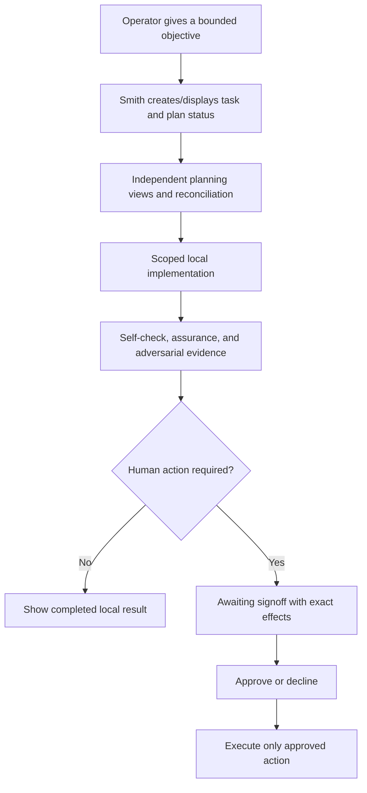

# Smith Operator Design

## Status

**Normative target design.** This document defines the human experience of an Ubuntu-workstation operator controlling Smith. It does not claim every behavior is implemented today.

## Design principles

1. **Agency is visible.** Smith states what it is doing, where, with which authority, and what remains pending.
2. **Evidence before confidence.** Completion views distinguish passed checks, failed checks, skipped checks, and unknowns.
3. **Approval is intentional.** A human sees exact effects before any remote or destructive action and can decline without ambiguity.
4. **Failure is recoverable.** Errors explain scope, affected task/revision, preservation state, and safe next action.
5. **Local-first is legible.** The operator can tell whether a task used host, container, local model, networked search, or external credentials.
6. **No deceptive autonomy.** The interface never represents queued/running model work, inferred approval, or unverified results as completed.

## Operator workflow

## Task states

Use one visible vocabulary across CLI, bridge, and future client surfaces:

| Stage | Operator meaning |
|---|---|
| `new` | Objective accepted but not yet investigated. |
| `discovery` | Facts, constraints, and risks are being collected. |
| `preproduction` | Independent analyses and implementation plan are being reconciled. |
| `production` | Scoped implementation or deterministic validation is running. |
| `review/signoff` | Evidence exists; human decision or remediation is required. |
| `completion` | The approved outcome finished and evidence is retained. |
| `failed` | Work stopped; cause, preserved state, and recovery path are visible. |

A task must not advance to completion merely because an agent produced text, an asynchronous request was acknowledged, or a worker process exited.

## Approval experience

Every signoff view must show:

- ticket, project/repository, branch, base revision, target revision, and changed files/diff summary;
- exact requested action: push, PR creation/update, merge, tag, release, deployment, or destructive operation;
- all intended external destinations and side effects;
- assurance verdict, adversarial findings, required-check results, skipped/unknown checks, and residual risks;
- compatibility/rollback information where relevant;
- approver identity, scope, expiry, and an explicit approve or decline choice.

Approval is invalid when the display cannot bind it to the exact target revision or when evidence is stale. A new commit, plan change, changed external effect, or expired window requires a new signoff.

## Critical operator flows

| Flow | Blocking behavior |
|---|---|
| Plan disagreement | Preserve the disagreement, identify owner/options, and block implementation if it concerns scope, safety, acceptance criteria, or architecture. |
| Validation failure | Show failed command/scenario and relevant output/artifact. Do not offer release approval. |
| Missing evidence | Mark gate unknown/failed, not passed. |
| Prompt-injection suspicion | Identify untrusted source, stop privileged progression, and request human review if scope/authority may have changed. |
| Worker/supervisor restart | Reconcile job status; show stale or unknown state rather than claiming continuation/completion. |
| Approval decline | Preserve evidence, stop external action, and return to review/remediation without deleting work. |
| Partial coordination | Surface repositories/PRs and merge order; block atomic changes until compatibility evidence permits partial progress. |

## Accessibility and local operation

- CLI output must provide the same task, evidence, and approval meaning as graphical surfaces.
- Status labels use text in addition to color or iconography.
- Long-running tasks show progress, elapsed time, current stage, and cancellation/recovery status where supported.
- Error and approval text must be concise, actionable, and readable without raw model transcripts.
- Flutter is the primary desktop interface; voice remains optional. CLI is secondary query/status/configuration, with existing commands retained and evidence/approval meaning preserved. Future headless operation is a separate deferred deployment/lifecycle capability, not another name for CLI.

## User-service operator flow

The service experience presents separate actions and separate state; it never compresses “installed,” “running,” and “starts at login” into one toggle.

| Operator action | Expected visible effect | Must remain unchanged |
|---|---|---|
| Install binary | Stable executable is built and `--help` plus `--version` are verified. | Unit, runtime, login enablement, sidecars, Docker, and lingering. |
| Install unit | Unit is staged and the user manager is reloaded. | Runtime and login enablement. |
| Start / restart / stop | Current manager runtime changes, with command failure shown. | Login enablement and lingering. |
| Autostart on / off | Enabled-at-login changes. | Current runtime and lingering. |
| Uninstall unit | Runtime is stopped, login enablement is disabled, registration is removed, and the manager is reloaded after a visible request. | Installed binary, Smith data, Docker, sidecars, client, and lingering unless separately approved. |

Status always labels configured autostart preference, unit installed/load state, manager active state/substate, manager result/restart count/main exit, persistent enabled-at-login, raw enablement state, linger `yes`/`no`/`unknown`, and Smith bridge identity/health independently. CLI and desktop surfaces must expose configured preference separately from observed manager state and drift. “Enabled at login” is not “running now.” With linger disabled or unknown, the interface must not claim pre-login availability. Smith may show the exact manual `loginctl` command and consequences, but it never runs a lingering mutation; that remains a separate human-approved host operation.

Service failures identify the attempted manager command, exit status, sanitized stderr, unit and executable paths, preserved state, and a safe retry/rollback action. A permanent host-runtime configuration failure is checked before warm model/service/sidecar work and is not automatically retried; other automatic failures are bounded by a visible restart fuse. An `activating/auto-restart` unit without a healthy Smith bridge is labeled unavailable and shows containment guidance. Registration or start failure must not lead to an unmanaged background process or a success/readiness message. If another process owns the bridge port, show an identity conflict and do not offer to stop the unrelated process.

After restart, the operator sees reconciliation before readiness: formerly queued/running work is labeled interrupted/recovery-required with retained task/job identifiers, prior diagnostic/result content, and a resume/retry/review action. Awaiting-signoff and completed/failed/cancelled records retain their meaning. Unknown manager, linger, bridge, or recovery state remains unknown rather than being inferred.

Sandbox smoke output is explicitly labeled simulated manager evidence. It is not evidence that the workstation’s real user manager, login session, lingering policy, bridge, Docker dependencies, or reboot recovery works. A later real-host smoke view must list the exact approved commands and effects before execution.

## Desktop client surfaces

**Implemented staged slice:** the approved [desktop wizard plan](plans/LOCAL-SMITH-DESKTOP-WIZARD-P0.md) extends [Flutter boot](plans/LOCAL-SMITH-FLUTTER-BOOT-P0.md). `client/lib/main.dart` mounts `desktop_boot_shell.dart`: Launch → Detect backend → Local runtime → Select/install model → Review & Start → Home/Chat, with a persistent readiness strip and Backend setup access after readiness. Automatic discovery validates only `<actual Halo executable directory>/smith_backend/smith`, not cwd/PATH or recursive scanning. Invalid discovery offers explicit retry or **Advanced · explicit backend path**, never silent fallback. Opening runs read-only structured `setup inspect`; inventory `ready` means observed eligible installed tags, not verified inference. Navigation/readiness pulses never start a chat backend, infer or download. Choose an observed exact `name:tag`, review and explicitly **Start packaged backend** only after observed absence.

**Installed-model path:** the picker shows exact installed tags with human-readable sizes; the selected field retains only the tag. A selected model explicitly states “Installed locally” and “No download needed.” Download controls are secondary and collapsed under “Optional · download another model.” An installed selection may advance to Review even while a listener conflict exists; final Start remains blocked until a fresh absence check. Disabled Start explains the backend/profile/provider/model conflict or missing inventory instead of implying another download is needed. A legacy listener must be resolved outside this app; the wizard cannot stop or replace it.

**Partial first-run setup:** missing Ollama shows instructions to provision/run it separately at the fixed loopback endpoint and **Retry inspection**. Smith supplies no Ollama host install/start, sudo, legacy install helpers, browser launch or service integration. **Review model download** opens action-specific confirmation for the exact tag and endpoint, expiring after 60 seconds; the adapter writes operation/model-bound stdin consent to the separate setup child. Progress shows sanitized provider stage and known completed/total layer bytes, not invented overall percentage. Pull observation has finite 15-minute overall/30-second idle deadlines, explicit cancellation and no automatic retry. Internet and persistent disk belong to external Ollama; sizes are unknown until reported, metadata is not artifact authentication, and daemon continuation/partial cache after cancel can remain unknown. Cancel never promises rollback or cache deletion. Success requires provider success plus fresh eligible exact tag verification, then inspection refresh; it is not inference proof. The chat-only bridge still exposes no provisioning tools/routes.

**Actual guards, not a global scheduler:** selection/editing requires no setup work/child, configurable non-ready backend, no owned backend child and no active chat. Pull additionally requires backend `absent`, rechecks permission before consent and cancels locally on conflicting backend/chat state. Start requires backend eligibility and selection still in inventory. Owned/external ready, lifecycle, unknown/conflict and cleanup-unknown states do not permit download/Start. Read-only detection/inspection may run while a backend is active. Unknown setup cleanup blocks duplicate setup children. The client accepts a fully validated sequence-zero terminal `error` as preflight failure without consent/approval; terminal success/cancelled first are rejected. Failure display preserves validated code/message with control/bidi stripping and slash-prefixed path-like redaction, retaining no-auto-retry/unknown-cache guidance. Detection and advanced-path resolution use the inspection timeout (10 seconds by default). Real provider version compatibility remains pending. See [Architecture](ARCHITECTURE.md#desktop-setup-command-boundary) for source contracts. No headless implementation is supplied.

Readiness requires positive Smith chat-only/non-echo identity, Ollama provider, exact model and affirmative provider/model availability; unknown/mismatch blocks Send. A compatible externally managed backend attaches untouched, displays its exact model and is never stopped or reset on attachment. A configured model is never silently substituted. States distinguish checking, absent, conflict, unknown, starting, owned/external ready, stopping and cleanup unknown; no fabricated percentage or artificial delay represents progress.

Lifecycle configuration/actions belong to Boot/Setup, not ordinary **read-only Settings**. Home/Chat share the draft; Settings observes endpoint, identity, profile, provider/model availability and memory-only history. Work and voice are not mounted; uploads, integrations, saved history and streaming are deferred. The supplied icon's original asset is not available in the workspace, so integration remains pending; no substitute is invented.

Owned readiness uses health `desktop_session` plus captured-child liveness, not merely a healthy port. Explicit Stop/normal close closes stdin and sends TERM, waits up to five seconds, then KILL with up to two seconds for exit confirmation. Cleanup unknown blocks restart and cancels normal exit. Parent-pipe EOF initiates backend shutdown as a backup, not a crash-proof termination or provider-cancellation guarantee. External processes are untouched. Pulses, disconnect and recovery never remount Home, clear draft/transcript, resend or reset conversation automatically.

The client transcript/draft disappear on application close. Backend context is one shared bounded in-memory default session, cleared on backend restart; reconnecting does not restore history or prove context survived. The first explicit send from a newly opened client resets that shared backend conversation. Confirmed New chat clears the visible transcript but preserves the draft; the next explicit send resets backend context. Failures remain visible, and model prose never becomes task/approval state. Profile mismatch blocks sending rather than silently using legacy `serve` or echo. Final manual desktop/clean-host validation remains pending; this is a local candidate, not a production-release claim.

**Longer-term target:** the Ubuntu desktop client uses one persistent application shell with Home, Chat, Work, and secondary Settings surfaces. Navigation preserves the active local conversation draft, voice lifecycle, selected work, and background task observation rather than reconstructing those concerns per page.

- **Home** summarizes current bridge, capture, speech, and work state with explicit text. Its Halo is a presentation of observed state, not evidence, approval, or a progress percentage. Unknown or stale task data must not be presented as live work.
- **Chat** keeps text entry primary and voice optional. Assistant prose remains visually distinct from structured task state. If session history is not supplied by the bridge, the client labels it unavailable rather than fabricating sessions.
- **Work** separates lifecycle stage from execution status, preserves task/run/result identifiers when supplied, and exposes stale, failed, skipped, unknown, and awaiting-signoff states without converting them to completion. Approval controls remain unavailable until the complete binding in [Approval experience](#approval-experience) is supplied and validated.
- **Settings** isolates explicit local service and speech configuration from observational Home and Work controls; navigation must not make configuration mutations implicit.

Wide layouts use persistent navigation and may show list/detail panes. Narrow layouts use compact navigation and single-panel details. Across sizes, controls remain keyboard operable, touch targets are at least 48 logical pixels, text scaling does not hide critical actions, reduced motion disables nonessential Halo motion, and status is never conveyed by color alone.

## Design change triggers

Update this document when changing task stages, operator-visible approval, error/recovery behavior, privacy disclosures, client/bridge interaction contracts, or accessibility behavior.
