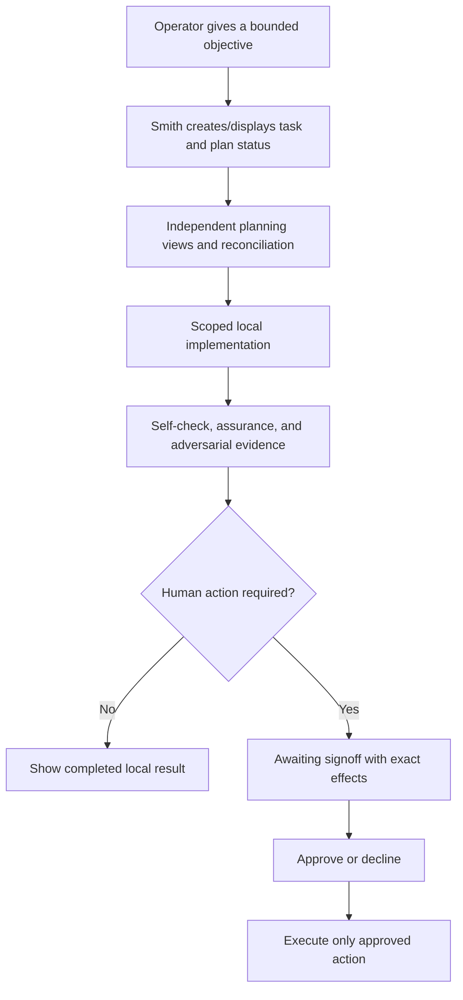

# Smith Operator Design

## Status

**Normative target design.** This document defines the human experience of an Ubuntu-workstation operator controlling Smith. It does not claim every behavior is implemented today.

## Design principles

1. **Agency is visible.** Smith states what it is doing, where, with which authority, and what remains pending.
2. **Evidence before confidence.** Completion views distinguish passed checks, failed checks, skipped checks, and unknowns.
3. **Approval is intentional.** A human sees exact effects before any remote or destructive action and can decline without ambiguity.
4. **Failure is recoverable.** Errors explain scope, affected task/revision, preservation state, and safe next action.
5. **Local-first is legible.** The operator can tell whether a task used host, container, local model, networked search, or external credentials.
6. **No deceptive autonomy.** The interface never represents queued/running model work, inferred approval, or unverified results as completed.

## Next-generation desktop/service lifecycle target

**Approved direction, not implemented:** first use discloses service operation after desktop close, resource/data effects and explicit startup consent. The desktop starts/connects to Smith and synchronizes service-owned goals, conversations and operation state. Returning clients synchronize instead of repeating setup or resending work. Temporary provider failure is a repair state, not first-use onboarding.

Closing the window or quitting the desktop detaches only; already-authorized operations may continue in the Smith service. **Stop Smith service** is a distinct, intentional action with visible effects on active operations, cancellation/interruption and saved state. Show service availability separately from provider availability and operation status; disconnected/stale UI state must not imply completion or fresh service state.

Persistent goal-oriented chat precedes roles/subagents/pipelines. Background continuation is not blanket autonomy. The login-boot source slice below now implements login-scoped enablement and bounded attach/synchronization, but logout/reboot recovery, pre-login/post-logout operation, lingering and live supervisor behavior remain unverified rather than guaranteed. The legacy client retains its prior lifecycle. See [the product reset](plans/LOCAL-SMITH-PRODUCT-RESET.md).

## Current next-generation login Boot experience

**Implemented in source under [login-boot plan](plans/LOCAL-SMITH-NEXT-LOGIN-BOOT.md):** application launch first shows a minimal Smith Boot surface while the login-enabled service becomes ready. A centered restrained `CustomPainter` loop accompanies only short live status—**Starting Smith**, **Connecting to Smith**, or **Syncing conversation**—with a static equivalent when reduced motion is requested. No sidebar, transcript, composer or chat action is mounted during Boot. Finite serialized Core observations stop after at most 15 seconds; once Core is ready, conversation synchronization uses its existing separate finite query/operation bounds. Action-required, conflict and unavailable outcomes stop animation and show concise repair or observe-again guidance rather than waiting forever.

The application never automatically starts, enables, installs, provisions a model, infers or resends. It enters chat only after exact bridge-ready observation and conversation synchronization. Only a fresh exact installed, registered, enabled and safely stopped state offers **Start Smith**. That action prepares once, displays the exact Start effect, requires separate confirmation, applies the original token once, then returns to fresh bounded observation. Disabled, missing/static, conflict, malformed and unknown states do not expose Start. Enable remains installer-owned and separately confirmed.

Installer lifecycle presentation keeps Enable and Start distinct: fresh setup confirms Enable, then confirms Start; Enable does not start now and Start does not enable. Neither action changes lingering. The resulting target is availability after user login, not a pre-login or post-logout promise. Real manager/login/reboot and installed-host maintenance UX remain unverified and require fresh exact approval; component PASS results are not independent assurance or release/deployment evidence.

## Current next-generation terminal-inspired presentation

**Implemented presentation slice under [UI redesign](plans/LOCAL-SMITH-NEXT-UI-REDESIGN.md):** after the existing Boot gate, native Flutter uses flat dark-teal surfaces, cyan accents, thin outlines, small radii and bundled JetBrains Mono (IBM Plex Mono build-time alternative). The header shows `> SMITH` on the left and the status indicator with last-observed service connectivity on the right—not continuous monitoring, model/GPU readiness or inference proof. The [shared-header follow-up](plans/LOCAL-SMITH-NEXT-SHARED-HEADER.md) places one Layout icon 16 logical pixels beside that status in a single window-level header above the grid; tiles no longer duplicate the app header. It has no version or manual refresh control. After Boot readiness, connection state is checked automatically after 30 seconds and again 30 seconds after each check completes, including through outages and Settings navigation. Healthy checks do not flicker offline. This is last-verified app transport/state, not continuing login enablement; model readiness and work completion remain separate. Errors retain explicit recovery, and reconnection never resends a message or starts the service. Read-only Settings shows the build-derived version with bundled declared-version fallback (`Version unavailable` only if neither metadata source is valid). Chat and read-only Settings share a collapsed rail; desktop history becomes an explicit modal drawer on narrow layouts. Independently scrollable selectable SMITH/YOU bubbles and an anchored multiline composer retain existing submission/recovery behavior. The transcript viewport spans the chat pane, with one 8px scrollbar flush to its right edge; centered messages retain their bounded reading width and at least 16px edge clearance so the thumb never overlays them. Composer and recovery content keep their existing bounded alignment. No fabricated timestamps, Markdown, streaming or window decorations are added.

The initial presentation slice exposed only **Current conversation**; the [multi-chat integration](plans/LOCAL-SMITH-NEXT-MULTI-CHAT.md) now supplies authoritative conversations and New/rename/archive/reactivate/delete callbacks to those same widgets. Menus and confirmations capture stable identity and revisions and revalidate current capability before dispatch; revoked authority cannot be revived by leaving an old dialog open. There is no UI-owned durable conversation store.

Settings hides the chat list/history controls while retaining the Chat return rail; Settings/drawers/resizing preserve the mounted conversation and draft. Enter sends once when eligible, Shift+Enter inserts a newline, and composition/repeat events cannot accidentally submit. Small-height recovery uses an explicit scrollable details dialog rather than clipping errors; long drafts scroll within the bounded composer. Tests and captures cover 400×400 through 4200×2400 and enlarged text, but fixture evidence is not installed graphical QA or full multi-chat acceptance. Multi-chat now retains per-conversation reading positions while the desktop remains open. This presentation supersedes the historical neutral/rounded/Chat-only styling below, not its safety or lifecycle boundaries.

## Split-workspace experiment

**Implemented local source experiment under [split-workspace plan](plans/LOCAL-SMITH-NEXT-SPLIT-WORKSPACE.md):** the shared **Layout** menu selects equal 1×1, 2×1, 1×2 or 2×2 tiles (columns × rows). The [shared-header follow-up](plans/LOCAL-SMITH-NEXT-SHARED-HEADER.md) supersedes the compact-navigation slice's repeated app headers: one fixed app header contains branding, system status and the window-wide Layout menu above both canvas scroll views, including when tiles show Settings. Only workspace bodies repeat: Chat/Settings rail, responsive history access, chat-title header, transcript/composer or Settings. Tile separators remain neutral, without an active-workspace outline. Selection and Chat/Settings navigation are independent. Slots are retained when hidden and restored when expanded. The [workspace restoration extension](plans/LOCAL-SMITH-NEXT-WORKSPACE-RESTORE.md) remembers layout, active tile, saved-chat selections and Chat/Settings pages across sessions; unsent state remains process-local. Split layouts use a minimum-size, two-axis scrollable canvas when the window cannot fit usable tiles, rather than shrinking text or controls.

**Implemented compact navigation:** below the existing tile-width/text-scale threshold, the chat title and downward chevron open an anchored, bounded chooser with live saved-chat rows and their existing revision-checked context menus. New chat (+) and Archived chats are directly available at the right of the existing chat header; archive opens the browser, not an archive-current action. The chooser omits redundant toolbar actions. Selection uses current membership/callbacks and affects only its originating tile. Wide layouts retain the sidebar; the rail history route remains available. Settings hides all chat-header controls while retaining the shared Layout menu. Shrinking from a tile that becomes hidden returns focus to a visible Layout control, not a composer. The shared app header and tile chat headers may wrap for enlarged text; no extra Layout-only toolbar is introduced. Layout uses a single native menu trigger rather than nested buttons. Hover/pressed fill is distinct from the visible keyboard-focus outline; mouse selection/cancel/exit/removal, keyboard traversal and route disposal are covered by production-theme widget tests. Synthetic pointer evidence does not establish closure of the reported native window-edge/deactivation symptom; that graphical check remains outstanding.

Each tile has its own reusable unsent New chat. Views of the same saved chat share history, draft and operation state, but retain independent reading positions and editor selection. Clicking/focusing a composer activates its tile; inactive composers cannot edit/send and hidden tiles cannot retain focus. A send scrolls only its originating view. Desired reading bookmarks survive temporary viewport clamping during resizing/hiding. Archive/delete repairs all affected tile selections, including hidden ones. Layout changes neither delete conversations nor cancel accepted work.

This is simultaneous presentation, not parallel inference: the existing shared controller, observation, queue and service ownership remain. Dev/terminal panes, arbitrary splitting and docking are not implemented. Workspace restoration now remembers all four slots, including hidden ones, without restoring composer focus or unsent drafts. Focused fake/widget validation and a Linux debug build are recorded in the plan; full-suite failures and native graphical/IME acceptance remain explicit limitations, not release approval.

**Implemented workspace restoration behavior:** after Boot synchronization, a short restoration gate loads local presentation preferences before enabling workspace interaction. A saved New chat reopens blank. Missing/deleted/archived saved chats fall back to New chat without losing their tile's Chat/Settings page; a concise warning explains the fallback, and repaired selections are saved. Other saved chats are not substituted automatically. Shared-chat tiles still share one authoritative conversation controller. Preferences never resume/resend work or restore model/service setup.

Missing preferences retain first-use defaults. Invalid/unreadable preferences leave the existing file untouched and show that changes are session-only; save failures warn that changes may not survive restart. No automatic corruption reset or overwrite is offered. The single-operator store excludes competing writers; a second desktop that cannot acquire ownership remains usable without saving its layout. Unsent text, reading positions, editor selection, open dialogs and provisional operation state are not part of workspace restoration. Source/fake restart tests do not establish native window-manager shutdown or installed graphical acceptance.

## Current multi-chat interaction

**Implemented source:** New chat opens/reuses one unsaved workspace; typing/navigation do not create saved empty chats. First accepted Send atomically creates a chat and its job, deriving its title from the first message: remove forbidden controls, collapse whitespace, and truncate to 40 Unicode scalar values (falling back to `New chat` if empty). The full message is unchanged, and later messages do not rename the chat; migration names the old conversation `Current chat`. New renames and all ordinary title displays share the 40-scalar limit, including archive, headings, tooltips and confirmations. Combining sequences may count as multiple scalars. Existing longer stored titles/receipts remain valid and unchanged; the rename editor exposes the original value with over-limit feedback rather than silently truncating it. Titles are bounded single-line text, not model-generated. Each chat uses only its own saved context. Global model/configuration remain shared. Up to four requests may be outstanding: one Running, the others Queued, with one outstanding submission per chat. Uncertainty is shown rather than an unverified running/completed claim. No actual parallel inference is implied.

Active rows offer Rename/Archive/Delete; Archived chats opens the complete bounded archive with Reactivate/Rename/Delete. Archive is reversible; Delete requires exact-target confirmation and means logical current-store deletion, not secure media/backup erasure. Chat dialogs use short, plain-language copy: Delete identifies the chat, says history/results are removed and cannot be undone, and notes backups are kept. Rename shows a concise limit/count; failed or unavailable actions state the outcome and next step without repeated boilerplate. Expired-request confirmation preserves uncertainty, duplicate-send caution and the local-only/no-cancel boundary. Exact service-start effects remain unchanged. Target unfinished or uncertain work blocks archive/delete, not unrelated navigation or another chat's Send. Rename may proceed with fresh metadata during generation. A stale dialog fails rather than silently applying to newer content. Archive/delete of the selected chat returns to the preserved unsaved workspace or a blank; reactivation need not change selection. Archive preserves a same-process draft; confirmed deletion discards the target's local draft/state.

Drafts, reading positions and provisional recovery are per-chat and process-local; saved-chat tile selections are retained by workspace preferences as described above; unsent drafts are not promised after desktop death. Accepted jobs/history survive independently of the client. Closing detaches, while service restart interrupts unfinished jobs without replay. Boot waits for authoritative synchronization, not job completion. Retry only observes; accepted identities survive poll failures, and retained interruption/failure evidence is shown on reattach without inventing missing prompt text. Enter sends once, Shift+Enter inserts a newline, and IME/repeat safeguards remain. The source/widget/socket evidence does not substitute for separately approved installed graphical or real-model QA.

**Implemented source under [immediate-send feedback](plans/LOCAL-SMITH-NEXT-IMMEDIATE-SEND.md):** eligible Send immediately adds a process-local, request-keyed user bubble and clears the composer, including while dispatch waits behind observation. A Smith status bubble shows Sending, then observed Queued or Thinking with a static progress icon and accessible live status. Verified replies replace progress; rejected, failed and unknown outcomes stop progress and retain explicit feedback without resending. Newer drafts remain untouched. Authoritative history replaces successful local receipts without duplicate turns. Each newly submitted message scrolls into view once; status updates and receipt reconciliation do not move a reader who has scrolled away. These local receipts are not durable history or proof of service admission.

## Current next-generation conversation-first text experience

**Implemented in source under [text reset](plans/LOCAL-SMITH-NEXT-TEXT-RESET.md):** launch always mounts a single dark conversation surface. No Core/LLM/Services wizard, completion action, microphone/playback or voice-service controls. Available history and draft survive outages with factual stale/unavailable labels. A compact connection status and observation-only Retry replace onboarding; there is no installer button/dialog. Retry only observes/synchronizes/queries; uncertain work is never resent. Legacy setup completion neither grants nor denies readiness; identity and persisted-data integrity remain mandatory. Under [minimal chat](plans/LOCAL-SMITH-NEXT-MINIMAL-CHAT.md), all model selection/setup belongs in the separate installer. Missing/unselected models disable Send with concise external guidance, never an inline chooser or default selection. A neutral dark surface keeps selectable history independently scrollable above an anchored rounded text composer. In the focused composer, Enter sends exactly once when Send is available, Shift+Enter inserts a newline, and Enter preserves the draft without submitting when Send is unavailable; the Send button remains equivalent. Under [the chat-sidebar slice](plans/LOCAL-SMITH-NEXT-CHAT-SIDEBAR.md), a narrow persistent left rail contains only the selected Chat icon, tooltip and selected accessibility state; it establishes scalable navigation structure without exposing placeholder or unavailable modes. Pending/uncertain results and confirmed expired-request resolution remain visible; no voice/speech controls or execution are introduced.

**Implemented source addition under [minimal Settings](plans/LOCAL-SMITH-NEXT-SETTINGS.md), adopting the parallel UI redesign:** a gear directly below Chat opens a separate, minimal read-only **Connection & About** page. This supersedes the earlier Chat-only rail. It displays supplied last-observed service connection, observed model status and build-derived version (or an explicit development fallback), not continuous monitoring or verified inference. Bounded-history, close-detaches and external-installer guidance remain visible in the scrollable page. Navigation retains the mounted conversation, draft, reading position and pending work; it performs no service/configuration action. No model/GPU selectors, lifecycle controls or editable preferences are introduced.

A verified terminal answer is retained separately from authoritative history during synchronization loss, including work accepted by an earlier client. Missing user text is not invented; already-visible saved reply text is not duplicated. Later successful synchronization replaces the provisional view. On initial mount, an existing retained conversation scrolls once to its newest content after layout; subsequent status, draft and controller updates do not force-scroll an operator who moved elsewhere in the transcript. Close detaches without stopping accepted service work. Context remains bounded, not archival unlimited history.

The native Rust `smith-installer` has separate confirmation for artifact publication, unit registration/reload, login Enable, Start, exact-model pull, saved preference and optional direct minimal inference. Full recipient mode accepts `--bundle`, `--dry-run`, `--model EXACT`, `--pull-model` and `--verify-inference`; it has no blanket `--yes`. The package root defaults beside the actual canonical running executable, not cwd or an alias. Keep the complete extracted `next/installer/dist/` package and its paired payload for repair. Recipients need prepared Ubuntu 24.04 x86_64 native runtime libraries, not Python or build tools; Python Dagger/package assembly is builder-only. See [the native migration](plans/LOCAL-SMITH-NEXT-NATIVE-INSTALLER.md).

Initial decline/dry-run makes no destination writes/locks and does not inspect managers/providers; later decline preserves prior accepted effects and reports partial/uncertain outcomes without rollback. Each consent read is bounded to 4096 bytes including newline and 60 seconds; EOF, interruption or timeout never approves, and an expired native preparation is not silently renewed. Missing Ollama/runtime/user-manager prerequisites get guidance, never automatic provision/start or cloud fallback. Models remain external through already-running `127.0.0.1:11434` Ollama; pull requires the exact model confirmation, no model is invented as best/default, and inventory or saved preference is not inference verification. Download size/daemon cache/cancellation can be uncertain; cancellation never promises daemon stop or cache deletion. The earlier instruction-only Open installer handoff is superseded by minimal chat: there is no desktop installer dialog or launch. Repair is performed externally, followed by explicit observation-only Retry.

Bounded recipient setup/progress output accepts pipes, sockets and terminals, not regular files/other devices whose writes cannot be bounded with nonblocking flags. A failed/backpressured output sink or interruption can leave the report incomplete; it must not turn failure into success or imply rollback. Individual console/manager/socket/provider budgets are not an overall filesystem/fsync deadline, and the artifact publisher's separate stdio path is not covered by that bounded sink contract.

Voice is archived, not disabled behind a toggle. Existing valid voice-v1 data remains readable and inert; no re-execution, deletion or corruption reset. The sections below record superseded implementation stages rather than current onboarding requirements.

## Current installer visual design

**Implemented presentation-only option A under [installer redesign](plans/LOCAL-SMITH-NEXT-INSTALLER-REDESIGN.md):** the existing native GTK3 shell now uses the application's flat dark-teal/cyan styling, thin panels, small radii, embedded JetBrains Mono and selected supplied outline icons. The header displays `> SMITH`, Installer and the actual Cargo version. Native window titles are `smith - installer` for the installer and `smith - local autonomy` for the main application. This supersedes the earlier near-black/green styling below, not its operation or consent contract.

The same Choose → current action/progress → Result structure remains. All artifact, lifecycle and model approvals stay separate, with complete exact effects shown once and action-specific buttons; model selection still prepares review rather than approving an effect. Preparation/confirmation copy does not imply prior approval. Progress hides redundant disabled primary actions. Results remove repeated generic prose while keeping verified scope, preservation, uncertainty, failures and safe next steps; there is no Confirm results step or automatic app launch. The scrolling body, wrapping model labels and adaptive footer retain accessible actions in narrow/enlarged layouts. `--licenses` exposes full embedded appearance notices without display/package discovery. Synthetic GTK captures are not live graphical or accessibility acceptance. Grouped consent remains deferred by explicit operator choice.

## Current native model and focused installer experience

**Implemented source under [model-wizard plan](plans/LOCAL-SMITH-NEXT-MODEL-WIZARD.md), simplified by [minimal-installer plan](plans/LOCAL-SMITH-NEXT-MINIMAL-INSTALLER.md):** one near-black/green GTK3 window initially presents exactly two large actions, **INSTALL / UPGRADE** and **UNINSTALL**. A hidden read-only artifact preview may run in the background; after selection, a dedicated **Checking Smith** state leads to one focused action/page with one primary and at most one secondary current-action control. Smith is one paired app/service product. Normal installation fixes registration, login Enable and Start as requested defaults, while retaining fresh separate exact confirmations. Enable changes only persistent default-target selection, Start changes only current runtime, and neither mutates lingering. There is no normal visible Logs/Details control: bounded internals remain retained, but exact effects, blocking failures, uncertainty, preservation state and safe next action stay directly visible.

Qwen3-14B Q4_K_M is preselected for fresh model setup (9001752960 bytes); reruns preserve existing saved selection. The chooser contains only the compiled seven-model Apache-2.0 catalog and presents compact tier/name/GiB/state labels: Compact Qwen2.5 1.5B, SmolLM2 1.7B and Qwen3 4B; Balanced Mistral 7B and Granite 8B; Large Mistral Nemo 12B and default Qwen3 14B. An unsupported saved selection remains preserved as inert read-only status, cannot consume or submit a request, and must be replaced by an explicit curated choice to continue. There is no free-form model name/path or import. Opening/preselection is not download, preference or inference authorization. Each exact-model action gets its own displayed confirmation: download, revision-checked saved preference, service-backed check or permanent removal. Download shows real byte counts; hashing/loading/generation use indeterminate stages and elapsed time. CPU speed is unmeasured. Model-default thinking is left intact; only complete final content is displayed/saved. Reasoning-only/empty/truncated/timeout results are failures, not verified setup.

**Implemented source under [download-progress plan](plans/LOCAL-SMITH-NEXT-DOWNLOAD-PROGRESS.md), with its visible Details surface superseded by the minimal shell above:** GTK displays the latest bounded actual-byte download snapshot in the compact progress stage and does not append every numeric sample to retained diagnostics; log text batches once per UI tick while confirmations, errors and final results remain immediate and ordered. Progress boundaries discard stale numeric display state. Retained bounded diagnostics begin with `Report.message`, preserving the primary outcome when logs are large, but are not attached to the normal installer page. Coalesced display is not completion, retry or recovery: there is no download resume, deadline increase or deletion, and fake/source checks do not establish a successful real transfer.

Manage models is not a landing action; it remains reachable from setup/review and appropriate result screens, including after failed or expired artifact review, and lets the operator add/select/check or remove models without artifact republication. A blocked Install shows its reason and explicit-upgrade guidance directly on the main page. Model management still requires a compatible verified running service; a differing managed installation directs to the explicit Upgrade flow below, never silent overwrite. Selected models cannot be removed: explicitly select another installed model first. Any loaded runner can block removal until its normal600s idle stop; no hidden unload/Stop, history or preference deletion. Removal needs separate destructive confirmation, preserves partial/orphan data on failure and never implies rollback.

Complete is scope-specific: installation results enumerate paired artifact/lifecycle effects and service-backed check; management reports only Model check complete or Model removal complete. Failed checks show Setup incomplete with prior effects preserved. Stopping invalidates consent and waits for the installer worker to join, without cancelling already accepted service work or resending it. After sticky process cancellation, Manage models is unavailable until the installer is closed/reopened. The app remains conversation-first and close detaches from the service.

**Implemented explicit launch under [installer launch](plans/LOCAL-SMITH-NEXT-INSTALLER-LAUNCH.md):** successful Installation/Upgrade results expose **Launch Smith** beside **Close**, only after the installer worker has joined and verified completion has no cancellation/fault. Manage models remains available in the result body. Uninstall, model-only, cancelled, incomplete and uncertain outcomes do not expose Launch. Nothing launches on completion/render/Close, and Launch is not the default action. A click validates the installed release asynchronously and dispatches that desktop, never the package payload. Repeated activation is blocked while pending and after successful dispatch. Inline launch failures allow explicit retry without changing the successful installation result or exit status. “Launch requested” means process dispatch, not visible-window, service or model readiness. Close during dispatch waits for its result; afterward the desktop operates independently and Close does not kill it. No service/model action is added to the launcher.

From `next/`, operator-owned QA uses `./installer/dist/smith-installer-ui` after a full package build. Neither installer is persistently installed; keep the package. The minimal-chat app has no Open installer action; installation/model management remain external. The existing differing-binary guard still blocks unapproved upgrades; no implicit installed-host migration or real-model readiness is claimed.

## GPU execution experience

**Implemented source boundary:** the current service automatically attempts fixed full Vulkan offload and retains independent CPU fallback; neither installer nor chat adds acceleration controls or status in this first slice. A successful fake/source test is not displayed as GPU verification. Real CPU/GPU mode remains unreported to the operator until a versioned status contract exists.

**Implemented source correction under [GPU startup fix](plans/LOCAL-SMITH-NEXT-GPU-STARTUP-FIX.md):** explicit pinned-runner logging and complete bounded startup records prevent default logging from masquerading as GPU failure. One sanitized last-startup fallback cause is retained only in provider-process memory behind a nonblocking Rust accessor. It survives CPU reuse/idle unload, resets at fresh preparation and is lost at provider restart. No retained cause does not mean GPU verified; a retained cause is history, not current mode. This is internal diagnostic retention, not an operator-visible status or service-log feature. No screen, preference, wire/storage schema, automatic repair or retry is added. Device discovery and passing synthetic tests remain distinct from real model offload/inference.

**Deferred proposal:** [GPU-preferred specification](plans/LOCAL-SMITH-NEXT-GPU-PREFERRED.md) keeps future preference/device configuration in the installer and adds only compact read-only CPU/GPU/mixed execution status to minimal chat. Preference, preparation, confirmed actual mode, last run and stale observations must remain distinct. CPU fallback verification must not be called GPU verification. Integrated/shared-memory graphics is neither automatically faster nor slower; capability and optional explicit measurements supply evidence. No automatic benchmark, inference, driver repair or additional setup screen is authorized.

## Existing-installation installer actions

**Implemented source under [maintenance plan](plans/LOCAL-SMITH-NEXT-INSTALLER-MAINTENANCE.md), with presentation superseded by [minimal-installer plan](plans/LOCAL-SMITH-NEXT-MINIMAL-INSTALLER.md):** the entry screen offers only **INSTALL / UPGRADE** and **UNINSTALL**, treating Smith app/service as one product. Manage models moves to setup/result paths rather than becoming a third landing action. The hidden opening preview is read-only; the selected flow shows dedicated checking while independent inspections remain authoritative and display foreign/unsafe/unknown refusal rather than making unavailable actions look successful.

Upgrade reviews old/candidate identities and preservation, separately confirms interruption/Stop and applicable registration/Enable/Start, and shows focused stage/confirmation/result views. It migrates only the exact legacy static unit, preserves exact current enabled state without churn, and explicitly enables exact current disabled state. Prior effects are preserved if a later stage is declined or fails. "Artifacts upgraded; service stopped" is distinct from running verified Core/app and from model readiness; after upgrade, choose Manage models explicitly. Old helper code is never executed for discovery or maintenance.

Uninstall is explicitly destructive to active integration, not user data: stop Smith, disable and verify before unregistering, then remove active menu/command/current/service entry points; **keep all conversations, preferences, models, releases, backups and preserved objects**. Retained data occupies disk. No purge option or hidden history deletion. Partial/uncertain failures are visible without automatic rollback/retry. Only exact legacy static/current installable `smith-next.service` units are accepted; foreign, malformed or unknown enablement blocks. Lingering and unrelated legacy services remain unchanged. The simplified presentation changes no safety, lifecycle or approval authority.

Cancel operation invalidates pending consent and waits for the owned worker to join; it is not Stop Smith or rollback. After sticky process cancellation, close/reopen before another operation. Original consent expiry remains strict, including preparation time; a slow/expired operation needs a new explicit run, never silent renewal. Keep the full extracted installer package. Operator-owned live Upgrade/Uninstall QA remains separate from isolated source/GTK tests and agent source authority.

## Historical next-generation debug loader/setup/home

**Implemented in source:** initial Loader performs read-only inspection, then shows Setup or Home from separate binary/unit/runtime/bridge/setup observations. Setup exposes Install binary, Register service, Start service and Finish setup only when applicable; each first prepares fresh effects, then shows exact resolved paths and separate confirmation/cancel. Registration can offer separately confirmed reload-only repair of the exact owned stopped unit. Finish setup writes only the debug flag through the verified service. Opening/Refresh never installs, starts, retries, enables login startup, downloads or performs inference.

Home requires verified completed setup for readiness; a safely completed installation can show Home repair while stopped/unavailable, with factual current statuses and explicit Start/Refresh. Failure/conflict/unknown is not absence or success. Expired/stale consent and double-clicks cannot bypass fresh preparation. Timeout/dispose means unknown action outcome, not rollback; fresh inspection is required before retry. Closing/quitting the UI does not stop the daemon. The disclosure states continued service operation after desktop close, no autostart/lingering and no logout/reboot guarantee.

This is debug text and minimal controls, not chat/provider setup. Stop/uninstall/crash-repair UI and real graphical/user-manager integration are deferred, and no normal-host installation is implied by tests. See [the debug boot plan](plans/LOCAL-SMITH-NEXT-DEBUG-BOOT.md).

## Historical next-generation setup wizard presentation

**Implemented presentation-only slice:** [setup wizard plan](plans/LOCAL-SMITH-NEXT-SETUP-WIZARD.md) replaces the debug-first display with Core → LLM → Services in a near-black/green theme, neutral readable text, labeled states, a single primary applicable Core action and collapsed diagnostics/secondary repair. Supported Core inspection runs automatically; opening and navigation do not mutate anything. Exact fresh prepared effects remain visible before action confirmation. Existing returning-user Core Home/repair routing remains; View setup exposes the stages without repeating registration.

This presentation-only stage initially showed planned LLM/Services pages; the subsequent voice/chat slice below implements local model and voice configuration. Search and cloud remain planned. Core debug completion does not mean complete onboarding or chat readiness. Login startup was unsupported by this historical slice; the current login-boot implementation above supersedes that limitation without adding a lingering toggle. No Compose migration or new provider capability is implemented.

**User-requested target direction:** local model setup precedes a first-class services step for speech-to-text, text-to-speech and search. The text/speech composer shares an editable draft with review-before-send; trusted automatic speech submission remains later opt-in, not effect approval. Whether every service must be healthy before text chat remains to be reconciled. Optional login startup, batched/standing setup authorization and containerized provider deployment require separately bounded lifecycle/capability plans. See the wizard plan for these unresolved boundaries; presentation simplification does not weaken consent.

## Archived next-generation text/speech interaction

**Implemented in source:** [voice/chat](plans/LOCAL-SMITH-NEXT-VOICE-CHAT.md) makes Home a conversation surface with independent Type/Microphone input and Text/Text+speech output. Speech becomes an editable draft; only explicit Send submits a model turn. Dictation appends to unchanged existing text. Edits during recording/transcription remain intact; a late transcript gets an explicit insertion action, never overwrites newer edits or sends automatically. Cancel preserves the draft. Microphone failure is visible and leaves typed chat usable. Switching speech output off suppresses pending/current playback without cancelling microphone capture; enabling it does not replay old answers. Reopening synchronizes history and accepted work without automatic resend or playback.

LLM/Services provide explicit asynchronous inventory and exact observed model/voice selection with saved preferences. Provider status is separate from Smith availability. Missing STT/TTS/audio utilities do not block typed chat. All answers remain selectable text; synthesis/playback failure does not remove them or regenerate a turn. Deliberate Speak requests synthesis only. Search/cloud/download/autostart remain unavailable. Providers are connected, not installed/started by setup.

Accepted operations continue in the service after window close. Uncertain acknowledgement is query-only; finite polling timeout does not mean cancellation. A definitively expired request offers a confirmed local forget action with unknown-outcome/duplicate-risk disclosure; it preserves draft/history and never resends/cancels service work. Bounded context/preferences survive service restart; unfinished jobs are interrupted, not resumed. Audio is transient, older context is evicted by the published bounds, and this is not an archival conversation product. Technical details remain secondary, with no claim of full provider onboarding from the Core debug flag.

## Next-generation artifact install experience

**Implemented in source:** `next/` Make install targets build artifacts and export the native tool to `installer/build/smith-installer`, then invoke explicit `--artifacts-only --client BUNDLE` and/or `--service BINARY` to show digests, exact user destinations and filesystem effects before confirmation. Optional `--yes` is accepted only in this artifact mode and bypasses no filesystem/identity safeguards; recipient/model arguments cannot be mixed into it. Client installation exposes a **smith** menu entry with the integrated icon and a separate `smith-next` user command; it never launches the app. Developer artifact installation means binary-only, not registration or Start. Full recipient mode in the separate package owns those separately consented actions; the application does not.

Artifact dry-run/decline makes no writes. Held-FD/no-follow, ownership/mode/link, canonical-manifest, post-consent/under-lock revalidation and no-clobber publication safeguards remain; conflicting/unsafe files or differing installed service binaries block rather than silently upgrade. Failure lists completed/staging effects and inspection paths, never claims rollback. Atomic selector exchange preserves displaced objects; conflicts can leave current changed and require inspection. Prior releases, selectors and failed staging remain; cleanup is separately scoped, not an automatic rollback or global transaction. Menu/dock appearance and native-candidate live-host lifecycle remain separate approved validation gates; the prior voice-candidate host approval is consumed.

## Operator workflow

## Task states

Use one visible vocabulary across CLI, bridge, and future client surfaces:

| Stage | Operator meaning |
|---|---|
| `new` | Objective accepted but not yet investigated. |
| `discovery` | Facts, constraints, and risks are being collected. |
| `preproduction` | Independent analyses and implementation plan are being reconciled. |
| `production` | Scoped implementation or deterministic validation is running. |
| `review/signoff` | Evidence exists; human decision or remediation is required. |
| `completion` | The approved outcome finished and evidence is retained. |
| `failed` | Work stopped; cause, preserved state, and recovery path are visible. |

A task must not advance to completion merely because an agent produced text, an asynchronous request was acknowledged, or a worker process exited.

## Approval experience

Every signoff view must show:

- ticket, project/repository, branch, base revision, target revision, and changed files/diff summary;
- exact requested action: push, PR creation/update, merge, tag, release, deployment, or destructive operation;
- all intended external destinations and side effects;
- assurance verdict, adversarial findings, required-check results, skipped/unknown checks, and residual risks;
- compatibility/rollback information where relevant;
- approver identity, scope, expiry, and an explicit approve or decline choice.

Approval is invalid when the display cannot bind it to the exact target revision or when evidence is stale. A new commit, plan change, changed external effect, or expired window requires a new signoff.

## Critical operator flows

| Flow | Blocking behavior |
|---|---|
| Plan disagreement | Preserve the disagreement, identify owner/options, and block implementation if it concerns scope, safety, acceptance criteria, or architecture. |
| Validation failure | Show failed command/scenario and relevant output/artifact. Do not offer release approval. |
| Missing evidence | Mark gate unknown/failed, not passed. |
| Prompt-injection suspicion | Identify untrusted source, stop privileged progression, and request human review if scope/authority may have changed. |
| Worker/supervisor restart | Reconcile job status; show stale or unknown state rather than claiming continuation/completion. |
| Approval decline | Preserve evidence, stop external action, and return to review/remediation without deleting work. |
| Partial coordination | Surface repositories/PRs and merge order; block atomic changes until compatibility evidence permits partial progress. |

## Accessibility and local operation

- CLI output must provide the same task, evidence, and approval meaning as graphical surfaces.
- Status labels use text in addition to color or iconography.
- Long-running tasks show progress, elapsed time, current stage, and cancellation/recovery status where supported.
- Error and approval text must be concise, actionable, and readable without raw model transcripts.
- Flutter is the primary desktop interface; voice remains optional. CLI is secondary query/status/configuration, with existing commands retained and evidence/approval meaning preserved. Future headless operation is a separate deferred deployment/lifecycle capability, not another name for CLI.

## User-service operator flow

The service experience presents separate actions and separate state; it never compresses “installed,” “running,” and “starts at login” into one toggle.

| Operator action | Expected visible effect | Must remain unchanged |
|---|---|---|
| Install binary | Stable executable is built and `--help` plus `--version` are verified. | Unit, runtime, login enablement, sidecars, Docker, and lingering. |
| Install unit | Unit is staged and the user manager is reloaded. | Runtime and login enablement. |
| Start / restart / stop | Current manager runtime changes, with command failure shown. | Login enablement and lingering. |
| Autostart on / off | Enabled-at-login changes. | Current runtime and lingering. |
| Uninstall unit | Runtime is stopped, login enablement is disabled, registration is removed, and the manager is reloaded after a visible request. | Installed binary, Smith data, Docker, sidecars, client, and lingering unless separately approved. |

Status always labels configured autostart preference, unit installed/load state, manager active state/substate, manager result/restart count/main exit, persistent enabled-at-login, raw enablement state, linger `yes`/`no`/`unknown`, and Smith bridge identity/health independently. CLI and desktop surfaces must expose configured preference separately from observed manager state and drift. “Enabled at login” is not “running now.” With linger disabled or unknown, the interface must not claim pre-login availability. Smith may show the exact manual `loginctl` command and consequences, but it never runs a lingering mutation; that remains a separate human-approved host operation.

Service failures identify the attempted manager command, exit status, sanitized stderr, unit and executable paths, preserved state, and a safe retry/rollback action. A permanent host-runtime configuration failure is checked before warm model/service/sidecar work and is not automatically retried; other automatic failures are bounded by a visible restart fuse. An `activating/auto-restart` unit without a healthy Smith bridge is labeled unavailable and shows containment guidance. Registration or start failure must not lead to an unmanaged background process or a success/readiness message. If another process owns the bridge port, show an identity conflict and do not offer to stop the unrelated process.

After restart, the operator sees reconciliation before readiness: formerly queued/running work is labeled interrupted/recovery-required with retained task/job identifiers, prior diagnostic/result content, and a resume/retry/review action. Awaiting-signoff and completed/failed/cancelled records retain their meaning. Unknown manager, linger, bridge, or recovery state remains unknown rather than being inferred.

Sandbox smoke output is explicitly labeled simulated manager evidence. It is not evidence that the workstation’s real user manager, login session, lingering policy, bridge, Docker dependencies, or reboot recovery works. A later real-host smoke view must list the exact approved commands and effects before execution.

## Desktop client surfaces

**Implemented staged slice:** the approved [desktop wizard plan](plans/LOCAL-SMITH-DESKTOP-WIZARD-P0.md) extends [Flutter boot](plans/LOCAL-SMITH-FLUTTER-BOOT-P0.md). `client/lib/main.dart` mounts `desktop_boot_shell.dart`: Launch → Detect backend → Local runtime → Select/install model → Review & Start → Home/Chat, with a persistent readiness strip and Backend setup access after readiness. Automatic discovery validates only `<actual Halo executable directory>/smith_backend/smith`, not cwd/PATH or recursive scanning. Invalid discovery offers explicit retry or **Advanced · explicit backend path**, never silent fallback. Opening runs read-only structured `setup inspect`; inventory `ready` means observed eligible installed tags, not verified inference. Navigation/readiness pulses never start a chat backend, infer or download. Choose an observed exact `name:tag`, review and explicitly **Start packaged backend** only after observed absence.

**Installed-model path:** the picker shows exact installed tags with human-readable sizes; the selected field retains only the tag. A selected model explicitly states “Installed locally” and “No download needed.” Download controls are secondary and collapsed under “Optional · download another model.” An installed selection may advance to Review even while a listener conflict exists; final Start remains blocked until a fresh absence check. Disabled Start explains the backend/profile/provider/model conflict or missing inventory instead of implying another download is needed. A legacy listener must be resolved outside this app; the wizard cannot stop or replace it.

**Partial first-run setup:** missing Ollama shows instructions to provision/run it separately at the fixed loopback endpoint and **Retry inspection**. Smith supplies no Ollama host install/start, sudo, legacy install helpers, browser launch or service integration. **Review model download** opens action-specific confirmation for the exact tag and endpoint, expiring after 60 seconds; the adapter writes operation/model-bound stdin consent to the separate setup child. Progress shows sanitized provider stage and known completed/total layer bytes, not invented overall percentage. Pull observation has finite 15-minute overall/30-second idle deadlines, explicit cancellation and no automatic retry. Internet and persistent disk belong to external Ollama; sizes are unknown until reported, metadata is not artifact authentication, and daemon continuation/partial cache after cancel can remain unknown. Cancel never promises rollback or cache deletion. Success requires provider success plus fresh eligible exact tag verification, then inspection refresh; it is not inference proof. The chat-only bridge still exposes no provisioning tools/routes.

**Actual guards, not a global scheduler:** selection/editing requires no setup work/child, configurable non-ready backend, no owned backend child and no active chat. Pull additionally requires backend `absent`, rechecks permission before consent and cancels locally on conflicting backend/chat state. Start requires backend eligibility and selection still in inventory. Owned/external ready, lifecycle, unknown/conflict and cleanup-unknown states do not permit download/Start. Read-only detection/inspection may run while a backend is active. Unknown setup cleanup blocks duplicate setup children. The client accepts a fully validated sequence-zero terminal `error` as preflight failure without consent/approval; terminal success/cancelled first are rejected. Failure display preserves validated code/message with control/bidi stripping and slash-prefixed path-like redaction, retaining no-auto-retry/unknown-cache guidance. Detection and advanced-path resolution use the inspection timeout (10 seconds by default). Real provider version compatibility remains pending. See [Architecture](ARCHITECTURE.md#desktop-setup-command-boundary) for source contracts. No headless implementation is supplied.

Readiness requires positive Smith chat-only/non-echo identity, Ollama provider, exact model and affirmative provider/model availability; unknown/mismatch blocks Send. A compatible externally managed backend attaches untouched, displays its exact model and is never stopped or reset on attachment. A configured model is never silently substituted. States distinguish checking, absent, conflict, unknown, starting, owned/external ready, stopping and cleanup unknown; no fabricated percentage or artificial delay represents progress.

Lifecycle configuration/actions belong to Boot/Setup, not ordinary **read-only Settings**. Home/Chat share the draft; Settings observes endpoint, identity, profile, provider/model availability and memory-only history. Work and voice are not mounted; uploads, integrations, saved history and streaming are deferred. The supplied icon's original asset is not available in the workspace, so integration remains pending; no substitute is invented.

Owned readiness uses health `desktop_session` plus captured-child liveness, not merely a healthy port. Explicit Stop/normal close closes stdin and sends TERM, waits up to five seconds, then KILL with up to two seconds for exit confirmation. Cleanup unknown blocks restart and cancels normal exit. Parent-pipe EOF initiates backend shutdown as a backup, not a crash-proof termination or provider-cancellation guarantee. External processes are untouched. Pulses, disconnect and recovery never remount Home, clear draft/transcript, resend or reset conversation automatically.

The client transcript/draft disappear on application close. Backend context is one shared bounded in-memory default session, cleared on backend restart; reconnecting does not restore history or prove context survived. The first explicit send from a newly opened client resets that shared backend conversation. Confirmed New chat clears the visible transcript but preserves the draft; the next explicit send resets backend context. Failures remain visible, and model prose never becomes task/approval state. Profile mismatch blocks sending rather than silently using legacy `serve` or echo. Final manual desktop/clean-host validation remains pending; this is a local candidate, not a production-release claim.

**Longer-term target:** the Ubuntu desktop client uses one persistent application shell with Home, Chat, Work, and secondary Settings surfaces. Navigation preserves the active local conversation draft, voice lifecycle, selected work, and background task observation rather than reconstructing those concerns per page.

- **Home** summarizes current bridge, capture, speech, and work state with explicit text. Its Halo is a presentation of observed state, not evidence, approval, or a progress percentage. Unknown or stale task data must not be presented as live work.
- **Chat** keeps text entry primary and voice optional. Assistant prose remains visually distinct from structured task state. If session history is not supplied by the bridge, the client labels it unavailable rather than fabricating sessions.
- **Work** separates lifecycle stage from execution status, preserves task/run/result identifiers when supplied, and exposes stale, failed, skipped, unknown, and awaiting-signoff states without converting them to completion. Approval controls remain unavailable until the complete binding in [Approval experience](#approval-experience) is supplied and validated.
- **Settings** isolates explicit local service and speech configuration from observational Home and Work controls; navigation must not make configuration mutations implicit.

Wide layouts use persistent navigation and may show list/detail panes. Narrow layouts use compact navigation and single-panel details. Across sizes, controls remain keyboard operable, touch targets are at least 48 logical pixels, text scaling does not hide critical actions, reduced motion disables nonessential Halo motion, and status is never conveyed by color alone.

## Design change triggers

Update this document when changing task stages, operator-visible approval, error/recovery behavior, privacy disclosures, client/bridge interaction contracts, or accessibility behavior.
