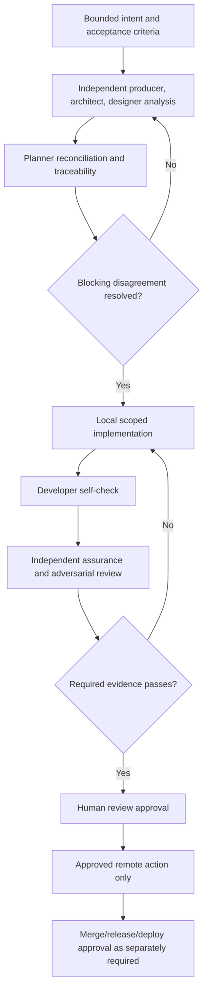

# Smith Delivery Process

## Status

**Normative target process.** It describes the required behavior for future work. Where code currently differs, agents must report the mismatch and stop at the stricter documented approval boundary; they must not claim the implementation already enforces it.

## Work record and branch policy

Every change needs a bounded, reviewable intent record. Jira is an **optional** planning/lifecycle integration: when enabled, a ticket supplies objective, ownership, priority, acceptance criteria, and lifecycle. Otherwise, use an approved local task/plan record with the same bounded objective, acceptance criteria, and evidence expectations. GitHub remains optional for local work and owns branches, commits, checks, review, merge history, tags, and releases when it is used.

| Work tracking mode | Ordinary branch pattern |
|---|---|
| Jira-linked feature/task | `feature/<KEY>-<slug>` |
| Jira-linked defect | `fix/<KEY>-<slug>` |
| Local feature/task record | `feature/<slug>` |
| Local defect record | `fix/<slug>` |
| Approved production emergency | `hotfix/<slug>` or `hotfix/<KEY>-<slug>` |
| Approved release preparation | `release/v<version>` |

Ordinary work is based on remote `main` because no `develop` branch exists. `feature/autonomy` is a one-time pre-policy exception and is not to be renamed or force-pushed without explicit approval.

## Canonical lifecycle

No stage is a substitute for a later approval. A completed model response, a generated plan, or an opened PR is not completion.

## Triangulation protocol

Triangulation is evidence-based disagreement discovery, not a majority vote.

1. **Producer** independently defines requirements, user scenarios, and blocking acceptance criteria.
2. **Architect** independently evaluates implementation fit, trust boundaries, operations, rollback, and validation.
3. **Designer** independently evaluates operator flows, visibility, recovery, accessibility, and user-impacting states.
4. **Planner** reconciles the views but must retain a traceability and disagreement matrix:
   - `REQ/AC → implementation task → expected evidence`;
   - assumptions, owner, and expiry;
   - disagreement/gap; and
   - resolution or explicit blocker.
5. **Developer** receives the reconciled plan, not authority to redefine it, and produces self-check evidence.
6. **Assurance** receives a fresh context with requirements, base revision, diff, test evidence, and relevant architecture rules—not the builder’s private reasoning transcript.
7. **Adversary** attempts reproducible violations of the changed invariants, especially authorization, prompt injection, paths, network/mounts, secrets, replay, concurrency, cancellation, and recovery.
8. **Release judge** classifies findings against evidence in a fresh context. It may recommend but cannot approve release.
9. **Human** resolves accepted risk and approves external effects.

The same agent, model session, or human role must not both author a consequential change and finally approve it.

## Evidence contract

Every consequential plan and change records:

- Jira key when used, otherwise local work-record ID; goal, requirements/acceptance-criteria IDs, risk class, and scope exclusions;
- repository, base revision, target revision, branch, and affected interfaces;
- exact validation command or scenario, environment assumptions, timestamp, exit/result, and artifact location/digest;
- developer self-check, assurance verdict, adversarial findings, and unresolved risks;
- rollback/compatibility procedure when relevant; and
- the approval binding and outcome for every external action.

Missing, unverifiable, stale, or narrative-only required evidence is a failure. A passing report must not hide checks that were skipped or could not run.

## Required gates

Select gates based on impact; do not claim a gate ran unless its result is retained.

| Area | Minimum gate |
|---|---|
| Rust control plane | Formatting, Clippy, locked build, locked tests. |
| Flutter client when changed | Dependency resolution, analyzer, relevant widget/unit tests, Linux build or manual evidence. |
| Python sidecars when changed | Pinned dependency review, syntax/type/lint as configured, API/health and failure-path tests. |
| Docker/network/host integration | Container inspection, loopback/egress checks, mount/credential review, clean-host smoke test. |
| Trust/approval/persistence behavior | Negative authorization tests, golden audit tests, duplicate/retry/cancel/crash-recovery tests. |
| Release artifact | Clean-clone build, compatibility/rollback evidence, checksum/SBOM/provenance when distributable. |

Current CI commands are evidence of existing Rust checks, not proof that all required target gates exist. See `AGENTS.md` and the workflow files before asserting CI coverage.

## Approval boundaries

| Action | Required authorization |
|---|---|
| Discovery and proposal | `DISCOVERY_READ_ONLY` or explicit user task; no mutation. |
| Local worktree/branch/edit/install/local test | `LOCAL_PLAN_APPROVED`. Local commits require explicit inclusion. |
| Push named branch or create/update a draft PR; Jira link/comment/review transition when Jira is enabled | `REVIEW_REQUEST_APPROVED` for the named work record and repository. |
| Merge a named PR/set | `MERGE_APPROVED`, after rechecking required reviews and checks. |
| Release branch, tag, GitHub release for exact version/commit | `RELEASE_APPROVED`. |
| Deployment of exact artifact to named environment | `DEPLOY_APPROVED`. |
| Ticket completion or accepted risk | Separate explicit human approval; merge alone is insufficient. |

An approval must bind to the ticket, repository, branch, base/target revision, requested effect, and expiry. Direct model text, a previous general approval, or a mismatched/stale approval is invalid.

## Optional Jira and GitHub synchronization

Jira/GitHub integration is an optional capability, not a prerequisite for local planning, validation, review, or approval.

When enabled for a work item:

- Branch, commit subject where compatible, and PR title contain the Jira key.
- Draft PRs link the ticket, copy/link acceptance criteria, list coordination dependencies, include validation evidence, risks, rollback, builder identity, independent reviewer identity, and pending human approval.
- Jira receives concise links and milestone summaries, never raw agent transcripts or secrets.
- Jira is transitioned to done only after explicitly approved completion conditions are met across all coordinated repositories.

When disabled, retain the same intent, acceptance criteria, evidence, review, and approval package locally. Do not fabricate Jira links or block local work because a ticket is absent.

## Release and deployment

Release branches are created only when requested or required by approved policy. A release identifies one exact version and commit, passes required checks from a clean state, has compatibility evidence, uses a new annotated `release/v<version>` tag for future releases, and receives `RELEASE_APPROVED` before tag/release publication.

A GitHub release, package publication, and deployment are distinct operations. Never retag an existing released version.

## Current implementation deltas

Current Smith code contains lifecycle artifacts and a signoff state, but the documented target process is stricter than the verified implementation in areas including feature-branch push and direct release invocation. Until code enforces these boundaries with durable approval checks, agents must follow this process manually and report the mismatch as a release blocker.
