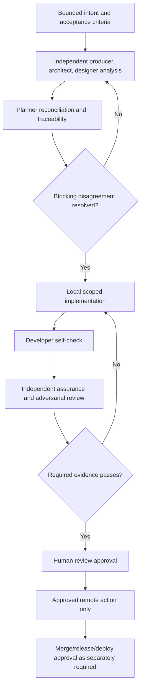

# Smith Delivery Process

## Status

**Normative target process.** It describes the required behavior for future work. Where code currently differs, agents must report the mismatch and stop at the stricter documented approval boundary; they must not claim the implementation already enforces it.

## Work record and branch policy

Every change needs a bounded, reviewable intent record. Jira is an **optional** planning/lifecycle integration: when enabled, a ticket supplies objective, ownership, priority, acceptance criteria, and lifecycle. Otherwise, use an approved local task/plan record with the same bounded objective, acceptance criteria, and evidence expectations. GitHub remains optional for local work and owns branches, commits, checks, review, merge history, tags, and releases when it is used.

| Work tracking mode | Ordinary branch pattern |
|---|---|
| Jira-linked feature/task | `feature/<KEY>-<slug>` |
| Jira-linked defect | `fix/<KEY>-<slug>` |
| Local feature/task record | `feature/<slug>` |
| Local defect record | `fix/<slug>` |
| Approved production emergency | `hotfix/<slug>` or `hotfix/<KEY>-<slug>` |
| Approved release preparation | `release/v<version>` |

Ordinary work is based on remote `main` because no `develop` branch exists. `feature/autonomy` is a one-time pre-policy exception and is not to be renamed or force-pushed without explicit approval.

## Canonical lifecycle

No stage is a substitute for a later approval. A completed model response, a generated plan, or an opened PR is not completion.

## Triangulation protocol

Triangulation is evidence-based disagreement discovery, not a majority vote.

1. **Producer** independently defines requirements, user scenarios, and blocking acceptance criteria.
2. **Architect** independently evaluates implementation fit, trust boundaries, operations, rollback, and validation.
3. **Designer** independently evaluates operator flows, visibility, recovery, accessibility, and user-impacting states.
4. **Planner** reconciles the views but must retain a traceability and disagreement matrix:
   - `REQ/AC → implementation task → expected evidence`;
   - assumptions, owner, and expiry;
   - disagreement/gap; and
   - resolution or explicit blocker.
5. **Developer** receives the reconciled plan, not authority to redefine it, and produces self-check evidence.
6. **Assurance** receives a fresh context with requirements, base revision, diff, test evidence, and relevant architecture rules—not the builder’s private reasoning transcript.
7. **Adversary** attempts reproducible violations of the changed invariants, especially authorization, prompt injection, paths, network/mounts, secrets, replay, concurrency, cancellation, and recovery.
8. **Release judge** classifies findings against evidence in a fresh context. It may recommend but cannot approve release.
9. **Human** resolves accepted risk and approves external effects.

The same agent, model session, or human role must not both author a consequential change and finally approve it.

## Evidence contract

Every consequential plan and change records:

- Jira key when used, otherwise local work-record ID; goal, requirements/acceptance-criteria IDs, risk class, and scope exclusions;
- repository, base revision, target revision, branch, and affected interfaces;
- exact validation command or scenario, environment assumptions, timestamp, exit/result, and artifact location/digest;
- developer self-check, assurance verdict, adversarial findings, and unresolved risks;
- rollback/compatibility procedure when relevant; and
- the approval binding and outcome for every external action.

Missing, unverifiable, stale, or narrative-only required evidence is a failure. A passing report must not hide checks that were skipped or could not run.

## Required gates

Select gates based on impact; do not claim a gate ran unless its result is retained.

| Area | Minimum gate |
|---|---|
| Rust control plane | Formatting, Clippy, locked build, locked tests. |
| Flutter client when changed | Dependency resolution, analyzer, relevant widget/unit tests, Linux build or manual evidence. |
| Python sidecars when changed | Pinned dependency review, syntax/type/lint as configured, API/health and failure-path tests. |
| Docker/network/host integration | Container inspection, loopback/egress checks, mount/credential review, clean-host smoke test. |
| Trust/approval/persistence behavior | Negative authorization tests, golden audit tests, duplicate/retry/cancel/crash-recovery tests. |
| Release artifact | Clean-clone build, compatibility/rollback evidence, checksum/SBOM/provenance when distributable. |

Current CI commands are evidence of existing Rust checks, not proof that all required target gates exist. See `AGENTS.md` and the workflow files before asserting CI coverage.

## User-service rollout and evidence

User-service work uses two distinct validation environments:

1. **Required sandbox smoke.** `bash scripts/smoke-user-service.sh --sandbox` creates temporary HOME, XDG, runtime, configuration, and install roots; activates deny-by-default fake `systemctl` and `loginctl` programs first on `PATH` before installer code or binaries run; invalidates the user D-Bus address; suppresses ambient Docker and loopback status probes; and exercises only the isolated installer/unit lifecycle. Each invocation creates a fresh, checksummed, owner-read-only run directory containing revision/worktree/source-input identity, environment assumptions, raw command output and exit statuses, fake-manager calls, the exact rendered unit, and a retained-binary unit fixture verified again after sandbox deletion. The evidence must prove unsupported-host/root/ownership/mode preflight rejection, `--help`/version verification, install/start/restart/stop/login-enable/login-disable separation, persistent versus runtime-only enablement, bounded restart directives, permanent-configuration retry suppression, malformed manager-property rejection, restart/result/exit status reporting, offline unit parsing, no `enable --now`, no lingering mutation, no ambient status contamination, and no unmanaged supervisor spawn. The manifest must state that fake-manager isolation is not syscall containment, that a locked Cargo build is not network- or cache-hermetic unless separately established, and that its owner-controlled checksum bundle detects stale mixing/accidental changes rather than adversarial rewriting. Before consequential approval, an independent review or approval record must retain the candidate package digest outside that package. A missing lifecycle command, required offline parser, unsupported fake-manager interaction, stale/mixed evidence, or changed source inputs during the run is blocking and must be reported, not bypassed with the live manager.
2. **Later approved real-host smoke.** Running `scripts/install.sh` into a normal user path, invoking a real `systemctl --user`, starting or stopping the real bridge, changing a live unit, logging out/rebooting, or changing lingering requires explicit human approval bound to the exact commands, account, executable, unit path, and expected effects. Sandbox success is prerequisite evidence, not that approval.

A real-host evidence package records binary digest/path and version, rendered unit, manager load/active/substate/enablement/result/restart/main-exit observations, linger observation, verified Smith bridge identity, loopback binding, permanent-failure restart suppression, generic restart-burst containment, restart-reconciliation results, journal excerpts with sensitive data removed, rollback commands, and timestamps. Test login-only behavior separately from any approved pre-login/linger scenario. Never infer pre-login availability from unit enablement alone.

Recovery validation must show that a controlled restart preserves durable identifiers, prior results/summaries/errors, and other record data; atomically converts only queued/running task and job records to interrupted/recovery-required; leaves awaiting-signoff and terminal records unchanged; and does not claim readiness before reconciliation. A failure preserves the unit and evidence for diagnosis unless the operator explicitly chooses uninstall/rollback.

The Flutter client has its own dependency, analyzer, test, Linux-build, packaging, and manual desktop checks. It is not part of the supervisor installer, user unit, or service smoke gate.

## Approval boundaries

| Action | Required authorization |
|---|---|
| Discovery and proposal | `DISCOVERY_READ_ONLY` or explicit user task; no mutation. |
| Local worktree/branch/edit/install/local test | `LOCAL_PLAN_APPROVED`. Local commits require explicit inclusion. |
| Push named branch or create/update a draft PR; Jira link/comment/review transition when Jira is enabled | `REVIEW_REQUEST_APPROVED` for the named work record and repository. |
| Merge a named PR/set | `MERGE_APPROVED`, after rechecking required reviews and checks. |
| Release branch, tag, GitHub release for exact version/commit | `RELEASE_APPROVED`. |
| Deployment of exact artifact to named environment | `DEPLOY_APPROVED`. |
| Ticket completion or accepted risk | Separate explicit human approval; merge alone is insufficient. |

An approval must bind to the ticket, repository, branch, base/target revision, requested effect, and expiry. Direct model text, a previous general approval, or a mismatched/stale approval is invalid.

## Optional Jira and GitHub synchronization

Jira/GitHub integration is an optional capability, not a prerequisite for local planning, validation, review, or approval.

When enabled for a work item:

- Branch, commit subject where compatible, and PR title contain the Jira key.
- Draft PRs link the ticket, copy/link acceptance criteria, list coordination dependencies, include validation evidence, risks, rollback, builder identity, independent reviewer identity, and pending human approval.
- Jira receives concise links and milestone summaries, never raw agent transcripts or secrets.
- Jira is transitioned to done only after explicitly approved completion conditions are met across all coordinated repositories.

When disabled, retain the same intent, acceptance criteria, evidence, review, and approval package locally. Do not fabricate Jira links or block local work because a ticket is absent.

## Release and deployment

Release branches are created only when requested or required by approved policy. A release identifies one exact version and commit, passes required checks from a clean state, has compatibility evidence, uses a new annotated `release/v<version>` tag for future releases, and receives `RELEASE_APPROVED` before tag/release publication.

A GitHub release, package publication, and deployment are distinct operations. Never retag an existing released version.

## Local chat candidates and publication blockers

[LOCAL-SMITH-OFFLINE-CHAT-SLICE-P0](plans/LOCAL-SMITH-OFFLINE-CHAT-SLICE-P0.md) permits local candidate preparation, not a production release. **Implemented:** Ubuntu 24.04 x86_64 full Flutter Halo packaging including `smith_backend/smith` and complete `lib/`/`data/`, with install-only scripts and a secondary standalone backend candidate; launch uses `serve --chat-only --model <exact-installed-tag>`. Plain `serve`, `chat`, and systemd registration remain legacy; candidate preparation cannot migrate them or authorize live installation, provisioning, or runtime changes. See [Chat Release](CHAT_RELEASE.md).

The approved [LOCAL-SMITH-FLUTTER-BOOT-P0](plans/LOCAL-SMITH-FLUTTER-BOOT-P0.md) permits explicit Start and captured-owned-child Stop/normal-close cleanup. [LOCAL-SMITH-DESKTOP-WIZARD-P0](plans/LOCAL-SMITH-DESKTOP-WIZARD-P0.md) extends it with automatic validated actual-launcher-directory `smith_backend/smith` discovery, explicit advanced path, read-only structured `setup inspect`, installed-model selection and review. It narrowly supersedes the provisioning exclusion for **operator-confirmed model pull only** through already-running loopback Ollama. `setup pull` requires exact-model/operation-bound stdin consent within 60 seconds, with bounded NDJSON progress/cancel, finite deadlines and no automatic retries. Opening may run read-only inspection, never start the chat backend, infer or download. Setup mutation guards and their limitations are in [Architecture](ARCHITECTURE.md#desktop-setup-command-boundary); inspection may run with an active backend, and no global daemon scheduler is claimed. Compatible external backends attach untouched. Flutter is primary; CLI is secondary query/status/configuration with existing commands retained; headless is a separate deferred deployment/lifecycle capability.

**Authority distinction:** implementing/testing the consent flow with inert fixtures does not authorize an agent to perform a live pull. Runtime operator confirmation binds only that model operation, not daemon installation/start, sudo, legacy install helpers, service/manager changes, cloud fallback, retry, cache deletion, publication or accepted risk. Model pull may cause external Ollama internet/disk effects; unknown size and daemon continuation/partial cache after cancellation must be disclosed. Missing Ollama receives guided separate provisioning/start instructions, not turnkey empty-host setup. Chat-only serving remains isolated without provisioning tools/routes. The current work approval permits no real app launch, download, install or manager mutation.

**Reported self-check, not final approval evidence:** agents initially reported 98 Flutter tests and 110 Rust tests PASS, followed by 108 Flutter tests after startup-budget and shutdown-readiness race fixes. Earlier full-suite OpenCode noisy-probe runs failed twice; the current backend agent subsequently reported a passing suite. Retain that history without claiming the noisy-probe root cause was resolved. Fresh static assurance re-review passed the remediated local source implementation; final source-bound integrated build/test evidence remains separate. Wizard agents subsequently reported **127 Rust tests and the full 136 Flutter tests** passing, plus client analyzer/Linux build PASS; these are agent-reported self-check results, not final source-bound integrated evidence or independent approval. Fresh wizard static assurance was reported **source-limited PASS, no blockers**; subsequent low-severity client fixes (validated seq-zero preflight error handling, preserved/redacted failure diagnostics and bounded discovery/advanced resolution) are implemented and passed focused independent static re-review. Final integrated checks remain separate from static review. Counts alone do not bind a candidate or satisfy real integration/offline/clean-host gates.

**Required before publication:** actual provider pull/cancel integration and provider/backend/client version compatibility; exact candidate/source-bound final build/test evidence and fresh independent assurance/adversarial review; actual contextual inference with external networking denied (not echo/mock results); clean-host desktop installation without builder toolchains; clean-source reconstruction/build binding; complete license and SBOM review, including Flutter/plugins; and independently retained artifact/evidence digests. This documentation update establishes none of those final gates.

**Legacy workflow blocker:** `.github/workflows/release.yml` still builds generic Ubuntu/macOS backend archives and publishes a non-draft release on `release/*` tags. It does not implement the approved Ubuntu 24.04 paired chat artifacts or the required evidence/approval gates. Its replacement/remediation is outside this documentation-only scope and blocks publication; do not trigger it as a shortcut. Separate `RELEASE_APPROVED` and any install/deployment approvals remain required after evidence and review pass.

## Current implementation deltas

Current Smith code contains lifecycle artifacts and a signoff state, but the documented target process is stricter than the verified implementation in areas including feature-branch push and direct release invocation. Until code enforces these boundaries with durable approval checks, agents must follow this process manually and report the mismatch as a release blocker.
