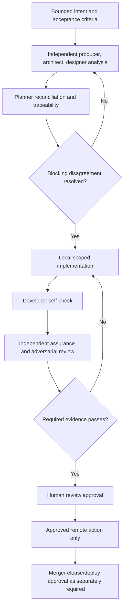

# Smith Delivery Process

## Status

**Normative target process.** It describes the required behavior for future work. Where code currently differs, agents must report the mismatch and stop at the stricter documented approval boundary; they must not claim the implementation already enforces it.

## Work record and branch policy

Every change needs a bounded, reviewable intent record. Jira is an **optional** planning/lifecycle integration: when enabled, a ticket supplies objective, ownership, priority, acceptance criteria, and lifecycle. Otherwise, use an approved local task/plan record with the same bounded objective, acceptance criteria, and evidence expectations. GitHub remains optional for local work and owns branches, commits, checks, review, merge history, tags, and releases when it is used.

| Work tracking mode | Ordinary branch pattern |
|---|---|
| Jira-linked feature/task | `feature/<KEY>-<slug>` |
| Jira-linked defect | `fix/<KEY>-<slug>` |
| Local feature/task record | `feature/<slug>` |
| Local defect record | `fix/<slug>` |
| Approved production emergency | `hotfix/<slug>` or `hotfix/<KEY>-<slug>` |
| Approved release preparation | `release/v<version>` |

Ordinary work is based on remote `main` because no `develop` branch exists. `feature/autonomy` is a one-time pre-policy exception and is not to be renamed or force-pushed without explicit approval.

## Canonical lifecycle

No stage is a substitute for a later approval. A completed model response, a generated plan, or an opened PR is not completion.

## Triangulation protocol

Triangulation is evidence-based disagreement discovery, not a majority vote.

1. **Producer** independently defines requirements, user scenarios, and blocking acceptance criteria.
2. **Architect** independently evaluates implementation fit, trust boundaries, operations, rollback, and validation.
3. **Designer** independently evaluates operator flows, visibility, recovery, accessibility, and user-impacting states.
4. **Planner** reconciles the views but must retain a traceability and disagreement matrix:
   - `REQ/AC → implementation task → expected evidence`;
   - assumptions, owner, and expiry;
   - disagreement/gap; and
   - resolution or explicit blocker.
5. **Developer** receives the reconciled plan, not authority to redefine it, and produces self-check evidence.
6. **Assurance** receives a fresh context with requirements, base revision, diff, test evidence, and relevant architecture rules—not the builder’s private reasoning transcript.
7. **Adversary** attempts reproducible violations of the changed invariants, especially authorization, prompt injection, paths, network/mounts, secrets, replay, concurrency, cancellation, and recovery.
8. **Release judge** classifies findings against evidence in a fresh context. It may recommend but cannot approve release.
9. **Human** resolves accepted risk and approves external effects.

The same agent, model session, or human role must not both author a consequential change and finally approve it.

## Evidence contract

Every consequential plan and change records:

- Jira key when used, otherwise local work-record ID; goal, requirements/acceptance-criteria IDs, risk class, and scope exclusions;
- repository, base revision, target revision, branch, and affected interfaces;
- exact validation command or scenario, environment assumptions, timestamp, exit/result, and artifact location/digest;
- developer self-check, assurance verdict, adversarial findings, and unresolved risks;
- rollback/compatibility procedure when relevant; and
- the approval binding and outcome for every external action.

Missing, unverifiable, stale, or narrative-only required evidence is a failure. A passing report must not hide checks that were skipped or could not run.

## Required gates

Select gates based on impact; do not claim a gate ran unless its result is retained.

| Area | Minimum gate |
|---|---|
| Rust control plane / native installer | Formatting, Clippy, locked build, locked tests. |
| Flutter client when changed | Dependency resolution, analyzer, relevant widget/unit tests, Linux build or manual evidence. |
| Python sidecars when changed | Pinned dependency review, syntax/type/lint as configured, API/health and failure-path tests. |
| Docker/network/host integration | Container inspection, loopback/egress checks, mount/credential review, clean-host smoke test. |
| Trust/approval/persistence behavior | Negative authorization tests, golden audit tests, duplicate/retry/cancel/crash-recovery tests. |
| Release artifact | Clean-clone build, compatibility/rollback evidence, checksum/SBOM/provenance when distributable. |

Current CI commands are evidence of existing Rust checks, not proof that all required target gates exist. See `AGENTS.md` and the workflow files before asserting CI coverage.

### Isolated next-generation development scaffold

The bounded [next scaffold](plans/LOCAL-SMITH-NEXT-SCAFFOLD.md) keeps native component check/test/build scripts under `next/client` and `next/service`, extended by [the native installer migration](plans/LOCAL-SMITH-NEXT-NATIVE-INSTALLER.md) to the independent `next/installer` crate, with a developer-only Dagger module under `next/dagger`. `next/dagger.toml` registers that local module as the default workspace entrypoint, so development commands run from `next/` using `dagger call` without repeating a module path. `next/Makefile` provides thin aggregate `make test`/`make build` and namespaced component shortcuts such as `make client/test`, `make service/build`, and intentional local launch via `make client/run`; formatting/lint and tests are combined under each `test` target, with no separate public `check` target. The explicit `make installer/run` convenience target depends on the existing full-package `installer/build` (including package verification), then launches `installer/dist/smith-installer-ui` in the foreground without bypass flags; installer effect confirmations remain mandatory. It is an operator GUI launch, not a validation gate or automatic installation. Pipeline logic remains in Dagger/component scripts, not duplicated in Make. Dagger does not become a recipient dependency or an application lifecycle manager. Component source inputs are explicit; build scripts and distribution inputs stay tracked, while generated `build/`, `target/`, and exported `dist/` outputs are ignored. Client builds now include the compatible Rust helper; no publication function or host installation is performed by the pipeline.

A module's source or Python syntax checks are not evidence of engine execution. Record module loading, image availability, toolchain/dependency resolution, and actual task results before calling the Dagger pipeline validated. Version-selected images alone do not establish hermetic builds or release provenance. Engine/cache effects, source access, network downloads, and optional cloud trace sharing must be explicit; container builds do not replace Ubuntu graphical or clean-host integration gates.

### Next-generation UI redesign validation

**Implemented source gates:** [UI redesign](plans/LOCAL-SMITH-NEXT-UI-REDESIGN.md) adds real-font widget goldens, responsive/keyboard/recovery tests and stale-menu capability-revalidation regressions. The package policy requires 24 exact nonempty UI asset paths (15 SVGs, six fonts, two notices and provenance README), not a permissive asset wildcard. Run client tests/analyzer, Linux build, actual-ELF package tests and exported-package verification on the final source snapshot; retain source/artifact identities in the focused evidence record and results in `next/VALIDATION.md`. Synthetic management fixtures cannot pass real multi-chat acceptance. Installed graphical QA, remaining visual-matrix checks and supplied-icon redistribution rights remain separate gates; no source PASS grants publication or deployment authority.

### Multi-chat validation and migration boundary

**Implemented source gates under [multi-chat plan](plans/LOCAL-SMITH-NEXT-MULTI-CHAT.md):** require strict v1-to-v2 migration, inert legacy-result and full-u64 configuration-revision compatibility, corrupt-byte preservation, exact installer-v1 projections through the actual service library, and real Rust-Dart socket tests. Require isolated context, atomic first admission, four-job FIFO/expiry, queued/running restart interruption without replay, phase-aware encoded-byte/revision completion reservations, terminal-only eviction and target-specific revision-bound lifecycle/delete residue tests. Accepted-request observation failure must preserve identity; old mutation receipts must not regress newer metadata. Retain Boot, per-chat drafts/scroll, narrow/2x keyboard/IME/focus, provisional and expired-request tests against real workspace callbacks rather than only presentation fixtures.

Run focused checks then `make service/test installer/test client/test` and `make test build` from `next/`, plus repository whitespace validation, on a stable combined source snapshot. Record results and independent assurance/remediation in `next/VALIDATION.md`; historical redesign goldens are not current production screenshots. Source tests use private roots/fake providers, never the installed service or model weights. No source approval authorizes live migration. Before deployment, bind the paired candidate, exact pre-migration state backup and tested restore procedure separately; old binaries reject v2 state, and artifact rollback alone cannot restore it. Logical chat deletion does not delete backups.

### Next cloud-provider validation and compatibility

**Implemented source/test definitions; final evidence is separately owned:** [cloud-provider plan](plans/LOCAL-SMITH-NEXT-CLOUD-PROVIDERS.md) and [API contract](plans/LOCAL-SMITH-NEXT-CLOUD-API-CONTRACT.md) add application schema3, originally disk3 (now disk4 under the timestamp extension below), optional Model → Providers installation, keyring-only credentials and same-chat routed sends. Earlier cloud exclusions and installer-only active selection are narrowly superseded by [current Scope](SCOPE.md#current-next-cloud-provider-scope), not by a test result. Core/unit and local runner contracts remain. The cloud 8192-total-generation-token cap includes reasoning; native local 1024 remains unchanged. This documentation records no combined PASS or fresh assurance verdict; consult parent-owned `next/VALIDATION.md` for source/artifact-bound outcomes after aggregate execution and review.

Required compatibility evidence covers strict v1/v2 local projections and receipts; v3 delegated/new envelopes and nullable fields; full-u64 configuration echoes; disk1/disk2/disk3 → disk4 preservation, unknown historical model identities, corrupt-byte preservation and interrupted work without replay. Legacy readers must receive `UPGRADE_REQUIRED` for v3 work/routing they cannot represent rather than silently hiding/misrouting it. Require provider-aware installer v3 local management after cloud use and no mutation/version fallback. Paired client/service/installer packaging and native runtime/dependency checks remain mandatory. A separately approved installed migration needs a pre-migration state snapshot and tested restore with compatible binaries and exact keyring-generation references; binary-only downgrade is invalid, and JSON backup is not keyring backup.

Source gates use synthetic capabilities, never real credentials or the normal session bus. `next/service/tests/cloud.rs` defines immutable-route/consent/deadline/replay/generation/storage-failure cases; `cloud_protocol.rs` defines exact compiled-catalog request/final-text/error/bounds fixtures. The [static-catalog expansion](plans/LOCAL-SMITH-NEXT-CLOUD-CATALOG-EXPANSION.md) requires independent exact 7/8 ordered identities, labels, contexts, uniqueness/capacity, strict unknown/wrong-provider rejection and every-entry request/response fixtures; real Rust-to-Dart catalog parsing must cover all fifteen entries. Picker tests require no-effect filtering/dismissal/current-route selection, origin/revision/generation/availability fencing, keyboard/IME isolation and 400x400 enlarged-text reachability. Static model additions authorize no live model listing or paid compatibility probes. The [saved-key attempt amendment](plans/LOCAL-SMITH-NEXT-SAVED-KEY-ATTEMPTS.md) additionally requires both-provider restart/unvalidated/adverse-observation matrices, cold saved-only real Rust-to-Dart and installer-domain attempts, failure/repair without an intermediate probe, exact fresh credential reads, key-read failure with zero HTTP/not_sent, and invalid-key provider rejection with one attempt. Both catalog parsers must accept the new eligibility combinations without relaxing generation, malformed-data, exact-model verification, consent or unknown-operation reservations. `next/service/src/cloud_keyring_tests.rs` uses private socket-pair Secret Service fixtures for production EXTERNAL authentication and encrypted-session negotiation with independent peer key derivation, leading-zero padding, owner/UID changes, malformed replies, authentication rejection and stalls. It also covers encrypted item exchange, no-auto-start and locked/missing/ambiguous/drifted/prompt-required cases. These isolated fixtures do not prove installed login-bus discovery or real GNOME Keyring integration. `cloud_http_tests.rs` exercises the actual HTTP path against private synthetic TLS servers, including certificates/hostnames, redirect credential isolation, proxy suppression, no retry, size/encoding/slow-response limits and expiry. Production has no endpoint/trust override. Require secret-canary absence from state/fingerprints/errors/events/output and zero vendor calls on opening, cached queries, probes, save, selection, Retry, migration or replay; validation makes one fixed no-history request. Unknown keyring/HTTP effects must preserve the original identity without automatic retry, fallback, orphan activation or cleanup.

Installer gates include separate provider save/check consent, both credentials, optional skip/failure preservation, hidden-input/terminal restoration, narrow CLI mode, actual service-domain round trips with fake capabilities, and isolated GTK tests. Flutter gates include grouped same-chat selection, unavailable-model recovery, immutable accepted routes, fresh-generation consent, retained-destination disclosure including intervening history, stale-dialog refusal, queued-cloud review and unknown-delivery observation. **The real compiled Rust↔Dart gate must cover schema-3 routed local admission, injected fake-cloud consent/admission, migration and reattach, not only legacy/local socket tests or Dart-only fakes.** Retain the existing `SMITH_TEST_SERVICE` fixture and explicitly record any skipped/missing cross-language scenario; a skip is not cloud acceptance. Concurrent message-queue/scaffold changes require a stable combined snapshot and routed-queue/consent regression evidence, not isolated component claims.

After focused checks, the parent runs from `next/`: `make service/test installer/test client/test`, then stable combined `make test build`, with `make package/test` and `python3 dagger/package.py --root installer/dist --verify` as applicable, plus scoped whitespace checks. Keep command/result/source/artifact identities and fresh independent assurance/adversarial remediation in the validation ledger; component reports do not establish aggregate PASS. Dagger may acquire approved build dependencies/pinned runtimes, never model weights, host secrets or live APIs. Normal-session keyring behavior, real exact-model access/charges, graphical install/rerun, installed migration/restore and deployment remain separately approved unverified gates. Public model documentation and synthetic success do not satisfy live-provider acceptance or authorize release; required missing/failed evidence remains blocking.

### Client-side message-queue validation

The [message-queue plan](plans/LOCAL-SMITH-NEXT-MESSAGE-QUEUE.md) requires exact fake-API ordering and request counts, success-plus-history advancement, immutable payloads, safe explicit Retry/Skip and stale-action fencing, uncertain acceptance/no replay, foreign-work/configuration/restart recovery, new-chat/shared-pane identity, count/UTF-8/long-wait bounds, and close-hold/disposal races. Widget checks cover Queue keyboard/IME behavior, truthful unsent states, inactive/stale dialogs, preserved transcript reading and 400×400 enlarged-text recovery/close dialogs. Require formatting/analyzer, the combined client suite, Linux build and fresh independent assurance after remediation. Fake tests do not establish installed GTK close/IME or actual provider timing. Do not claim stable aggregate evidence across concurrent cloud edits; record source identities and outstanding routed-send/consent integration separately. No live model, vendor API, keyring or service-manager call is part of queue validation.

### Next-generation artifact install validation

**Implemented pipeline source:** from `next/`, `make install`, `make client/install` and `make service/install` build through Dagger, including `make installer/binary` exporting `installer/build/smith-installer`, then invoke that native ELF with explicit `--artifacts-only --client BUNDLE` and/or `--service BINARY` inputs and effect confirmation. The service target is binary-only; no registration/start/enablement is authorized by artifact installation. Only explicit artifact mode accepts optional `--yes`; it bypasses confirmation, not publisher checks, and cannot be mixed with recipient/model flags. Native source/tests live under `next/installer`, with the sibling `next/service` library as an explicit build input. Host publication stays outside the builder with no added host-home mounts. Direct native `--artifacts-only ... --dry-run` is read-only and does not build; Make install targets build before asking consent. `make test` includes native installer gates; `make installer/test` runs them alone through Dagger.

Required evidence includes complete bundle/launcher identity and byte-identical canonical release manifests, paired-helper compatibility, decline/dry-run no files/locks, ownership/mode/single-link and bounded-tree checks, held-FD/no-follow traversal, unsafe-root/link/overwrite rejection, post-consent/under-lock changed-input revalidation, concurrent no-clobber publication, synced publication, bounded verified-FD locking and truthful partial failures. Final dependency verification must cover service-only and selected-client paths too. Atomic selector exchange retains displaced objects, including conflicts, without automatic rollback; releases and failed stages are preserved, and neither same-UID filesystem CAS nor a global transaction is claimed. Normal-home publication, app launch and real manager operations require separately bound human approval; isolated tests are not installed-host evidence. See the [artifact install contract](plans/LOCAL-SMITH-NEXT-ARTIFACT-INSTALL.md) and [native migration](plans/LOCAL-SMITH-NEXT-NATIVE-INSTALLER.md).

### Next-generation debug boot validation

[LOCAL-SMITH-NEXT-DEBUG-BOOT](plans/LOCAL-SMITH-NEXT-DEBUG-BOOT.md) requires `make test` to exercise Rust filesystem/consent/manager/peer-identity tests, Flutter state/confirmation/cleanup tests and a real Rust↔Dart Unix-socket round trip under temporary roots. Dagger supplies the compiled service to the Flutter integration fixture and runs component tasks as a non-root container user. `make build` must export a paired desktop bundle with a safely copied executable-relative helper. All quality gates remain under `/test`; no separate public check command exists.

Sandbox tests may inject a Rust manager implementation; production cannot select manager commands through PATH or ambient fake-manager variables. No normal-host unit installation/start/enablement, GUI launch, login/linger mutation or provider effect is performed as a test shortcut. Current source-bound test/build results and fresh assurance/adversarial remediation evidence precede separately approved real-host integration. Passing fake-manager/socket tests is not permission or proof for the live manager, desktop close/reopen or a production release.

### Current next-generation login-boot validation

**Implemented source gates and observed component results:** [LOCAL-SMITH-NEXT-LOGIN-BOOT](plans/LOCAL-SMITH-NEXT-LOGIN-BOOT.md) requires strict Core schema 2, exact manager enablement plus deterministic `default.target.wants` link verification, `[Install]/WantedBy=default.target`, and fixed Enable then Start calls with no `--now`, `loginctl` or lingering mutation. It also requires byte-exact legacy-static/current maintenance migration, current-enabled preservation without churn, current-disabled Enable, and disable-before-unregister. Client gates cover a serialized bounded 15-second Boot, bridge-ready then conversation synchronization, exact enabled+safely-stopped Start eligibility, separate confirmation, reduced motion, accessibility and narrow enlarged-text layout.

From `next/`, the following commands were observed **PASS** for this source slice: `make service/test`; `make installer/test`, including containerized isolated GTK and interpreter-free runtime execution; `make client/test`, including analyzer/tests and the Rust↔Dart fixture; aggregate `make test`; `make build`; and `make installer/build`. These are developer source/build self-check results, not independent assurance, clean-clone/hermetic, release, deployment or live-host evidence.

Real `systemctl --user` enable/start/disable behavior, actual login/logout/reboot, and installed-host upgrade/uninstall remain unverified. They require fresh approval bound to the exact account, candidate, commands and effects. Enabled `default.target` with unchanged/no lingering is a login-scoped target after user login; never infer pre-login or post-logout availability.

### Current text-reset and recipient-package validation

**Implemented pipeline source:** `make test` runs text service/client, native publisher/orchestrator/model/CLI/wizard gates, isolated GTK smoke and builder-only package tests. `make build` exports service, full paired desktop and native recipient package `installer/dist/` containing both installer ELFs; `make installer/build` creates that package, while `make installer/binary` exports only the unchanged CLI to `installer/build/smith-installer`. `make package/test` exposes the builder metadata/package suite separately. Dagger compiles/runs native quality/parity tests on actual Ubuntu 24.04 as UID/GID 1000, using Rust 1.98 tooling; release binaries are built with Rust 1.98 Bookworm. A separate Ubuntu 24.04 UID/GID-1000 runtime gate checks Python is absent, removes useful PATH lookup and directly executes the actual release ELF's help/version/artifact-only dry-run without builder toolchains. Python Dagger/package assembly remains builder-only. `test-sidecars`, `services/test`, speech images/dependencies and the sidecar input are removed, not optional default work. Both checksummed voice and Python-installer references are outside explicit pipeline inputs. Component formatting/lint remain under `/test`; the declared Rust MSRV alone is not an actual minimum-toolchain compile result.

Require preserved valid v1 voice metadata and rejected new speech execution, no replay/duplicate/expired-ID resurrection, preserved corruption, app readiness independent of the legacy completion flag, outage-safe authoritative/provisional reply display, and separate installer effect consent. Packaging takes the compiled CLI and optional-feature GUI ELFs plus paired build outputs, not generated Python/ZIP entrypoints; unknown model/voice/reference files/directories are rejected by a reviewed payload-path policy. Builder package tests receive actual CLI/GUI ELFs through `SMITH_TEST_INSTALLER` and `SMITH_TEST_INSTALLER_UI`. They exercise CLI help/dry-run/alias/decline and GUI no-display help/version/preflight under temporary roots with synthetic paired payloads; GUI shared libraries are supplied even for no-display help. They must not silently substitute header-only fixtures or skipped native execution as equivalent evidence. Require ELF architecture/interpreter/library-dependency inspection, package manifest/modes/checksums, identical helper copies and direct no-Python Ubuntu execution. Package fixtures and the narrow runtime gate are not full recipient installation, real manager/provider or clean-host graphical validation. Missing prerequisites and partial outcomes must not be called complete installation or inference.

Native orchestration must reuse `smith_service::Controller` with packaged `payload/service/smith-service` as source, never installer `current_exe`; the client/service and unit/wire contracts stay unchanged. Require lazy runtime-root/backend/provider construction after artifact acceptance, original Core-token expiry without reprepare, bounded 4096-byte/60-second consent including slow drip, and EOF/interrupt/later-decline preservation tests. Cooperative manager/socket/provider/output budgets are not a global filesystem deadline or external-daemon cancellation guarantee. Bounded setup/progress output accepts pipes, sockets and terminals only; regular files/other devices are rejected rather than promised interruptible writes. The artifact publisher's separate stdio and filesystem/fsync path has no such overall deadline. Backpressure, failed/incomplete reporting, cancellation, retained displaced data and no automatic rollback/cache deletion require explicit negative evidence.

Historical model/voice/Python-installer/source evidence is retained without rewriting its hashes or treating old review results as native-candidate validation. Current source/artifact-bound native checks and fresh independent architecture/adversarial assurance remain required. The native migration's final integrated assurance was cancelled, not a PASS; this documentation update asserts neither final integrated results nor final independent review. They precede a newly approved installed upgrade or model/inference/GUI smoke. Prior host upgrade approval is consumed. Model weights remain outside the recipient package; provider operations use already-running fixed-loopback Ollama, with separate exact-model pull, preference and inference consent. Weights/license/offline-pack distribution and release provenance remain separate gates. See the [text-reset plan](plans/LOCAL-SMITH-NEXT-TEXT-RESET.md) and [native migration plan](plans/LOCAL-SMITH-NEXT-NATIVE-INSTALLER.md).

### Current bundled runner validation

**Implemented source direction:** [native-runner plan](plans/LOCAL-SMITH-NEXT-NATIVE-RUNNER.md) supersedes external Ollama for `next/` only. Dagger may download pinned runner/toolchain artifacts, never model weights under this source-validation approval. Require held-model FD/path replacement, active-inference owner teardown/join, cooperative per-read verification deadlines/cancellation, lease/peer/process ownership, context/protocol bounds and synthetic publication regressions. Aggregate `make test build` retains Rust, Flutter, isolated GTK, actual-ELF package and no-Python CLI gates. Observed results are in `next/VALIDATION.md`, not inferred from configuration. Scoped review closes only named findings, not release/deployment assurance. Live upgrade/download/inference, GPU, clean-host, licensing/SBOM and provenance remain separately approved gates.

### Current GPU-preferred source validation gates

**Implemented first source slice; live evidence pending:** [GPU-preferred plan](plans/LOCAL-SMITH-NEXT-GPU-PREFERRED.md) pins separate llama.cpp `b11429` CPU/Vulkan archives and exact package paths, verifies the CPU path without loading Vulkan, and requires fake-runner coverage for fixed launch flags, strict full/partial/zero/missing/malformed offload evidence, same-lease/original-deadline fallback, confirmed cleanup and no post-completion-dispatch replay. Builder inspection must record archive size/SHA, members, ELF dependencies and `$ORIGIN` runpaths. The first slice intentionally excludes automatic partial offload, device discovery/stable selection, preference/status schema and UI.

**GPU startup correction gates:** [the bounded fix](plans/LOCAL-SMITH-NEXT-GPU-STARTUP-FIX.md) additionally requires a fake logger that models pinned `b11429` verbosity/decorations rather than unconditionally printing accepted evidence; exact unchanged CPU flags; every-byte framing and unterminated/duplicate/overflow tests; fixed-window deadline/cancellation/child/capture failure checks; and sanitized fallback-cause retention through CPU success/failure, reuse, idle and fresh preparation. The diagnostic accessor must be nonblocking and must not change serialized responses or persistent state. Independent review and snapshot-bound source results remain required.

Mock subprocesses and archive inspection are not real acceleration evidence. Candidate/model/device-bound GPU and independent CPU inference, loader/ICD/driver behavior, resource/desktop measurements, installed upgrade and graphical QA remain separate explicit human approvals. Ordinary source gates must pass without GPU device passthrough or a host GPU probe.

### Focused installer/model wizard validation

**Implemented source gates; current results in next/VALIDATION.md:** [the UI plan](plans/LOCAL-SMITH-NEXT-INSTALLER-UI.md) adds `make installer/ui-test` / Dagger `test-installer-ui`, using actual Ubuntu 24.04 UID/GID 1000, GTK3 GUI-enabled formatting/warning-denied Clippy and isolated Xvfb widget/session smoke. `make installer/test` includes this gate; `make installer/ui` exports `installer/build/smith-installer-ui`, and full package assembly records/checks both native ELFs without relaxing payload exclusions. GUI help/version avoids GTK initialization/display discovery, not GTK shared-library loading. The default CLI no-Python/no-GTK/no-display runtime gate remains separate and unchanged.

Require read-only review/close/decline snapshots, artifact snapshot/owner binding, frozen recipes, exact pending IDs/original Core expiry, separately consented GUI model operations, revision/request correlation, bounded-channel/backpressure handling, joined-worker cancellation and truthful completed/skipped/failed/uncertain outcomes. Under [minimal-installer plan](plans/LOCAL-SMITH-NEXT-MINIMAL-INSTALLER.md), also require exactly two large landing actions and no opening effect command; hidden read-only preview; a dedicated Checking state; one focused action/page with one primary and at most one secondary action; hidden landing lifecycle/artifact/model controls; fixed register+Start defaults with unchanged separate exact confirmations; Manage models reachable only from setup/result paths; and no normal visible Logs/Details control while bounded internals remain retained. Download-progress evidence must cover typed actual-byte numeric delivery with strict default CLI/sink forwarding, bounded latest-only GTK coalescing, strict critical FIFO/consent/final delivery, boundary invalidation of stale telemetry, nonblocking UI drains, batched retained-diagnostics updates beginning with bounded `Report.message`, and proof that the minimal shell does not attach those diagnostics to the normal page. It must retain cancellation/disconnect/original-deadline and negative no-retry/no-resume/no-deadline-increase/no-deletion regressions. Model wizard source adds fake download/preference/check/removal/rerun tests and sticky-cancel/scope-specific completion regressions; service tests cover removal locks/path drift/partial preservation and verify without history. Minimal-installer evidence must additionally prove exact confirmation effects and failure/uncertainty remain visible without diagnostics; successful low-level details remain hidden; the chooser equals the compiled curated catalog; unsupported saved selections remain inert and cannot consume/submit a request; no free-form/import path exists; and narrow/minimum-size GTK flows preserve the focused controls. Current results and focused assurance closure are parent-owned in next/VALIDATION.md, not inferred from these requirements; fake/source evidence does not prove a real transfer. Operator-owned graphical/live QA is separate: from `next/`, use `./installer/dist/smith-installer-ui` after `make installer/build` if needed. Agent source work does not authorize executing that host flow, upgrades or publication.

### Explicit installer launch validation

**Implemented source/tests under [installer launch](plans/LOCAL-SMITH-NEXT-INSTALLER-LAUNCH.md):** require fake-launcher GTK tests for joined verified Install/Upgrade eligibility, negative outcomes, no launch on completion/render/Close, repeated activation, launch-error/exit-code separation, pending Close and retained management access. Temporary installed-release fixtures must reject unsafe/missing/drifted selectors, executable/manifest mismatches without writes or manager/provider calls. A finite synthetic desktop verifies absolute resolved-release dispatch, argv/cwd/null stdio, independent session, immediate dispatch reporting, background reaping and survival of the launching process's exit. No real installed Smith launch is part of source validation. Run locked format/warning-denied Clippy/native tests and isolated `make installer/ui-test` / `make installer/test`; retain final-source/log identities. Actual graphical readiness and full paired package/release checks remain separate.

### Installer presentation validation

**Implemented source/test additions under [installer redesign option A](plans/LOCAL-SMITH-NEXT-INSTALLER-REDESIGN.md):** extend the existing sole GTK initialization test with synthetic layout/resource/consent-visibility and result assertions. The opt-in developer helper `next/installer/scripts/capture-ui.py` calls the existing isolated Dagger GUI recipe through an in-memory export wrapper; it does not modify the shared pipeline or add a production demo mode. Capture directories must be new to prevent stale mixing; before/after source identities, exact test exit status and image metadata distinguish current from historical evidence. Require font-face/PNG validation, exact effects and separate request-bound approvals, minimum/enlarged layout and reachable actions, no premature success/Close, display-free embedded license output and the unchanged CLI runtime gate. Pair current source with actual native package tests/build/verification; source fixtures are not real manager/model or installed graphical acceptance. Actual outcomes are recorded in `next/VALIDATION.md` and the focused evidence, not inferred from configured tests. No grouped consent or new host effects are authorized.

### Existing-installation maintenance validation

**Implemented source gates:** [maintenance plan](plans/LOCAL-SMITH-NEXT-INSTALLER-MAINTENANCE.md) extends native service/installer tests and isolated GTK gate; [minimal-installer plan](plans/LOCAL-SMITH-NEXT-MINIMAL-INSTALLER.md) adds routing regressions for Install/Upgrade, Uninstall and setup/result model management; [login-boot plan](plans/LOCAL-SMITH-NEXT-LOGIN-BOOT.md) adds exact legacy-static/current migration and enablement handling. Require old-voice-pair ownership independent of candidate mismatch; ordinary Install no-overwrite; candidate-independent uninstall/no old-helper execution; exact unit/launcher/drop-in/enablement/runtime/cgroup checks; original consent expiry/drift/replay; installation/Core/runner lock ordering and lease root/path replacement checks; Stop/remaining-child/socket/reload/Enable/Start failure; exact static-to-current migration, current-enabled no-churn, current-disabled Enable and disable-before-unregister; backup/exchange/displacement/partial preservation; uninstall ordering and unchanged state/model/release sentinels; joined GUI cancel/expired-preview actions and scope-specific completion. No recursive purge or rollback shortcut. Retain cancellation/progress/maintenance regressions and verify the simplified shell does not alter lifecycle requests, consent binding, preservation reporting or lingering behavior.

Parent records final locked fmt/Clippy/tests/build/package results, source/artifact identities and fresh focused assurance in `next/VALIDATION.md`. Static/fake review and isolated Xvfb do not prove production user-manager/cgroup compatibility, real installed upgrade/uninstall or desktop/model behavior. Agent live upgrade/uninstall still requires exact deployment/destructive scope and fresh binding; operator runtime confirmations authorize only displayed effects. Prior one-time host approval remains consumed. No release/provenance or accepted-risk approval follows from source success.

### Historical next-generation voice/chat validation

**Historical implemented pipeline at the voice/chat stage:** `make test` ran service, client, installer and voice sidecar checks concurrently. `make services/test` built the speech runtime image from pinned requirements, ran `pip check` and 30 fake/synthetic tests including NumPy; it published no ports, mounted no models and did not start a provider server. The application socket fixture compiles the actual Rust service and checks the distinct app envelope and restart state alongside Core lifecycle regressions. Model generation and speech are tested with injected/fake adapters, not real inference. Dagger image/package downloads are developer build effects; model downloads are excluded. Runtime Python pins resolve cleanly in the tested image, but are not a hash-verified supply-chain lock or hermetic image/native-package build.

Require admission/deduplication, worker teardown fencing, durable corruption preservation, restart interruption, bounds and provider-identity tests plus all four input/output paths, explicit Send, mixed-input draft preservation, no autoplay/retry, speech-outage text availability and safe audio cleanup. Fresh assurance precedes installed-service upgrades and real Compose/provider/microphone smoke. The installed binary mismatch remains a deliberate gate; build/install targets cannot silently upgrade a running service. Real audio/model trial requires candidate-bound stop/backup/replace/start approval plus separately bound model sources/storage/mounts/container actions; passing fakes is not authorization. See [voice/chat plan](plans/LOCAL-SMITH-NEXT-VOICE-CHAT.md).

## User-service rollout and evidence

User-service work uses two distinct validation environments:

1. **Required sandbox smoke.** `bash scripts/smoke-user-service.sh --sandbox` creates temporary HOME, XDG, runtime, configuration, and install roots; activates deny-by-default fake `systemctl` and `loginctl` programs first on `PATH` before installer code or binaries run; invalidates the user D-Bus address; suppresses ambient Docker and loopback status probes; and exercises only the isolated installer/unit lifecycle. Each invocation creates a fresh, checksummed, owner-read-only run directory containing revision/worktree/source-input identity, environment assumptions, raw command output and exit statuses, fake-manager calls, the exact rendered unit, and a retained-binary unit fixture verified again after sandbox deletion. The evidence must prove unsupported-host/root/ownership/mode preflight rejection, `--help`/version verification, install/start/restart/stop/login-enable/login-disable separation, persistent versus runtime-only enablement, bounded restart directives, permanent-configuration retry suppression, malformed manager-property rejection, restart/result/exit status reporting, offline unit parsing, no `enable --now`, no lingering mutation, no ambient status contamination, and no unmanaged supervisor spawn. The manifest must state that fake-manager isolation is not syscall containment, that a locked Cargo build is not network- or cache-hermetic unless separately established, and that its owner-controlled checksum bundle detects stale mixing/accidental changes rather than adversarial rewriting. Before consequential approval, an independent review or approval record must retain the candidate package digest outside that package. A missing lifecycle command, required offline parser, unsupported fake-manager interaction, stale/mixed evidence, or changed source inputs during the run is blocking and must be reported, not bypassed with the live manager.
2. **Later approved real-host smoke.** Running `scripts/install.sh` into a normal user path, invoking a real `systemctl --user`, starting or stopping the real bridge, changing a live unit, logging out/rebooting, or changing lingering requires explicit human approval bound to the exact commands, account, executable, unit path, and expected effects. Sandbox success is prerequisite evidence, not that approval.

A real-host evidence package records binary digest/path and version, rendered unit, manager load/active/substate/enablement/result/restart/main-exit observations, linger observation, verified Smith bridge identity, loopback binding, permanent-failure restart suppression, generic restart-burst containment, restart-reconciliation results, journal excerpts with sensitive data removed, rollback commands, and timestamps. Test login-only behavior separately from any approved pre-login/linger scenario. Never infer pre-login availability from unit enablement alone.

Recovery validation must show that a controlled restart preserves durable identifiers, prior results/summaries/errors, and other record data; atomically converts only queued/running task and job records to interrupted/recovery-required; leaves awaiting-signoff and terminal records unchanged; and does not claim readiness before reconciliation. A failure preserves the unit and evidence for diagnosis unless the operator explicitly chooses uninstall/rollback.

The Flutter client has its own dependency, analyzer, test, Linux-build, packaging, and manual desktop checks. It is not part of the supervisor installer, user unit, or service smoke gate.

### Saved message timestamp validation and migration

**Implemented source contract under [message-timestamp plan](plans/LOCAL-SMITH-NEXT-MESSAGE-TIMESTAMPS.md):** application schema3 remains unchanged while disk4 adds atomic history-aligned timing. Require strict disk1/2/3 migration with unknown historical dates, malformed-byte preservation, admission/completion semantics, replay/restart/job-eviction stability, bounded completion reservation, trimming/deletion and failure/interruption tests. Existing exact v1/v2 history/results and local/cloud provider payloads/context hashes must remain unchanged. Installer compatibility gates must exercise disk4, not stop at obsolete disk-version assertions.

Client gates cover strict nullable metadata, instance/conversation/revision/count correlation, optional-query failure without replay, local date/seconds/offset, unknown omission, narrow/2x layout and focus/reading preservation. Run the compiled Rust↔Dart timestamp fixture in addition to existing socket/cloud journeys; skipped fixtures are not acceptance. Record stable source identities, actual component checks and fresh assurance in the plan and `next/VALIDATION.md`. Fixture graphics are not installed graphical QA. Disk4 is incompatible with older binaries; live migration/restore requires separate approval for a pre-migration state snapshot and compatible paired binaries, preserving cloud keyring-generation references. Source checks neither migrate installed state nor authorize release/deployment.

## Approval boundaries

| Action | Required authorization |
|---|---|
| Discovery and proposal | `DISCOVERY_READ_ONLY` or explicit user task; no mutation. |
| Local worktree/branch/edit/install/local test | `LOCAL_PLAN_APPROVED`. Local commits require explicit inclusion. |
| Push named branch or create/update a draft PR; Jira link/comment/review transition when Jira is enabled | `REVIEW_REQUEST_APPROVED` for the named work record and repository. |
| Merge a named PR/set | `MERGE_APPROVED`, after rechecking required reviews and checks. |
| Release branch, tag, GitHub release for exact version/commit | `RELEASE_APPROVED`. |
| Deployment of exact artifact to named environment | `DEPLOY_APPROVED`. |
| Ticket completion or accepted risk | Separate explicit human approval; merge alone is insufficient. |

An approval must bind to the ticket, repository, branch, base/target revision, requested effect, and expiry. Direct model text, a previous general approval, or a mismatched/stale approval is invalid.

## Optional Jira and GitHub synchronization

Jira/GitHub integration is an optional capability, not a prerequisite for local planning, validation, review, or approval.

When enabled for a work item:

- Branch, commit subject where compatible, and PR title contain the Jira key.
- Draft PRs link the ticket, copy/link acceptance criteria, list coordination dependencies, include validation evidence, risks, rollback, builder identity, independent reviewer identity, and pending human approval.
- Jira receives concise links and milestone summaries, never raw agent transcripts or secrets.
- Jira is transitioned to done only after explicitly approved completion conditions are met across all coordinated repositories.

When disabled, retain the same intent, acceptance criteria, evidence, review, and approval package locally. Do not fabricate Jira links or block local work because a ticket is absent.

## Release and deployment

Release branches are created only when requested or required by approved policy. A release identifies one exact version and commit, passes required checks from a clean state, has compatibility evidence, uses a new annotated `release/v<version>` tag for future releases, and receives `RELEASE_APPROVED` before tag/release publication.

A GitHub release, package publication, and deployment are distinct operations. Never retag an existing released version.

## Local chat candidates and publication blockers

[LOCAL-SMITH-OFFLINE-CHAT-SLICE-P0](plans/LOCAL-SMITH-OFFLINE-CHAT-SLICE-P0.md) permits local candidate preparation, not a production release. **Implemented:** Ubuntu 24.04 x86_64 full Flutter Halo packaging including `smith_backend/smith` and complete `lib/`/`data/`, with install-only scripts and a secondary standalone backend candidate; launch uses `serve --chat-only --model <exact-installed-tag>`. Plain `serve`, `chat`, and systemd registration remain legacy; candidate preparation cannot migrate them or authorize live installation, provisioning, or runtime changes. See [Chat Release](CHAT_RELEASE.md).

The approved [LOCAL-SMITH-FLUTTER-BOOT-P0](plans/LOCAL-SMITH-FLUTTER-BOOT-P0.md) permits explicit Start and captured-owned-child Stop/normal-close cleanup. [LOCAL-SMITH-DESKTOP-WIZARD-P0](plans/LOCAL-SMITH-DESKTOP-WIZARD-P0.md) extends it with automatic validated actual-launcher-directory `smith_backend/smith` discovery, explicit advanced path, read-only structured `setup inspect`, installed-model selection and review. It narrowly supersedes the provisioning exclusion for **operator-confirmed model pull only** through already-running loopback Ollama. `setup pull` requires exact-model/operation-bound stdin consent within 60 seconds, with bounded NDJSON progress/cancel, finite deadlines and no automatic retries. Opening may run read-only inspection, never start the chat backend, infer or download. Setup mutation guards and their limitations are in [Architecture](ARCHITECTURE.md#desktop-setup-command-boundary); inspection may run with an active backend, and no global daemon scheduler is claimed. Compatible external backends attach untouched. Flutter is primary; CLI is secondary query/status/configuration with existing commands retained; headless is a separate deferred deployment/lifecycle capability.

**Authority distinction:** implementing/testing the consent flow with inert fixtures does not authorize an agent to perform a live pull. Runtime operator confirmation binds only that model operation, not daemon installation/start, sudo, legacy install helpers, service/manager changes, cloud fallback, retry, cache deletion, publication or accepted risk. Model pull may cause external Ollama internet/disk effects; unknown size and daemon continuation/partial cache after cancellation must be disclosed. Missing Ollama receives guided separate provisioning/start instructions, not turnkey empty-host setup. Chat-only serving remains isolated without provisioning tools/routes. The current work approval permits no real app launch, download, install or manager mutation.

**Reported self-check, not final approval evidence:** agents initially reported 98 Flutter tests and 110 Rust tests PASS, followed by 108 Flutter tests after startup-budget and shutdown-readiness race fixes. Earlier full-suite OpenCode noisy-probe runs failed twice; the current backend agent subsequently reported a passing suite. Retain that history without claiming the noisy-probe root cause was resolved. Fresh static assurance re-review passed the remediated local source implementation; final source-bound integrated build/test evidence remains separate. Wizard agents subsequently reported **127 Rust tests and the full 136 Flutter tests** passing, plus client analyzer/Linux build PASS; these are agent-reported self-check results, not final source-bound integrated evidence or independent approval. Fresh wizard static assurance was reported **source-limited PASS, no blockers**; subsequent low-severity client fixes (validated seq-zero preflight error handling, preserved/redacted failure diagnostics and bounded discovery/advanced resolution) are implemented and passed focused independent static re-review. Final integrated checks remain separate from static review. Counts alone do not bind a candidate or satisfy real integration/offline/clean-host gates.

**Required before publication:** actual provider pull/cancel integration and provider/backend/client version compatibility; exact candidate/source-bound final build/test evidence and fresh independent assurance/adversarial review; actual contextual inference with external networking denied (not echo/mock results); clean-host desktop installation without builder toolchains; clean-source reconstruction/build binding; complete license and SBOM review, including Flutter/plugins; and independently retained artifact/evidence digests. This documentation update establishes none of those final gates.

**Legacy workflow blocker:** `.github/workflows/release.yml` still builds generic Ubuntu/macOS backend archives and publishes a non-draft release on `release/*` tags. It does not implement the approved Ubuntu 24.04 paired chat artifacts or the required evidence/approval gates. Its replacement/remediation is outside this documentation-only scope and blocks publication; do not trigger it as a shortcut. Separate `RELEASE_APPROVED` and any install/deployment approvals remain required after evidence and review pass.

## Current implementation deltas

Current Smith code contains lifecycle artifacts and a signoff state, but the documented target process is stricter than the verified implementation in areas including feature-branch push and direct release invocation. Until code enforces these boundaries with durable approval checks, agents must follow this process manually and report the mismatch as a release blocker.
