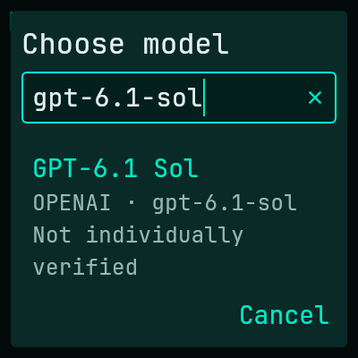

# Static cloud catalog expansion and search — evidence

**Implemented source and separate component/build/package PASS. Overall aggregate acceptance remains FAIL; not deployed.** [Bounded plan](../../plans/LOCAL-SMITH-NEXT-CLOUD-CATALOG-EXPANSION.md), [independent assurance](../../plans/LOCAL-SMITH-NEXT-CLOUD-CATALOG-EXPANSION-REVIEW.md), and [validation ledger](../../../next/VALIDATION.md) distinguish the source deliverable from whole-product/release approval.

## Bounded implementation

- Fifteen exact static text-model choices: seven OpenAI and eight Anthropic, including GPT-6 Sol and GPT-6.1 Sol. Rust and Dart catalogs agree; the installer uses the shared service catalog. Existing default validation choices, bounds and strict response-model matching remain unchanged.
- A compact trigger opens a locally searchable LOCAL/CLOUD dialog. Match display label, exact model ID, provider or group; preserve current selection, disabled reasons and not-individually-verified disclosures. Search, clearing, canceling and same-route selection do not change route/draft/queue or call APIs. Explicit selection affects only future sends, with origin/revision/instance/generation/availability fencing.
- No discovery, new HTTP operation, credential/worker/controller/schema/budget change, automatic retry or fallback. Account entitlement is untested; a selected model may fail on an explicit send. The operator's availability allowance does not waive quality gates or authorize live probes.

## Final separate checks

[Command/status evidence](final.json), [suite counts](suite-counts.json), [source manifest](source-manifest.json) and [all exported identities](artifacts.json) bind the following sequential commands, each run once from `next/`:

| Gate | Observed result |
|---|---|
| `make service/test` | 258 passed; three controlled fixture ignores; formatting/warning-denied Clippy clean |
| `make installer/test` | 279 native + nine isolated GTK passed; two controlled fixture ignores; interpreter-free Ubuntu CLI runtime passed |
| `make client/test` | 538 passed, zero failed/skipped; formatter/analyzer clean; compiled Rust-Dart gates included |
| `make build` | Paired standalone service/client and full native recipient package exported |
| `python3 dagger/package.py --root installer/dist --verify` | 95 manifest-listed files verified; 97 recipient files total |

Make commands used `env DAGGER_NO_NAG=1 DAGGER_CLOUD_TOKEN= DAGGER_PROGRESS=plain`. All five commands and final recording used the same **1,289 inputs**, SHA256 `205bfa82434e1a4ecbd23f2f9c5455c7d61274c1b96c888b9e3a948453724b03`. Exactly thirteen source/test files differ from the retained initial manifest; only three production files changed. Unrelated Boot/header/logo/scroll work was preserved, inventoried and tested as part of the current snapshot, not authored or independently approved by this task.

The **41 package tests** passed inside the second aggregate on this identical final source snapshot, using actual compiled native installer ELFs. They were **not rerun** during the sequential component/build sequence. This is matching-source evidence reuse, not 41 freshly rerun tests or exported-package verification. The subsequent explicit verification above checks the rebuilt recipient candidate.

All **189 exports** are inventoried: one service, 91 client and 97 recipient files. All four service copies match SHA256 `e5b80a4d1c2a4e687385280a91aa44bec1cabeb7caf59d4387476a10223a708f`; all 91 client/payload pairs match. Recipient manifest SHA256 `d6ab1d2d8392cfa242cd3b66a8689f69a2e382f26de773d214bbb2b0097839cf`. Use the complete `next/installer/dist/` candidate. This is local artifact consistency, not installed acceptance, clean-clone/hermetic provenance, release or deployment authority.

## Failures and remediation retained

1. [First aggregate](aggregate-attempt-1.json): stable1,289 inputs; exit2; Flutter535 passed/two failed because two historical-route entrance tests cast the new TextButton trigger to the old DropdownButton type. Remaining concurrent gates were incomplete/canceled; no current package was verified. Those tests were repaired to exercise the actual picker while retaining unavailable/historical routing, history, readiness and no-effect/no-replay assertions. The new real split-pane unsent-chat regression closed reviewer L1. No production change or golden refresh was made for remediation.
2. [Second aggregate](aggregate-attempt-2.json): stable final1,289 inputs; exit2; unchanged runner/provider code failed `provider_prefers_full_vulkan_and_falls_back_once_only_before_completion_dispatch` at `service/tests/runner.rs:2130`, `RUNNER_BUSY: Model verification could not acquire or retain its bounded runner lease`. Service257 passed/one failed; Flutter529 passes were observed before cancellation, **not full-suite acceptance**. Installer279/package41 completed; GTK canceled; build not reached.

No third aggregate or runner source/test relaxation occurred. Standalone component passes establish only those executions; they do not establish cause, equivalence to earlier runner failures, harmlessness or resolution. The initial picker-test defects are remediated; the second aggregate failure remains unresolved and unaccepted. Pre-build mixed/stale exports in earlier reports are not the final rebuilt candidate.

Focused implementation evidence remains at `next/service/build/cloud-catalog-expansion/backend/` (61 tests, exact catalog regression/requests/sends/readiness/strict negatives) and `next/client/build/cloud-catalog-expansion/` (54 initial focused tests including real Rust catalog/socket coverage, then74 in the test-remediation run). Counts overlap broader gates and must not be added as unique tests. Initial test-only warnings/failed assumptions and held-Enter reopening were remediated and retained there. Source copies, scoped patches, command logs/statuses and initial inventory remain under ignored build roots; no earlier task evidence was rewritten.

## Presentation evidence

This bundled-font Flutter widget capture shows a filtered GPT-6.1 Sol result and not-individually-verified status. It is a synthetic isolated test, not the installed desktop, native IME/accessibility acceptance, or proof that every row fits simultaneously. Additional initial, scrolling and disabled-reason captures remain in the client evidence root. Narrow/enlarged layout and reachability tests passed.

## Safety and authority limits

No normal-host credentials/keyring, installed service/manager/state, vendor Models API or inference, model download, commit, branch mutation, publication or deployment was accessed/performed. Only public documentation research preceded the static additions. Source self-check and independent review cannot approve external effects or accept the runner risk. The running installation remains unchanged. Approval for any later paired upgrade is separate.

Owner-writable before/after hashes detect snapshot/artifact drift; they are not signed provenance or continuous monitoring. Generated/cache roots and the root validation ledger are excluded from build-input inventories as recorded in the manifest; later documentation-only evidence additions do not retroactively change tested source identities.
